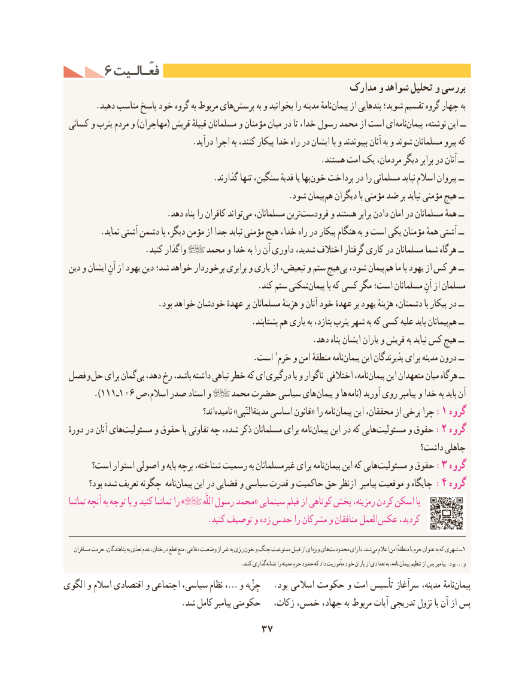

# PDF page 47

6 فعّـالـیتفعّـالـیت
                                                      مدارک و شواهد تحلیل و بررسی
.‌دهید مناسب پاسخ خود گروه به مربوط هایپرسش به و بخوانید را مدینه نامهٔپیمان‌     از بندهایی شوید؛ تقسیم گروه چهار به
 کسانی و یثرب مردم و )مهاجران( قریش قبیلهٔ مسلمانان و مؤمنان میان در تا خدا، رسول محمد از است اینامه‌   پیمان‌     نوشته، این ــ
                               .درآید اجرا به کنند، پیکار خدا راه در ایشان با و بپیوندند آنان به و شوند مسلمانان پیرو که
                                                             .هستند امت یک مردمان، دیگر برابر در آنان ــ
   .‌گذارند تنها سنگین، فدیهٔ یا بهاخون پرداخت در را مسلمانی نباید اسالم پیروان ــ
            .‌شود پیمانهم دیگران با مؤمنی ضد بر نباید مؤمنی هیچ ــ
   .‌دهد پناه را کافران تواندمی مسلمانان، ترینفرودست‌       و هستند برابر دادن امان در مسلمانان همهٔ ــ
         .نماید آشتی دشمن با دیگر، مؤمن از جدا نباید مؤمنی هیچ خدا، راه در پیکار هنگام به و است یکی مؤمنان همهٔ آشتی ــ
                   .کنید واگذار    محمد و خدا به را آن داوری شدید، اختالف گرفتار کاری در مسلمانان شما هرگاه ــ
 دین و ایشان آنِ از یهود دین شد؛ خواهد برخوردار برابری و یاری از تبعیض، و ستم هیچبی‌  شود، پیمان هم ما با یهود از کس هر ــ
       .‌کند ستم شکنیپیمان با که کسی مگر است؛ مسلمانان آنِ از مسلمان
                       .بود خواهد خودشان عهدهٔ بر مسلمانان هزینهٔ و آنان خود عهدهٔ بر یهود هزینهٔ دشمنان، با پیکار در ــ
  .‌بشتابند هم یاری به بتازد، یثرب شهر به که کسی علیه باید پیمانانهم ــ
                                                           .دهد پناه ایشان یاران و قریش به نباید کس هیچ ــ
               .1است حَرم و امن منطقهٔ نامهپیمان‌     این پذیرندگان برای مدینه درون ــ
 فصل و حل برای گمانبی‌  دهد، رخ باشد، داشته تباهی خطر که ای درگیری یا و ناگوار اختالفی نامه،پیمان‌     این متعهدان میان هرگاه ــ
       ).111ـ106 اسالم،ص صدر اسناد و    محمد حضرت سیاسی های پیمان و ها نامه( آورید روی پیامبر و خدا به باید آن
                                               اند؟نامیده‌     »النّبیمدینة‌   اساسی قانون« را نامهپیمان‌:این محققان، از برخی چرا 1 گروه
  دورهٔ در آنان هایمسئولیت‌       و حقوق با تفاوتی چه شده، ذکر مسلمانان برای نامهپیمان‌     این در که هاییمسئولیت‌:و حقوق 2 گروه
                                                                              داشت؟ جاهلی
      است؟ استوار اصولی و پایه برچه شناخته، رسمیت به غیرمسلمانان برای نامهپیمان‌     این که هاییمسئولیت‌:و حقوق 3 گروه
        بود؟ شده تعریف چگونه نامهپیمان‌:این در قضایی و سیاسی قدرت و حاکمیت حق ازنظر پیامبر موقعیت و جایگاه  4 گروه
 تماشا آنچه به توجه با و کنید تماشا را »          اللّٰه رسول محمد« سینمایی فیلم از کوتاهی بخش رمزینه، کردن اسکن با
  . کنید توصیف و زده حدس را مشرکان و منافقان العمل عکس کردید،

    مسافران حرمت پناهندگان، به تعدّی عدم درختان، قطع منع دفاعی، وضعیت از غیر به ریزی خون و جنگ ممنوعیت قبیل از ای ویژه های محدودیت دارای شد، می اعالم امن منطقهٔ یا حرم عنوان به که شهری ــ1
                                                                  .کنند گذاری نشانه را مدینه حرم حدود که داد مأموریت خود یاران از تعدادی به نامه، پیمان تنظیم از پس پیامبر .بود … و
الگوی و اسالم اقتصادی و اجتماعی سیاسی، نظام ،… و جِزْیه   .بود اسالمی حکومت و امت تأسیس سرآغاز مدینه، نامهٔپیمان‌
                            .شد کامل پیامبر حکومتی   زکات، خمس، جهاد، به مربوط آیات تدریجی نزول با آن از پس
                                 37

