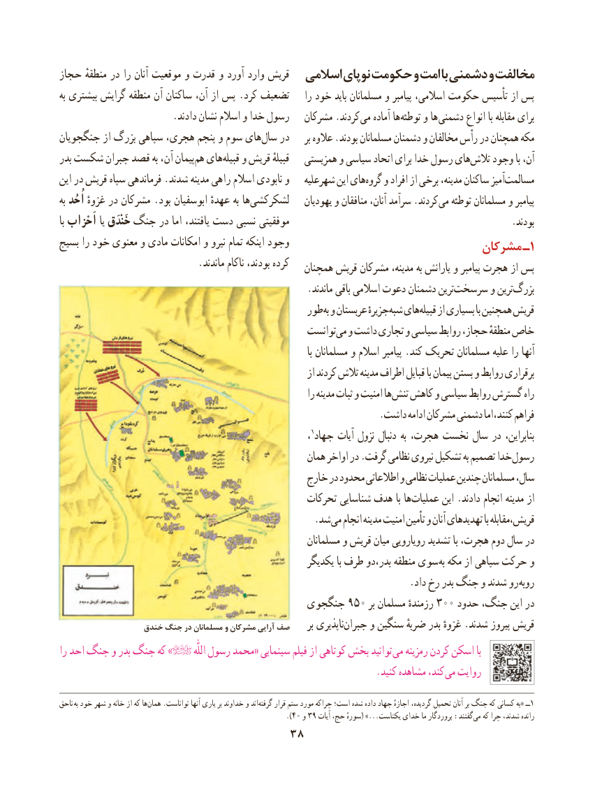

# PDF page 48

حجاز منطقهٔ در را آنان موقعیت و قدرت و آورد وارد قریش  اسالمی نوپای حکومت و امت با دشمنی و مخالفت
به بیشتری گرایش منطقه آن ساکنان آن، از پس .کرد تضعیف    را خود باید مسلمانان و پیامبر اسالمی، حکومت تأسیس از پس
                       .دادند نشان اسالم و خدا رسول   مشرکان .کردند می آماده ها توطئه و ها دشمنی انواع با مقابله برای
جنگجویان از بزرگ سپاهی هجری، پنجم و سوم های‌سال در     بر عالوه .بودند مسلمانان دشمنان و مخالفان رأس در همچنان مکه
بدر شکست جبران قصد به آن، پیمانهم‌  های ‌قبیله و قریش قبیلهٔ   همزیستی و سیاسی اتحاد برای خدا رسول هایتالش‌    وجود با آن،
این در قریش سپاه فرماندهی .شدند مدینه راهی اسالم نابودی و   شهرعلیه این هایگروه‌   و افراد از برخی مدینه، ساکنان آمیزمسالمت‌
به اُحُد غزوهٔ در مشرکان .بود ابوسفیان عهدهٔ به ها ‌لشکرکشی    یهودیان و منافقان آنان، سرآمد .کردند می توطئه مسلمانان و پیامبر
با اَحْزاب یا خَنْدَق جنگ در اما یافتند، دست نسبی موفقیتی                                               .بودند
بسیج را خود معنوی و مادی امکانات و نیرو تمام اینکه وجود                                                               مشرکان ـ 1
                            .ماندند ناکام بودند، کرده                                                   همچنان قریش مشرکان مدینه، به یارانش و پیامبر هجرت از پس
                                                   .ماندند باقی اسالمی دعوت دشمنان ترینسرسخت‌       و ترینبزرگ‌
                                               طور به و عربستان جزیرهٔشبه‌  هایقبیله‌    از بسیاری با همچنین قریش
                                                   توانستمی‌  و داشت تجاری و سیاسی روابط حجاز، منطقهٔ خاص
                                                                                                  با مسلمانان و اسالم پیامبر .کند تحریک مسلمانان علیه را آنها
                                                                 از کردند تالش مدینه اطراف قبایل با پیمان بستن و روابط برقراری
                                                                 را مدینه ثبات و امنیت ها تنش کاهش و سیاسی روابط گسترش راه
     . داشت ادامه مشرکان دشمنی اما ،فراهمکنند
                                                                  ،1جهاد آیات نزول دنبال به هجرت، نخست سال در بنابراین،
                                                      همان اواخر در .گرفت نظامی نیروی تشکیل به تصمیم خدا رسول
                                               خارج در محدود اطالعاتی و نظامی عملیات چندین مسلمانان سال،
                                                  تحرکات شناسایی هدف با ها عملیات این .دادند انجام مدینه از
                                                    .شد می انجام مدینه امنیت تأمین و آنان تهدیدهای با قریش،مقابله
                                                            مسلمانان و قریش میان رویارویی تشدید با هجرت، دوم سال در
                                                        یکدیگر با طرف بدر،دو منطقه سوی به مکه از سپاهی حرکت و
      . داد رخ بدر جنگ و شدند رو روبه
                                       جنگجوی 950 بر مسلمان رزمندهٔ 300 حدود جنگ، این در
                 خندق جنگ در مسلمانان و مشرکان آرایی صف     بر ناپذیریجبران‌     و سنگین ضربهٔ بدر غزوهٔ .شدند پیروز قریش
را احد جنگ و بدر جنگ که »           اللّٰه رسول محمد« سینمایی فیلم از کوتاهی بخش توانید می رمزینه کردن اسکن با
         . کنید مشاهده کند، می روایت

ناحق به خود شهر و خانه از که ها ‌همان .تواناست آنها یاری بر خداوند و اند‌گرفته قرار ستم مورد چراکه است؛ شده داده جهاد اجازهٔ گردیده، تحمیل آنان بر جنگ که کسانی به« ــ1
                                                              .)40 و 39 آیات حج، سورهٔ( ...»یکتاست خدای ما پروردگار :گفتندمی‌  که چرا شدند، رانده
                                38

