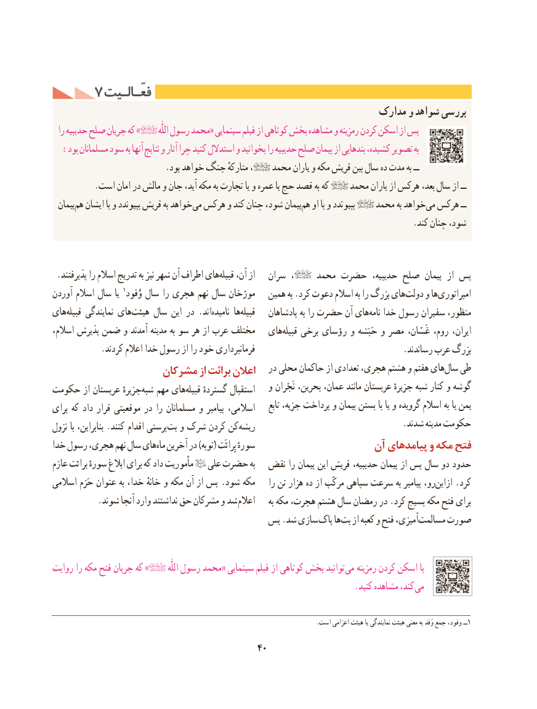

# PDF page 50

7 فعّـالـیتفعّـالـیت
                                                           مدارک و شواهد بررسی
  را حدیبیه صلح جریان که »          اللّٰه رسول محمد« سینمایی فیلم از کوتاهی بخش مشاهده و رمزینه کردن اسکن از پس
  :بود مسلمانان سود به آنها نتایج و آثار چرا کنید استدالل و بخوانید را حدیبیه صلح پیمان از بندهایی کشیده، تصویر به
                          .بود خواهد جنگ متارکهٔ ،    محمد یاران و مکه قریش بین سال ده مدت به ــ
          .است امان در مالش و جان آید، مکه به تجارت یا و عمره یا حج قصد به که    محمد یاران از هرکس بعد، سال از ــ
  پیمانهم‌  ایشان با و بپیوندد قریش به خواهدمی‌  هرکس و کند چنان شود، پیمانهم‌  او با و بپیوندد    محمد به خواهدمی‌  هرکس ــ
                                                                                    .کند چنان شود،

.‌پذیرفتند را اسالم تدریج به نیز شهر آن اطراف هایقبیله آن، از   سران  ،     محمد حضرت حدیبیه، صلح  پیمان  از پس
آوردن اسالم سال یا ۱مورّخانوُفود سال را هجری نهم سال          همین به .کرد دعوت اسالم به را بزرگ هایدولت‌    و هاامپراتوری‌
هایقبیله‌     نمایندگی هایهیئت‌    سال این در .اندنامیده‌      هاقبیله‌       پادشاهان به را حضرت آن هاینامه‌   خدا رسول سفیران منظور،
اسالم، پذیرش ضمن و آمدند مدینه به سو هر از عرب مختلف   هایقبیله‌    برخی رؤسای و حَبَشه و مصر غَسّان، روم، ایران،
           .کردند اعالم خدا رسول از را خود فرمانبرداری                                  .رساندند عرب بزرگ
                   مشرکان از برائت اعالن   در محلی حاکمان از تعدادی هجری، هشتم و هفتم هایسال‌  طی
                                                  و نَجْران بحرین، عمان، مانند عربستان جزیرهٔ شبه کنار و گوشهحکومت از عربستان جزیرهٔشبه‌   مهم هایقبیله‌    گستردهٔ استقبال
                                                                              تابع جزیه، پرداخت و پیمان بستن با یا و گرویده اسالم به یا یمنبرای که داد قرار موقعیتی در را مسلمانان و پیامبر اسالمی،
                                                                                 .شدند مدینه حکومتنزول با بنابراین، .کنند اقدام پرستیبت‌  و شرک کردن کن ریشه
خدا رسول هجری، نهم سال هایماه‌  آخرین در )توبه( بِرائَت سورهٔ                    آن پیامدهای و مکه فتح
عازم برائت سورهٔ ابالغ برای که داد مأموریت   علی حضرت به  نقض را پیمان این قریش حدیبیه، پیمان از پس سال دو حدود
اسالمی حَرَم عنوان به خدا، خانهٔ و مکه آن از پس .شود مکه    را تن هزار ده از مرکّب سپاهی سرعت به پیامبر رو،ازاین‌    .کرد
           .شوند آنجا وارد نداشتند حق مشرکان و شد اعالم     به مکه هجرت، هشتم سال رمضان در .کرد بسیج مکه فتح برای
                                    پس .شد سازی پاک هابت‌   از کعبه و فتح آمیزی،مسالمت‌    صورت

روایت را مکه فتح جریان که »           اللّٰه رسول محمد« سینمایی فیلم از کوتاهی بخش توانید می رمزینه کردن اسکن با
          . کنید مشاهده کند، می

                                                                                      .است۱اعزامی هیئت یا نمایندگی هیئت معنی به وَفد جمع وفود، ــ
                                           40

