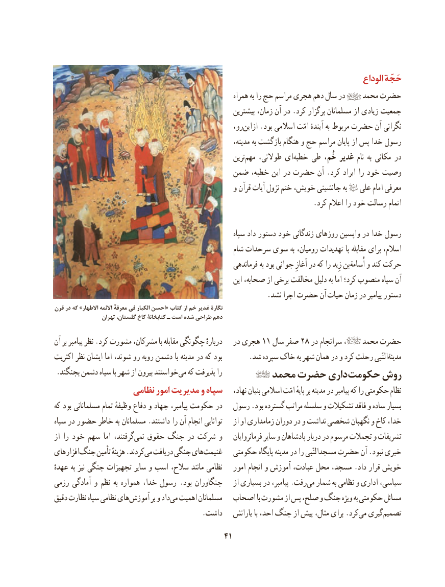

# PDF page 51

..                                                                                         الوداع ‌حَجّه
                                                            همراه به را حج مراسم هجری دهم سال در    محمد حضرت
                                                          بیشترین زمان، آن در .کرد برگزار مسلمانان از زیادی جمعیت
                                                      رو،‌ازاین .بود اسالمی امّت آیندهٔ به مربوط حضرت آن نگرانی
                                                                 مدینه، به بازگشت هنگام و حج مراسم پایان از پس خدا رسول
                                                             ترین‌مهم طوالنی، ای‌خطبه طی خُم، غدیر نام به مکانی در
                                   ضمن خطبه، این در حضرت آن .کرد ایراد را خود وصیت
                                                  و قرآن آیات نزول ختم خویش، جانشینی به   علی امام معرفی
                                                                         .کرد اعالم را خود رسالت اتمام

                                                             سپاه داد دستور خود زندگانی روزهای واپسین در خدا رسول
                                                     شام سرحدات سوی به رومیان، تهدیدات با مقابله برای اسالم،
                                                          فرماندهی به بود جوانی آغازِ در که را زِید بن اُسامة و کند حرکت
                                                             این صحابه، از برخی مخالفت دلیل به اما کرد؛ منصوب سپاه آن
                                                            .نشد اجرا حضرت آن حیات زمان در پیامبر دستور
قرن در که »االطهار االئمهمعرفه فی الکبار احسن« کتاب از خم غدیر نگارۀ
                  تهران گلستان، کاخ کتابخانۀ ـ است شده طراحی دهم

آن بر پیامبر نظر .کرد مشورت مشرکان، با مقابله چگونگی دربارهٔ   در هجری 11 سال صفر 28 در سرانجام ،    محمد حضرت
اکثریت نظر ایشان اما شوند، رو روبه دشمن با مدینه در که بود       .شد سپرده خاک به شهر همان در و کرد رحلت مدینةالنّبی
 .بجنگند دشمن سپاه با شهر از بیرون خواستندمی‌  که پذیرفت را        محمد حضرت داری حکومت روش
                  نظامی امور مدیریت و سپاه    نهاد، بنیان اسالمی امّت پایهٔ بر مدینه در پیامبر که را حکومتی نظام
که بود مسلمانانی تمام وظیفهٔ دفاع و جهاد پیامبر، حکومت در   رسول .بود گسترده مراتب سلسله و تشکیالت فاقد و ساده بسیار
سپاه در حضور خاطر به مسلمانان .داشتند را آن انجام توانایی    از او زمامداری دوران در و نداشت شخصی نگهبان و کاخ خدا،
از را خود سهم اما گرفتند،نمی‌   حقوق جنگ در شرکت و    فرمانروایان سایر و پادشاهان دربار در مرسوم تجمالت و تشریفات
افزارهایجنگ‌     تأمین هزینهٔ .کردندمی‌  دریافت جنگی هایغنیمت‌       حکومتی پایگاه مدینه در را مسجدالنّبی حضرت آن .نبود خبری
عهدهٔ به نیز جنگی تجهیزات سایر و اسب سالح، مانند نظامی   امور انجام و آموزش عبادت، محل مسجد، .داد قرار خویش
رزمی آمادگی و نظم به همواره خدا، رسول .بود جنگاوران    از بسیاری در پیامبر، .رفتمی‌  شمار به نظامی و اداری سیاسی،
دقیق نظارت سپاه نظامی های آموزش بر و دادمی‌  اهمیت مسلمانان  اصحاب با مشورت از پس صلح، و جنگ ویژه به حکومتی مسائل
                                         .داشت   یارانش با احد، جنگ از پیش مثال، برای .کردمی‌  گیریتصمیم‌
                                            41

