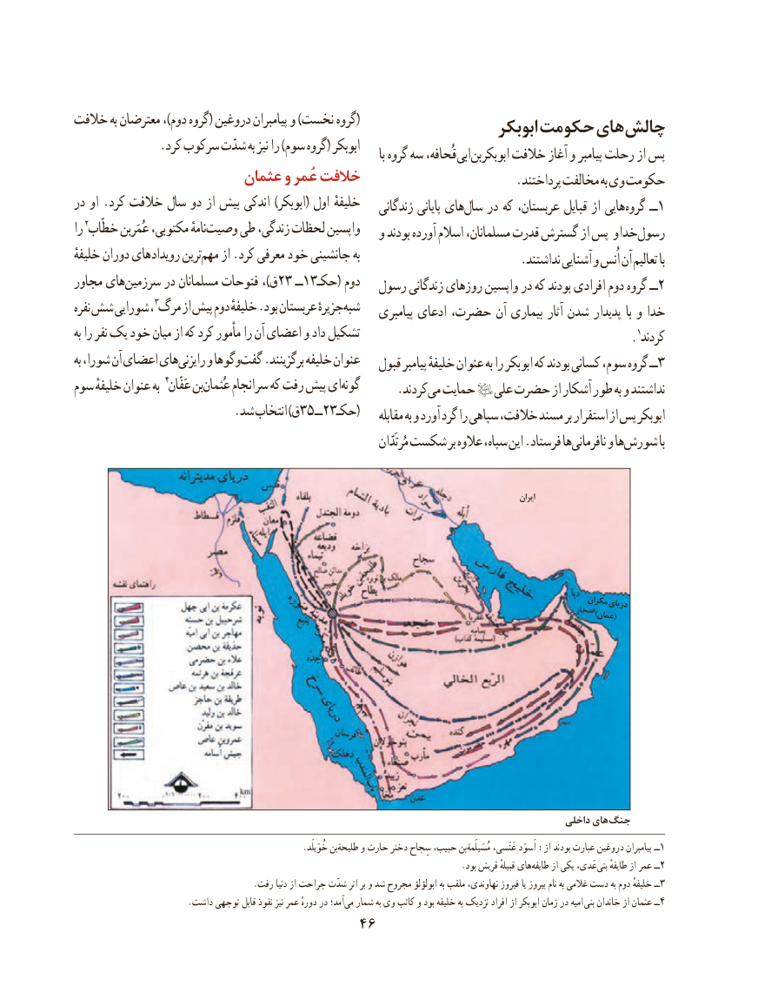

# PDF page 56

خالفت به معترضان ،)دوم گروه( دروغین پیامبران و )نخست گروه(                                                               ابوبکر حکومت های چالش
              .کرد سرکوب شدّت به نیز را )سوم گروه( ابوبکر                                                                                                 با گروه سه قُحافه، ابی ابوبکربن خالفت آغاز و پیامبر رحلت از پس
                      عثمان و عُمر خالفت                                                                         .پرداختند مخالفت به وی حکومت
در او .کرد خالفت سال دو از بیش اندکی )ابوبکر( اول خلیفهٔ                                                              زندگانی پایانی هایسال‌   در که عربستان، قبایل از هایی گروه ١ــ
را خطّاب٢ عُمَربن مکتوبی، نامهٔوصیت‌    طی زندگی، لحظات واپسین                                                  و بودند آورده اسالم مسلمانان، قدرت گسترش از پس و خدا رسول
خلیفهٔ دوران رویدادهای ترینمهم‌    از .کرد معرفی خود جانشینی به                                                                         .نداشتند آشنایی و اُنس آن تعالیم با
مجاور هایسرزمین‌      در مسلمانان فتوحات ،)ق23 ــ13حکـ( دوم                                            رسول زندگانی روزهای واپسین در که بودند افرادی دوم گروه ــ2
نفره شش شورایی مرگ٣، از پیش دوم خلیفهٔ .بود عربستان جزیرهٔشبه‌                                                              پیامبری ادعای حضرت، آن بیماری آثار شدن پدیدار با و خدا
به را نفر یک خود میان از که کرد مأمور را آن اعضای و داد تشکیل                                                                                            .کردند١
به شورا، آن اعضای هایرایزنی‌    و وگوهاگفت‌   .برگزینند خلیفه عنوان                                                       قبول پیامبر خلیفهٔ عنوان به را ابوبکر که بودند کسانی سوم، گروه ــ3
سوم خلیفهٔ عنوان به عَفّان٤ بنعُثمان‌     سرانجام که رفت پیش ایگونه‌                                                     .کردند می حمایت   علی حضرت از آشکار طور به و نداشتند
      .35شد انتخاب )ق    ــ23(حکـ                                                                          مقابله به و آورد گرد را سپاهی خالفت، مسند بر استقرار از پس ابوبکر
                                                                                            مُرتَدّان شکست بر عالوه سپاه، این .فرستاد هانافرمانی‌     و هاشورش‌          با

                                                                                                                                             ایران

                                                                                                                مکراندریای
                                                                                         )عمان(

                                                                                                 داخلی های جنگ
            .‌خُوَیلَد بنطلیحة و حارث دختر سِجاح حبیب، بنمُسَیلَمة‌       عَنَسی، اَسوَد :از بودند عبارت دروغین پیامبران ١ــ
           .‌بود قریش قبیلهٔ هایطایفه از یکی عَدی، ‌بنی طایفهٔ از عمر ٢ــ
                                         .رفت دنیا از جراحت شدّت اثر بر و شد مجروح ابولؤلؤ به ملقب نهاوندی، فیروز یا پیروز نام به غالمی دست به دوم خلیفهٔ ٣ــ
                          .داشت توجهی قابل نفوذ نیز عمر دورهٔ در آمد؛می‌  شمار به وی کاتب و بود خلیفه به نزدیک افراد از ابوبکر زمان در امیه  بنی خاندان از عثمان ٤ــ
                                   46

