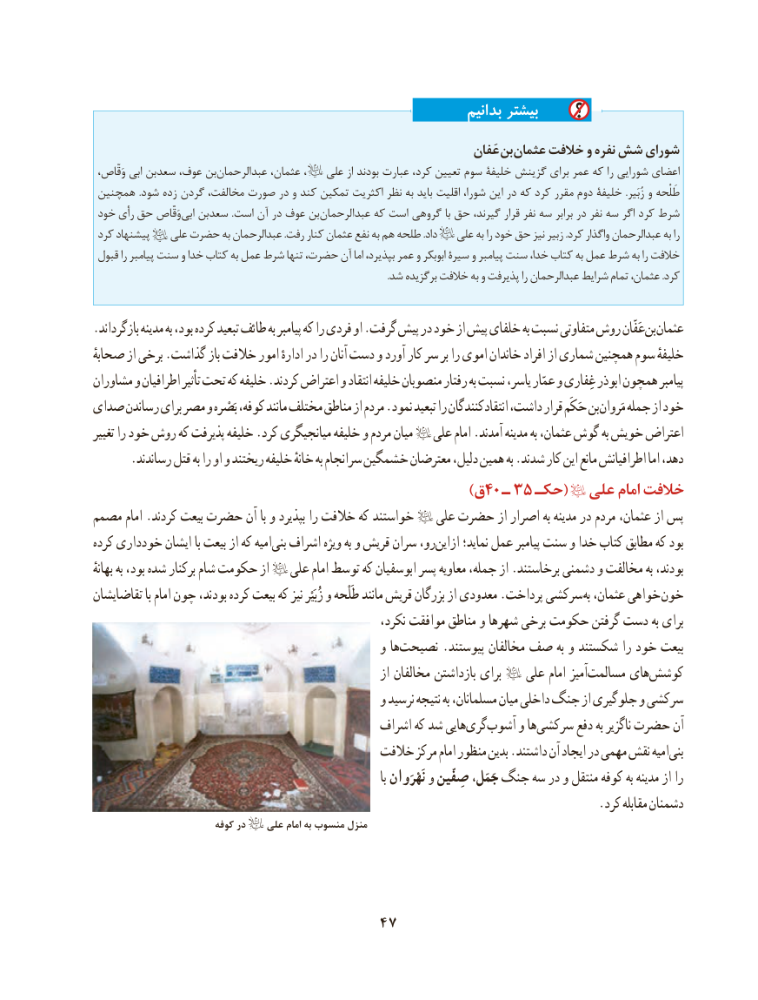

# PDF page 57

بدانیم بیشتر
                                                                       عَفان بن عثمان خالفت و نفره شش شورای
 وَقّاص، ابی سعدبن عوف، بن ‌عبدالرحمان عثمان، ،    علی از بودند عبارت کرد، تعیین سوم خلیفۀ گزینش برای عمر که را شورایی اعضای
 همچنین .شود زده گردن مخالفت، صورت در و کند تمکین اکثریت نظر به باید اقلیت شورا، این در که کرد مقرر دوم خلیفۀ .زُبَیر و طَلحهْ
 خود رأی حق وَقّاص‌ابی سعدبن .است آن در عوف بن‌عبدالرحمان که است گروهی با حق گیرند، قرار نفر سه برابر در نفر سه اگر کرد شرط
 کرد پیشنهاد   علی حضرت به عبدالرحمان .رفت کنار عثمان نفع به هم طلحه .داد   علی به را خود حق نیز زبیر .کرد واگذار عبدالرحمان به را
 قبول را پیامبر سنت و خدا کتاب به عمل شرط تنها حضرت، آن اما بپذیرد، عمر و ابوبکر سیرۀ و پیامبر سنت خدا، کتاب به عمل شرط به را خالفت
                                                                                                                              .شد برگزیده خالفت به و پذیرفت را عبدالرحمان شرایط تمام عثمان، .کرد

.بازگرداند مدینه به بود، کرده تبعید طائف به پیامبر که را فردی او .گرفت پیش در خود از پیش خلفای به نسبت متفاوتی روش عَفّان بن عثمان
صحابهٔ از برخی .گذاشت باز خالفت امور ادارهٔ در را آنان دست و آورد کار سر بر را اموی خاندان افراد از شماری همچنین سوم خلیفهٔ
مشاوران و اطرافیان تأثیر تحت که خلیفه .کردند اعتراض و انتقاد خلیفه منصوبان رفتار به نسبت یاسر، عمّار و غِفاری ابوذر همچون پیامبر
صدای رساندن برای مصر و بَصْره کوفه، مانند مختلف مناطق از مردم .نمود تبعید را انتقادکنندگان داشت، قرار حَکَم بن مَروان جمله از خود
تغییر را خود روش که پذیرفت خلیفه .کرد میانجیگری خلیفه و مردم میان   علی امام .آمدند مدینه به عثمان، گوش به خویش اعتراض
      .رساندند قتل به را او و ریختند خلیفه خانهٔ به سرانجام خشمگین معترضان دلیل، همین به .شدند کار این مانع اطرافیانش اما دهد،
                                   )40ق  ـ 35 حكـ(  علی امام خالفت
مصمم امام .کردند بیعت حضرت آن با و بپذیرد را خالفت که خواستند    علی حضرت از اصرار به مدینه در مردم عثمان، از پس
کرده خودداری ایشان با بیعت از که امیهبنی‌  اشراف ویژه به و قریش سران رو،ازاین‌     نماید؛ عمل پیامبر سنت و خدا کتاب مطابق که بود
بهانهٔ به بود، شده برکنار شام حکومت از   علی امام توسط که ابوسفیان پسر معاویه جمله، از .برخاستند دشمنی و مخالفت به بودند،
تقاضایشان با امام چون بودند، کرده بیعت که نیز زُبَیْر و طَلْحه مانند قریش بزرگان از معدودی .پرداخت سرکشی به عثمان، خواهی خون
                                                        نکرد، موافقت مناطق و شهرها برخی حکومت گرفتن دست به برای
                                                و هانصیحت‌       .پیوستند مخالفان صف به و شکستند را خود بیعت
                                                            از مخالفان بازداشتن برای        علی امام آمیزمسالمت‌      هایکوشش‌
                                                و نرسید نتیجه به مسلمانان، میان داخلی جنگ از جلوگیری و سرکشی
                                             اشراف که شد هاییگری‌  آشوب‌     و هاسرکشی‌       دفع به ناگزیر حضرت آن
                                          خالفت مرکز امام منظور بدین .داشتند آن ایجاد در مهمی نقش امیهبنی‌
                                                                                           با نَهْرَوان و صِفّین جَمَل، جنگ سه در و منتقل کوفه به مدینه از را
                                                                                   .کرد مقابله دشمنان
                          کوفه در    علی امام به منسوب منزل

                                 47

