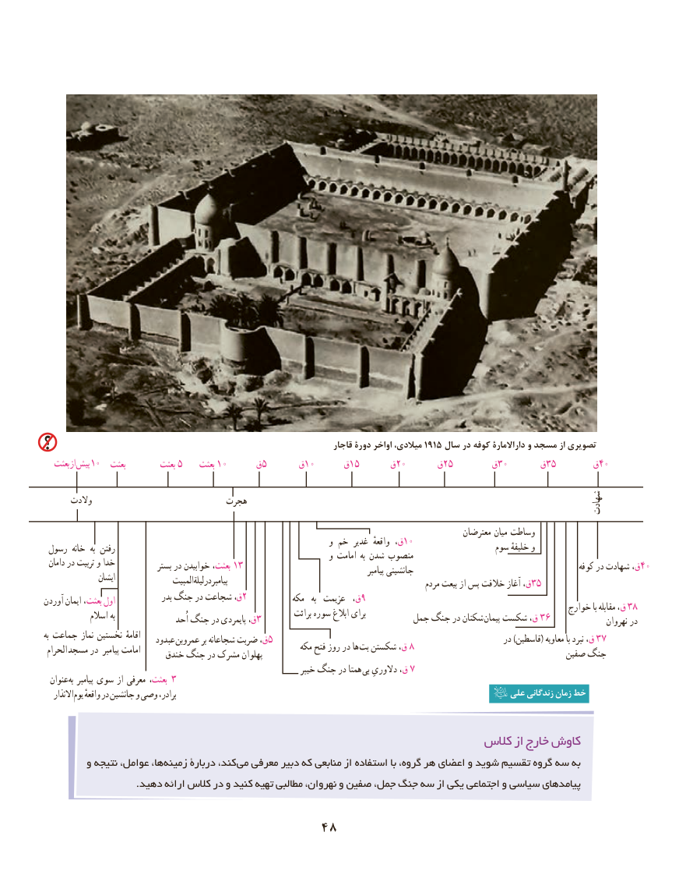

# PDF page 58

قاجار دورۀ اواخر میالدی، 1915 سال در کوفه داراالمارۀ و مسجد از تصویری
   بعثت از پیش 10  بعثت         بعثت 5    بعثت 10     ق5      ق10     ق15      ق20      ق25       ق30      ق35       ق40

      والدت                          هجرت                                                                                  شهادت
                                                                                                         معترضان میان وساطت                                                                      و خم غدیر  واقعهٔ ق،10 رسول خانه  به رفتن                                                                                   سوم خلیفهٔ و                                                                      و امامت  به شدن منصوب دامان در تربیت و خدا            بستر در خوابیدن بعثت، 13                                                                                                                    پیامبر جانشینی                                            کوفه در شهادت ق،40                ایشان                المبیت لیلةدرپیامبر                                                      مردم بیعت از پس خالفت آغاز ق،35
                                  بدر جنگ در شجاعت ق،2           مکه   به  عزیمت  ق،9آوردن ایمان بعثت، اول                                                                                                                    خوارج با مقابله ق، 38                                                                       برائت سوره ابالغ برای             اسالم به                                         اُحد جنگ در پایمردی ق،3                                                                    جمل جنگ در شکنان پیمان شکست ق، 36                نهروان در
به جماعت نماز نخستین اقامهٔ                             عبدود  عمروبن بر شجاعانه ضربت ق،5                                                         در )قاسطین( معاویه با نبرد ق، 37 الحرام  مسجد در  پیامبر امامت                                        مکه فتح روز در ها بت شکستن ق، 8                          خندق جنگ در مشرک پهلوان                                                              صفین جنگ
                                                                     خیبر جنگ در همتا  بی دالوریِ ق، 7  عنوان به پیامبر سوی از معرفی بعثت، 3
   االنذار یوم واقعهٔ در جانشین و وصی برادر،                                                                  علی زندگانی زمان خط

                                                               کالس از خارج کاوش
        و نتیجه عوامل، ها،زمینه‌     دربارۀ کند، می معرفی دبیر که منابعی از استفاده با گروه، هر اعضای و شوید تقسیم گروه سه به
                             .دهید ارائه کالس در و کنید تهیه مطالبی نهروان، و صفین جمل، جنگ سه از یکی اجتماعی و سیاسی پیامدهای

                                   48

