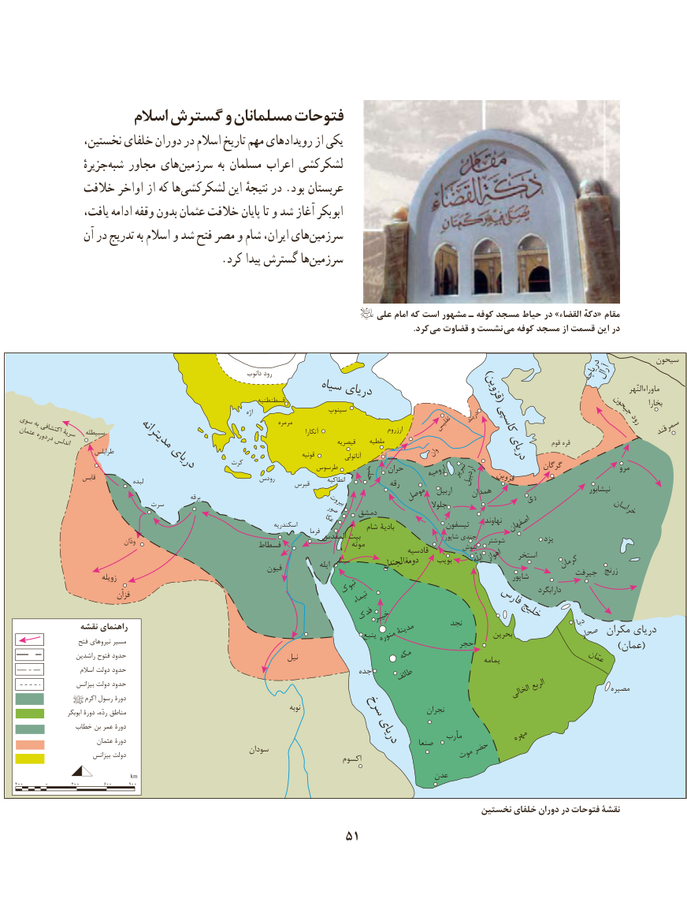

# PDF page 61

اسالم گسترش و مسلمانان فتوحات
             نخستین، خلفای دوران در اسالم تاریخ مهم رویدادهای از یکی
                 جزیرهٔ ‌شبه مجاور های‌سرزمین به مسلمان اعراب لشکرکشی
           خالفت اواخر از که هالشکرکشی‌          این نتیجهٔ در .بود عربستان
              یافت، ادامه وقفه بدون عثمان خالفت پایان تا و شد آغاز ابوبکر
              آن در تدریج به اسالم و شد فتح مصر و شام ایران، هایسرزمین‌
     .‌کرد پیدا گسترش هاسرزمین

                                                                       علی امام که است مشهور ـ کوفه مسجد حیاط در »القضاءدکه« مقام
                                            . کرد می قضاوت و نشست  می کوفه مسجد از قسمت این در

                                                                                                                                            ﺳﻴﺤﻮﻥ
                                                                               ﺩﺍﻧﻮﺏ ﺭﻭﺩ                                                                 ﻗﻔﻘﺎﺯ                                 ﺩﺭﻳﺎﭼﻪﺁﺭﺍﻝ
                                                    ﺳﻴﺎﻩ                                                                          ﻬﺮﺍﻟﻨءﻣﺎﻭﺭﺍ                                                      ﺩﺭﻳﺎﻯ                       )ﻗﺰﻭﻳﻦ(                                                                        ﻗﺴﻄﻨﻄﻨﻴﻪ                                                                                                                                                                                                                                ﺑﺨﺎﺭﺍ                                                                                        ﻩژﺍ             پﺳﻴﻨﻮ                                                  ﺟﻴﺤﻮﻥ                                                                                                                          ﺩﺭﺑﻨﺪ                         ﺭﻭﺩ ﺳﻮﻯﺑﻪ                                                                                   ﻣﺮﻣﺮﻩ                                                                                                                                                   ﺍﺭﺯﺭﻭﻡ       ﺗﻔﻠﻴﺲ       ﻛﺎﺳﭙﻰ                            ﺳﻤﺮﻗﻨﺪ ﻋﺜﻤﺎﻥ ﺍﻛﺘﺸﺎﻓﻰﺳﺮﻳﺔ   ﺳﺒﻴﻄﻠﻪ                                                                                              ﺁﻧﻜﺎﺭﺍ      ﺩﺭﺩﻭﺭﻩ          ﺍﻧﺪﻟﺲ                                                                                       ﻗﻴﺼﺮﻳﻪ     ﻣﻠﻄﻴﻪ                                                          ﻗﻮﻡ ﻗﺮﻩ                       ﻣﺪﻳﺘﺮﺍﻧﻪ                        ﻃﺮﺍﺑﻠﺲ                                                                                                                 ﻗﻮﻧﻴﻪ            ﺁﻧﺎﺗﻮﻟﻰ             ﻭﺍﻥ           ﺩﺭﻳﺎﻯ                                                      ﻛﺮﺕ                      ﺩﺭﻳﺎﻯ                                                                     ﻃﺮﺳﻮﺱ             ﺣﺮﺍﻥ                                    ﮔﺮﮔﺎﻥ                 ﻣﺮﻭ                                                                  ﺣﻠﺐ                                                                                                              ﺍﺭﻭﻣﻴﻪ ﺗﺒﺮﻳﺰ                    ﻗﺎﺑﺲ                                                                                                                                         ﺍﺭﺩﺑﻴﻞ    ﻗﺰﻭﻳﻦ                                             ﻟﺒﺪﻩ                             ﺭﻭﺩﺱ     ﻗﺒﺮﺱ       ﺍﻧﻄﺎﻛﻴﻪ                                                                                                                 ﺭﻗﻪ                                                                                                                                                                                           ﻧﻴﺸﺎﺑﻮﺭ                                                                                                                                         ﺍﺭﺑﻴﻞ    ﻫﻤﺪﺍﻥ                                                                   ﻣﻮﺻﻞ                                                               ﺭﻯ                                                                     ﺑﺮﻗﻪ                                 ﺑﻴﺮﻭﺕ                               ﺳﺮﺕ                                                                                                        ﺟﻠﻮﻻ                                                              ﺻﻮﺭ    ﺩﻣﺸﻖ                                                   ﺧﺮﺍﺳﺎﻥ                                                                     ﻋﻜﺎ                                                                                        ﺍﺳﻜﻨﺪﺭﻳﻪ                                                                                            ﺷﺎﻡ ﺑﺎﺩﻳﺔ             ﺗﻴﺴﻔﻮﻥ                                                                                                                                                                 ﻧﻬﺎﻭﻧﺪ ﺍﺻﻔﻬﺎﻥ                                                                                                                      ﻓﺮﻣﺎ
                                                                           ﺍﻟﻤﻘﺪﺱ ﺑﻴﺖ                              ﺷﺎﭘﻮﺭ ﺟﻨﺪﻯ   ﺷﻮﺷﺘﺮ            ﻳﺰﺩ                                     ﺍﻥﻭﺩ                                                      ﻓﺴﻄﺎﻁ                     ﻣﻮﺗﻪ                    ﺷﻮﺵ                                                                                                               ﻗﺎﺩﺳﻴﻪ                                                                                                                ﺑﻮﻳﺐ  ﻪﺍﺑﻠّ ﺍﻫﻮﺍﺯ    ﺍﺳﺘﺨﺮ                                                                                                                       ﻛﺮﻣﺎﻥ                                                                   ﻓﻴﻮﻥ               ﺍﻳﻠﻪ              الجندلدومة                                                                                                                      ﺯﺭﻧﺞﺟﻴﺮﻓﺖ                            ﺯﻭﻳﻠﻪ                                                                                                                       ﺷﺎﭘﻮﺭ
                                                          ﺗﺒﻮﻙ                                                             ﺩﺍﺭﺍﺑﮕﺮﺩ                  ﻥﻓﺰﺍ                               ءﺗﻴﻤﺎ                  ﻓﺎﺭﺱ
                                                 ﻓﺪﻙﺧﻴﺒﺮ                  ﺧﻠﻴﺞ                                                                                                              ﻧﺠﺪ                             ﺩﺑﺎ               ﻧﻘﺸﻪ                     ﺭﺍﻫﻨﻤﺎﻯ                                                                                        ﻣﺪﻳﻨﺔ                                                                                                                           ﺑﺤﺮﻳﻦ             ﺻﺤﺎﺭ ﻣﻜﺮﺍﻥ ﺩﺭﻳﺎﻯ                                                                                                      ﻳﻨﺒﻊ ﻣﻨﻮﺭﻩ                    ﻓﺘﺢ                         ﻧﻴﺮﻭﻫﺎﻯ                             ﻣﺴﻴﺮ                                                                                             ﺣﺠﺮ                                                                                                                                   )ﻋﻤﺎﻥ(
                                                                              ّﻋﻤ                   ﺭﺍﺷﺪﻳﻦ ﻓﺘﻮﺡ ﺣﺪﻭﺩ                                             ﻧﻴﻞ                 ﻣﻜﻪ                     ﻳﻤﺎﻣﻪ            ﺎﻥ
                   ﺍﺳﻼﻡ ﺩﻭﻟﺖ ﺣﺪﻭﺩ                                                      ﺟﺪﻩ    ﻃﺎﺋﻒ
                    ﺑﻴﺰﺍﻧﺲ ﺩﻭﻟﺖ ﺣﺪﻭﺩ                                                                                                               ﺍﻟﺮﺑﻊ                 ﻣﺼﻴﺮﻩ                         ﺍﻛﺮﻡ ﺭﺳﻮﻝ ﺩﻭﺭﺓ                                                                                                     ﺍﻟﺨﺎﻟﻰ
                                                                                                  ﻧﻮﺑﻪ                      ﺍﺑﻮﺑﻜﺮ ﺩﻭﺭﺓ ،ﻩﺭﺩ ﻣﻨﺎﻃﻖ                                    ﺳﺮﺥ          ﻧﺠﺮﺍﻥ
              ﺧﻄﺎﺏ ﺑﻦ ﻋﻤﺮ ﺩﻭﺭﺓ
                                                                                                            ﻣﺄﺭﺏ          ﻣﻬﺮﻩ                         ﻋﺜﻤﺎﻥ ﺩﻭﺭﺓ                                       ﺩﺭﻳﺎﻯ    ﺻﻨﻌﺎ                                                           ﺳﻮﺩﺍﻥ                                ﺣﻀﺮ                          ﺑﻴﺰﺍﻧﺲ ﺩﻭﻟﺖ                                                         ﺍﻛﺴﻮﻡ                ﻣﻮﺕ
                                km                                                                 ﻋﺪﻥ
300        0         300          600       900

                                                                                            نخستین خلفای دوران در فتوحات نقشۀ
                                                  51

