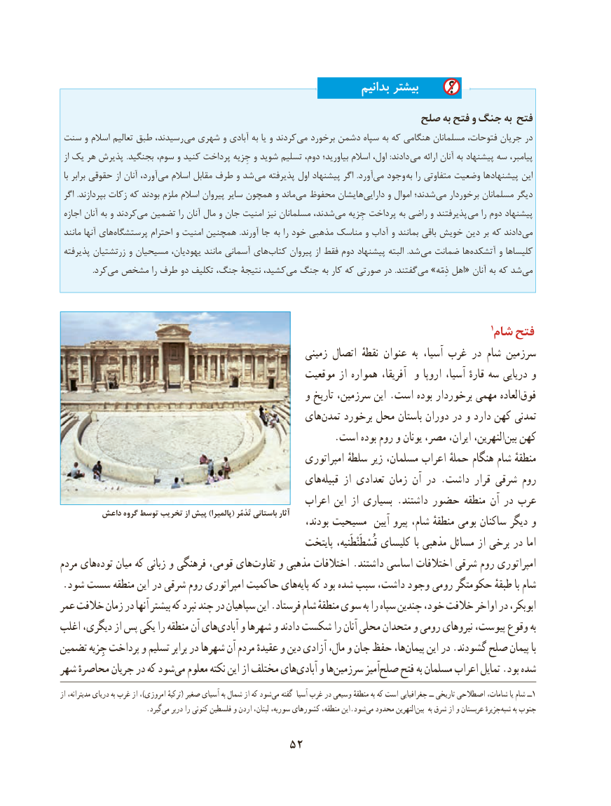

# PDF page 62

بدانیم بیشتر
                                                      صلح به فتح و جنگ به فتح
 سنت و اسالم تعالیم طبق رسیدند، می شهری و آبادی به یا و کردند می برخورد دشمن سپاه به که هنگامی مسلمانان فتوحات، جریان در
 از یک هر پذیرش .بجنگید  ،دادندسوم و کنید پرداخت جِزیه و شوید تسلیم دوم، بیاورید؛ اسالم اول، :       می ارائه آنان به پیشنهاد سه پیامبر،
 با برابر حقوقی از آنان آورد، ‌می اسالم مقابل طرف و شد می پذیرفته اول پیشنهاد اگر  .آورد می‌  وجود به را متفاوتی وضعیت پیشنهادها این
 اگر .بپردازند زکات که بودند ملزم اسالم پیروان سایر همچون و ماند ‌می محفوظ هایشان‌دارایی و اموال شدند؛‌می برخوردار مسلمانان دیگر
 اجازه آنان به و کردندمی‌  تضمین را آنان مال و جان امنیت نیز مسلمانان شدند، ‌می جِزیه پرداخت به راضی و پذیرفتند  می را دوم پیشنهاد
 مانند آنها های ‌پرستشگاه احترام و امنیت همچنین  .آورند جا  به را خود مذهبی مناسک و آداب و بمانند باقی خویش دین بر که دادند‌می
 پذیرفته زرتشتیان و مسیحیان یهودیان، مانند آسمانی های‌کتاب پیروان از فقط دوم پیشنهاد البته  .شد می ضمانت ها‌آتشکده و کلیساها
    .‌کردمی مشخص را طرف دو تکلیف جنگ، نتیجۀ کشید،‌می جنگ به کار که صورتی در .گفتندمی‌  »ذِمّه اهل« آنان به که شدمی‌

                                                                                                                                                  1شام فتح
                                                        زمینی اتصال  نقطهٔ عنوان  به آسیا، غرب در شام سرزمین
                                                 موقعیت از همواره آفریقا،  و اروپا آسیا، قارهٔ سه دریایی و
                                                  و تاریخ سرزمین، این .است بوده برخوردار مهمی العادهفوق‌
                                             های‌تمدن برخورد محل باستان دوران در و دارد کهن تمدنی
                                                        .است بوده روم و یونان مصر، ایران، النهرین،بین‌  کهن
                                                         امپراتوری سلطهٔ زیر مسلمان، اعراب حملهٔ هنگام شام منطقهٔ
                                             های‌قبیله از تعدادی زمان آن در .داشت قرار شرقی روم
                                                   اعراب این از بسیاری .داشتند حضور منطقه آن در عرب
        داعش گروه توسط تخریب از پیش )پالميرا( تَدْمُر باستاني آثار                                                               بودند، مسیحیت  آیین پیرو شام، منطقهٔ بومی ساکنان دیگر و
                                                     پایتخت قُسْطَنْطَنیه، کلیسای با مذهبی مسائل از برخی در اما
مردم های ‌توده میان که زبانی و فرهنگی قومی، های‌تفاوت و مذهبی اختالفات .داشتند اساسی اختالفات شرقی روم امپراتوری
 .شود سست منطقه این در شرقی روم امپراتوری حاکمیت هایپایه‌   که بود شده سبب داشت، وجود رومی حکومتگر طبقهٔ با شام
عمر خالفت زمان در آنها بیشتر که نبرد چند در سپاهیان این .فرستاد شام منطقهٔ سوی به را سپاه چندین خود، خالفت اواخر در ابوبکر،
اغلب دیگری، از پس یکی را منطقه آن هایآبادی‌    و شهرها و دادند شکست را آنان محلی متحدان و رومی نیروهای پیوست، وقوع به
تضمین جِزیه پرداخت و تسلیم برابر در شهرها آن مردم عقیدهٔ و دین آزادی مال، و جان حفظ ها،پیمان‌     این در .گشودند صلح پیمان با
شهر محاصرهٔ جریان در که شودمی‌  معلوم نکته این از مختلف هایآبادی‌    و هاسرزمین‌        آمیزصلح‌    فتح به مسلمان اعراب تمایل .بود شده
از مدیترانه، دریای به غرب از ،)امروزی ترکیهٔ( صغیر آسیای به شمال از که شود‌می گفته آسیا غرب در وسیعی منطقهٔ به که است جغرافیایی ــ تاریخی اصطالحی شامات، یا شام ــ1
                         .گیردمی‌   دربر را کنونی فلسطین و اردن لبنان، سوریه، کشورهای منطقه، این.شودمی‌  محدود النهرینبین‌     به شرق از و عربستان جزیرهٔ‌شبه به جنوب

                                  52

