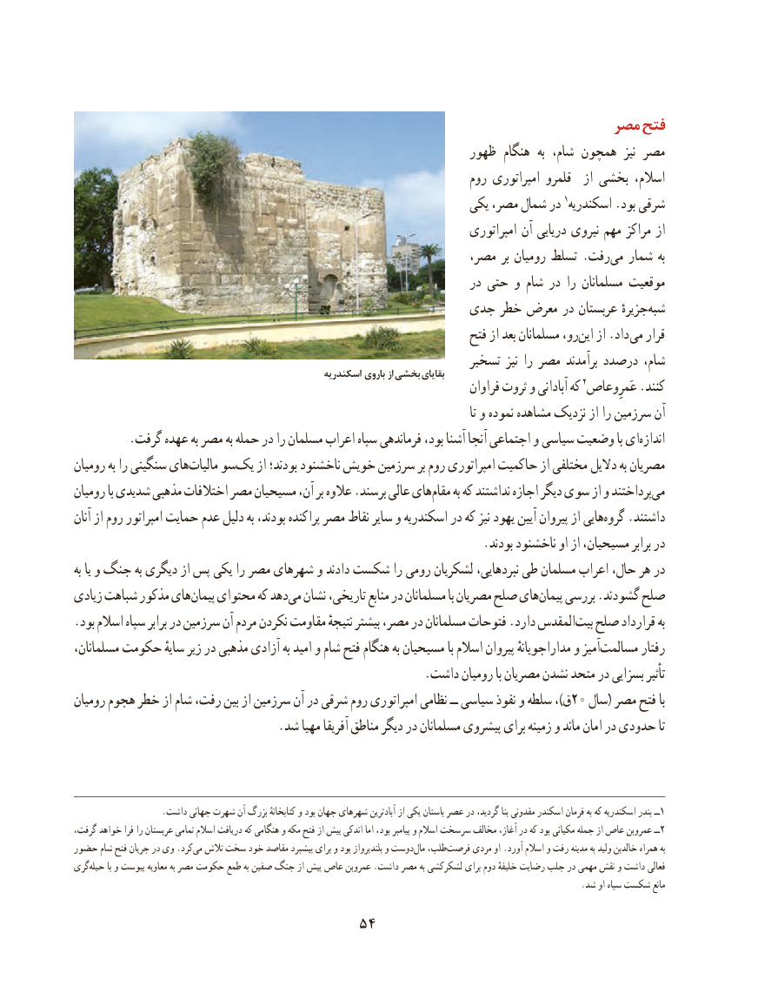

# PDF page 64

مصر فتح
                                                            ظهور هنگام  به شام، همچون  نیز مصر
                                                                     روم امپراتوری قلمرو  از بخشی اسالم،
                                                              یکی مصر، شمال در 1اسکندریه .بود شرقی
                                                                           امپراتوری آن دریایی نیروی مهم مراکز از
                                                           مصر، بر رومیان تسلط .رفتمی‌  شمار به
                                                                   در حتی و شام در را مسلمانان موقعیت
                                              جدی خطر معرض در عربستان جزیرهٔشبه‌
                                                                     فتح از بعد مسلمانان رو،این‌   از .داد می قرار
                                                                تسخیر نیز را مصر برآمدند درصدد شام،                                                     اسكندريه باروی از بخشي بقاياي
                                                                               فراوان ثروت و آبادانی که 2عَمرِوعاص .کنند
                                                                                                                     تا و نموده مشاهده نزدیک از را سرزمین آن
         .گرفت عهده به مصر به حمله در را مسلمان اعراب سپاه فرماندهی بود، آشنا آنجا اجتماعی و سیاسی وضعیت با ایاندازه‌
رومیان به را سنگینی هایمالیات‌    سویک‌    از بودند؛ ناخشنود خویش سرزمین بر روم امپراتوری حاکمیت از مختلفی دالیل به مصریان
رومیان با شدیدی مذهبی اختالفات مصر مسیحیان آن، بر عالوه .برسند عالی هایمقام‌     به که نداشتند اجازه دیگر سوی از و پرداختندمی‌
آنان از روم امپراتور حمایت عدم دلیل به بودند، پراکنده مصر نقاط سایر و اسکندریه در که نیز یهود آیین پیروان از هاییگروه‌   .داشتند
                                                                   .بودند ناخشنود او از مسیحیان، برابر در
به یا و جنگ به دیگری از پس یکی را مصر شهرهای و دادند شکست را رومی لشکریان نبردهایی، طی مسلمان اعراب حال، هر در
زیادی شباهت مذکور هایپیمان‌    محتوای که دهدمی‌  نشان تاریخی، منابع در مسلمانان با مصریان صلح هایپیمان‌    بررسی .گشودند صلح
.بود اسالم سپاه برابر در سرزمین آن مردم نکردن مقاومت نتیجهٔ بیشتر مصر، در مسلمانان فتوحات .دارد المقدسبیت‌  صلح قرارداد به
مسلمانان، حکومت سایهٔ زیر در مذهبی آزادی به امید و شام فتح هنگام به مسیحیان با اسالم پیروان مداراجویانهٔ و آمیزمسالمت‌        رفتار
                                                          .داشت رومیان با مصریان نشدن متحد در بسزایی تأثیر
رومیان هجوم خطر از شام رفت، بین از سرزمین آن در شرقی روم امپراتوری نظامی ــ سیاسی نفوذ و سلطه ،)ق20 سال( مصر فتح با
                                  .شد مهیا آفریقا مناطق دیگر در مسلمانان پیشروی برای زمینه و ماند امان در حدودی تا

                    .داشت جهانی شهرت آن بزرگ کتابخانهٔ و بود جهان شهرهای آبادترین از یکی باستان عصر در گردید، بنا مقدونی اسکندر فرمان به که اسکندریه بندر ــ1
،ــگرفت خواهد فرا را عربستان تمامی اسالم دریافت که هنگامی و مکه فتح از پیش اندکی اما بود، پیامبر و اسالم سرسخت مخالف آغاز، در که بود مکیانی جمله از عاص عمروبن 2
حضور شام فتح جریان در وی .کردمی‌  تالش سخت خود مقاصد پیشبرد برای و بود بلندپرواز و دوست‌مال طلب،‌فرصت مردی او .آورد اسالم و رفت مدینه به ولید خالدبن همراه به
گری ‌حیله با و پیوست معاویه به مصر حکومت طمع به صفین جنگ از پیش عاص عمروبن .داشت مصر به لشکرکشی برای دوم خلیفهٔ رضایت جلب در مهمی نقش و داشت فعالی
                                                                                                                     .شد او سپاه شکست مانع
                                 54

