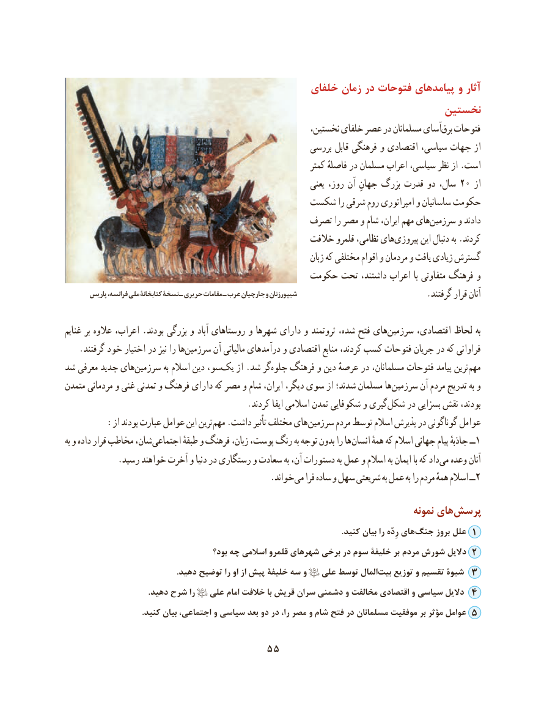

# PDF page 65

خلفای زمان در فتوحات پیامدهای و آثار
                                                              نخستین
                                                          نخستین، خلفای عصر در مسلمانان آسایبرق‌  فتوحات
                                                         بررسی قابل فرهنگی و اقتصادی سیاسی، جهات از
                                                                  کمتر فاصلهٔ در مسلمان اعراب سیاسی، نظر از .است
                                                                    یعنی روز، آن جهانِ بزرگ قدرت دو سال، 20 از
                                      شکست را شرقی روم امپراتوری و ساسانیان حکومت
                                            تصرف را مصر و شام ایران، مهم هایسرزمین‌      و دادند
                                                   خالفت قلمرو نظامی، هایپیروزی‌       این دنبال به .کردند
                                                                        زبان که مختلفی اقوام و مردمان و یافت زیادی گسترش
                                            حکومت تحت داشتند، اعراب با متفاوتی فرهنگ و
       پاریس فرانسه، ملی کتابخانۀ نسخۀ ـ حریری مقامات ـ عرب جارچیان و شیپورزنان                                                                                     .گرفتند قرار آنان

غنایم بر عالوه اعراب، .بودند بزرگی و آباد روستاهای و شهرها دارای و ثروتمند شده، ‌ فتح های‌سرزمین اقتصادی، لحاظ به
.‌گرفتند خود اختیار در نیز را هاسرزمین آن مالیاتی درآمدهای و اقتصادی منابع کردند، کسب فتوحات جریان در که فراوانی
شد معرفی جدید های سرزمین‌          به اسالم دین سو،یک‌    از .شد گرجلوه‌   فرهنگ و دین عرصهٔ در مسلمانان، فتوحات پیامد ترین‌مهم
متمدن مردمانی و غنی تمدنی و فرهنگ دارای که مصر و شام ایران، دیگر، سوی از شدند؛ مسلمان ها‌سرزمین آن مردم تدریج به و
                                           .کردند ایفا اسالمی تمدن شکوفایی و گیریشکل‌    در بسزایی نقش بودند،
 : از بودند عبارت عوامل این ترین مهم .داشت تأثیر مختلف های سرزمین مردم توسط اسالم پذیرش در گوناگونی عوامل
به و داده قرار مخاطب شان، اجتماعی طبقهٔ و فرهنگ زبان، پوست، رنگ به توجه بدون را ها انسان همهٔ که اسالم جهانی پیام جاذبهٔ ــ 1
            .رسید خواهند آخرت و دنیا در رستگاری و سعادت به آن، دستورات به عمل و اسالم به ایمان با که داد می وعده آنان
                . خواندمی فرا ساده و سهل شریعتی به عمل به را مردم همهٔ اسالم ــ2

                                                                                   نمونه های‌پرسش
       .‌کنید بیان را رِدّه هایجنگ بروز علل 1
                                         بود؟ چه اسالمی قلمرو شهرهای برخی در سوم خلیفۀ بر مردم شورش دالیل 2
                                                       .دهید توضیح را او از پیش خلیفۀ سه و   علی توسط المال ‌بیت توزیع و تقسیم شیوۀ 3
                                         .دهید شرح را   علی امام خالفت با قریش سران دشمنی و مخالفت اقتصادی و سیاسی دالیل 4
                                      .کنید بیان اجتماعی، و سیاسی بعد دو در را، مصر و شام فتح در مسلمانان موفقیت بر مؤثر عوامل 5

                                 55

