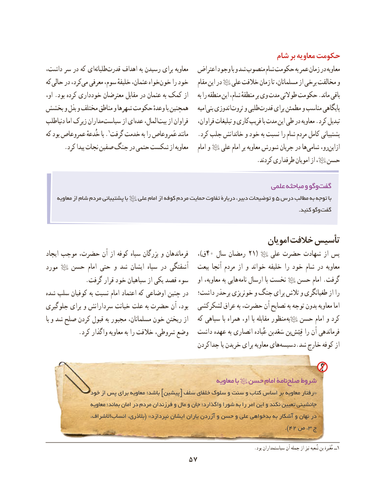

# PDF page 67

شام بر معاویه حکومت
داشت، سر در كه ایطلبانه‌   قدرت‌     اهداف به رسیدن برای معاویه   اعتراض وجود با و شد منصوب شام حكومت به عمر زمان در معاویه
که حالی در کرد،می‌  معرفی سوم، خلیفهٔ عثمان، خواهخون‌     را خود    مقام این در   علی خالفت زمان تا مسلمانان، از برخی مخالفت و
او، .بود کرده داری خود معترضان مقابل در عثمان به کمک از     به را منطقه این شام، منطقهٔ بر وی مدت طوالنی حكومت .ماند باقی
بخشش و بذل و مختلف مناطق و شهرها حكومت وعدهٔ با همچنین    امیهبنی‌  اندوزیثروت‌    و طلبیقدرت‌     برای مطمئن و مناسب پایگاهی
طلب دنیا ماا‌ زیرک مداران سیاست از ایعده‌   المال،بیت‌    از فراوان    فراوان، تبلیغات و كاری فریب با مدت این طی در معاویه .کرد تبدیل
كه بود عمروعاص خُدعهٔ با .گرفت١ خدمت به را عَمروعاص مانند   .كرد جلب خاندانش و خود به نسبت را شام مردم كامل پشتیبانی
      .كرد پیدا نجات صفین جنگ در حتمی شكست از معاویه    امام و   علی امام بر معاویه شورش جریان در ها شامی رو،ازاین‌
                         .‌كردند طرفداری امویان از ،  حسن

                                                                علمی مباحثه و وگوگفت‌
    معاویه از شام مردم پشتیبانی با   علی امام از كوفه مردم حمایت تفاوت دربارۀ دبیر، توضیحات و 5 درس مطالب به توجه با
                                                                                                                                              .کنید وگو گفت

                                                              امویان خالفت تأسیس
ایجاد موجب حضرت، آن از كوفه سپاه بزرگان و فرماندهان    ،)ق40 سال رمضان 21(    علی حضرت شهادت از پس
مورد   حسن امام حتی و شد ایشان سپاه در آشفتگی   بیعت آنجا مردم از و خواند خلیفه را خود شام در معاویه
             .گرفت قرار خود سپاهیان از یكی قصد  سوء    او معاویه، به هایی  نامه ارسال با نخست   حسن امام .گرفت
شده سلب كوفیان به نسبت امام اعتماد كه اوضاعی چنین در   داشت؛ برحذر خونریزی و جنگ برای تالش و طغیانگری از را
جلوگیری برای و سردارانش خیانت علت به حضرت آن بود،   لشكركشی عراق به حضرت، آن نصایح به توجه بدون معاویه اما
با و شد صلح کردن قبول به مجبور مسلمانان، خون ریختن از   كه سپاهی با همراه او، با مقابله منظور به  حسن امام و كرد
           .كرد واگذار معاویه به را خالفت شروطی، وضع   داشت عهده به انصاری عُباده سَعْدبن بن‌قِیْسْفرماندهیرا آن
                                                 جداكردن یا خریدن برای معاویه های‌دسیسه.شد خارج كوفه از

                                                          معاویه با  حسن امام نامۀصلح‌   شروط
               خود از پس برای معاویه باشد؛ ]پیشین[ سَلَف خلفای سلوک و سنت و كتاب اساس بر معاویه رفتار«
                  معاویه بماند؛ امان در مردم فرزندان و مال و جان واگذارد؛ شورا به را امر این و نكند تعیین جانشینی
                 االشراف،انساب‌      بالذری،( »نپردازد ایشان یاران آزردن و حسن و علی بدخواهی به آشكار و نهان در
                                                                                  ).42 ص ،3 ج

     .1بود سیاستمداران آن جمله از نیز شُعبه بن مُغَیرة ــ
                                57

