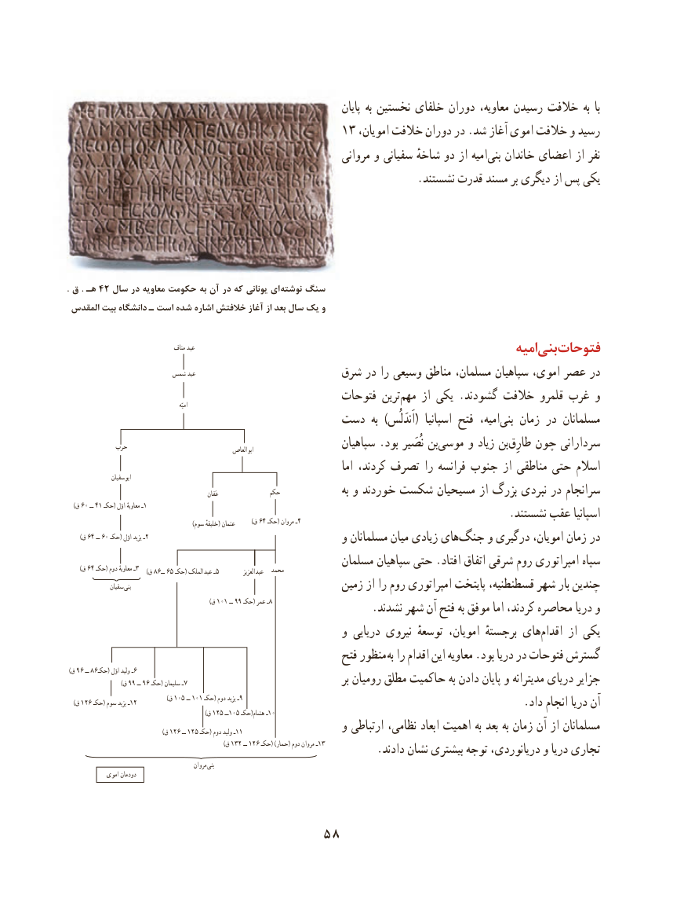

# PDF page 68

پایان به نخستین خلفای دوران معاویه، رسیدن خالفت به  با
                                        13 ،رسیدامویان خالفت دوران در .شد آغاز اموی خالفت و
                                                           مروانی و سفیانی شاخهٔ دو از امیه‌بنی خاندان اعضای از نفر
                                                                .نشستند قدرت مسند بر دیگری از پس یكی

. ق . هـ 42 سال در معاویه حکومت به آن در که یونانی ای نوشته سنگ
 المقدس بیت دانشگاه ـ است شده اشاره خالفتش آغاز از بعد سال یک و

                                      مناف عبد                                                                                 امیهبنی‌  فتوحات
                       شمس عبد                                          شرق در را وسیعی مناطق مسلمان، سپاهیان اموی، عصر در
                                                فتوحات ترین‌مهم از یكی .گشودند خالفت قلمرو غرب و                                                                    امیّه
                                    دست  به  )اَندَلُس(  اسپانیا فتح  امیه،‌بنی زمان در مسلمانان
            حرب                                        ابوالعاص                   سپاهیان .بود نُصَیر‌ بن‌موسی و زیاد بن‌طارِق چون سردارانی
                                                                          اما كردند، تصرف را فرانسه جنوب از مناطقی حتی اسالم                  ابوسفیان
                                                                عَفان              حکم                  به و خوردند شكست مسیحیان از بزرگ نبردی در سرانجام
 )60ق     ــ 41 حکـ( اوّل معاویهٔ ـ1                                                                                 .نشستند عقب اسپانیا                                                                )سوم خلیفهٔ( عثمان   )64ق   حکـ( مروان ـ4
       )ق 64 ــ 60 حکـ( اوّل یزید ـ2                                                  و مسلمانان میان زیادی های ‌جنگ و درگیری امویان، زمان در
                                                    مسلمان سپاهیان حتی .افتاد اتفاق شرقی روم امپراتوری سپاه       )ق 64 حکـ( دوم معاویهٔ ـ3 )86ق     ــ 65 حکـ( الملک عبد ـ5           عبدالعزیز  محمد
                سفیان  بنی                                        زمین از را روم امپراتوری پایتخت قسطنطنیه، شهر بار چندین
                                                                        )ق 101 ــ 99 حکـ( عمر ـ8                  .نشدند شهر آن فتح به موفق اما كردند، محاصره دریا و
                                                  و دریایی نیروی توسعهٔ امویان، برجستهٔ های ‌اقدام از یكی
                                                     فتح منظور به را اقدام این معاویه .بود دریا در فتوحات گسترش
)96ق     ــ 86حکـ( اوّل ولید ـ6                           )ق 99 ــ 96 حکـ( سلیمان ـ7                                           بر رومیان مطلق حاكمیت به دادن پایان و مدیترانه دریای جزایر
                                                   )ق 105 ــ 101 حکـ( دوم یزید ـ9   )ق 126 حکـ( سوم یزید ـ12                                                                                   .داد انجام دریا آن                                                                      )ق 125 ــ105 حکـ(هشام ـ10
                                                )ق 126 ــ 125 حکـ( دوم ولید ـ11                  و ارتباطی نظامی، ابعاد اهمیت به بعد به زمان آن از مسلمانان
                                                                               )ق 132 ــ 126 حکـ( )حمار( دوم مروان ـ13         .دادند نشان بیشتری توجه دریانوردی، و دریا تجاری
                                                 مروان بنی
             اموی دودمان

                               58

