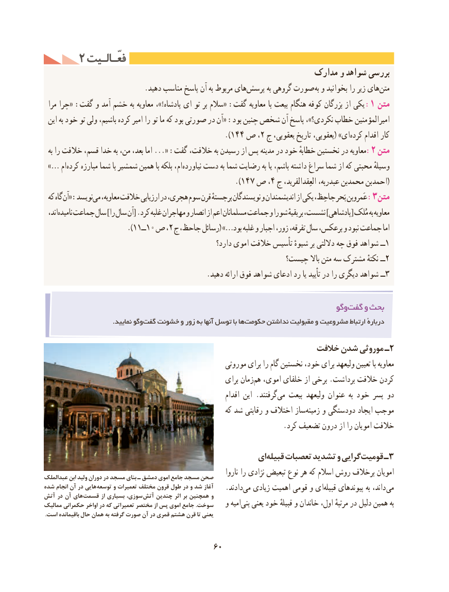

# PDF page 70

2 فعّـالـیتفعّـالـیت
                                                          مدارک و شواهد بررسی
  .‌دهید مناسب پاسخ آن به مربوط هایپرسش به گروهی صورت به و بخوانید را زیر هایمتن‌
  مرا چرا« :گفت و آمد خشم به معاویه ،!»پادشاه ای تو بر سالم« :گفت معاویه با بیعت هنگام کوفه بزرگان از یكی :1 متن
 این به خود تو ولی باشیم، كرده امیر را تو ما كه بود صورتی در آن« :بود چنین شخص آن پاسخ ،»نكردی؟ خطاب امیرالمؤمنین
                                              ).144 ص ،2 ج یعقوبی، تاریخ یعقوبی،( »ایكرده‌    اقدام كار
  به را خالفت قسم، خدا به من، بعد، اما «... :گفت خالفت، به رسیدن از پس مدینه در خود خطابهٔ نخستین در معاویه:2 متن
 …» ام‌كرده مبارزه شما با شمشیر همین با بلكه ام، ‌نیاورده دست به شما رضایت به یا باشم، داشته سراغ شما از كه محبتی وسیلهٔ
                                                ).147 ص ،4 ج العِقدالفرید، عبدربه، محمدبن احمدبن(
 كه گاه آن« :نویسدمی‌:معاویه، خالفت ارزیابی در هجری، سوم قرن برجستهٔ نویسندگان و اندیشمندان از یكی جاحِظ، بَحر عَمروبن 3 متن
  اند،نامیده‌   جماعت سال ]را سال آن[ .کرد غلبه مهاجران و انصار از اعم مسلمانان جماعت و شورا بقیهٔ بر نشست، ]پادشاهی[ مُلک به معاویه
                       ).11ــ10 ص ،2 ج جاحظ، رسائل( …»بود غلبه و اجبار زور، تفرقه، سال برعكس، و نبود جماعت اما
                                                        دارد؟ اموی خالفت تأسیس شیوهٔ بر داللتی چه فوق شواهد ــ1
                                                      چیست؟ باال متن سه مشترک نكتهٔ ــ2
                                             .دهید ارائه فوق شواهد ادعای رد یا تأیید در را دیگری شواهد ــ3

                                                                           وگوگفت‌    و بحث
    .‌نمایید وگوگفت خشونت و زور به آنها توسل با هاحكومت‌      نداشتن مقبولیت و مشروعیت ارتباط دربارهٔ

                                                           خالفت شدن موروثی ـ2
                                                    موروثی برای را گام نخستین خود، برای ولیعهد تعیین با معاویه
                                                       برای زمانهم‌  اموی، خلفای از برخی .برداشت خالفت كردن
                                                                اقدام این .گرفتندمی‌   بیعت ولیعهد عنوان  به خود پسر دو
                                                         كه شد رقابتی و اختالف ساززمینه‌    و دودستگی ایجاد موجب
                                                                   .كرد تضعیف درون از را امویان خالفت

                                                   ایقبیله‌    تعصبات تشدید و گراییقومیت‌     ـ3
                                                                       ناروا را نژادی تبعیض نوع هر که اسالم روش برخالف امویانعبدالملک ابن ولید دوران در مسجد بنای ـ دمشق اموی جامع مسجد صحن
شده انجام آن در هایی توسعه و تعمیرات مختلف قرون طول در و شد آغاز                                                  .دادندمی‌  زیادی اهمیت قومی و ایقبیله‌    پیوندهای به داند، میآتش در آن های قسمت از بسیاری سوزی، آتش چندین اثر بر همچنین و
ممالیک حکمرانی اواخر در که تعمیراتی مختصر از پس اموی جامع .سوخت   و امیهبنی‌   یعنی خود قبیلهٔ و خاندان اول، مرتبهٔ در دلیل همین به
 .است باقیمانده حال همان به گرفته صورت آن در قمری هشتم قرن تا یعنی

                                         60

