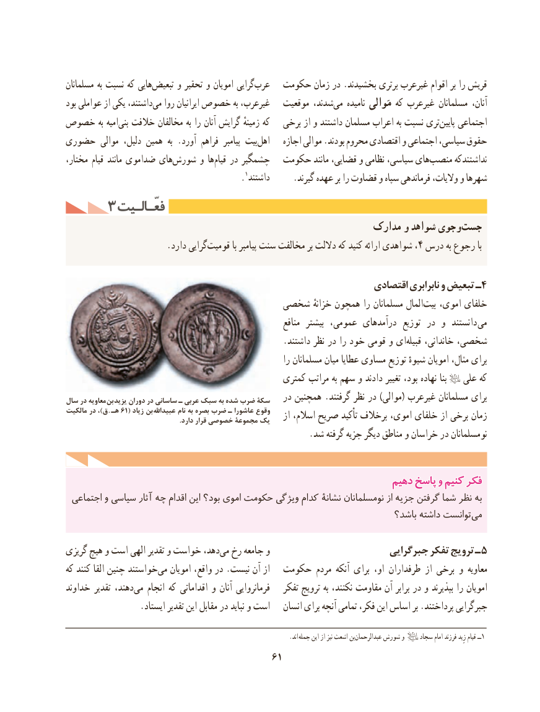

# PDF page 71

مسلمانان به نسبت كه هاییتبعیض‌      و تحقیر و امویان گراییعرب‌     حكومت زمان در .بخشیدند‌ برتری غیرعرب اقوام بر را قریش
بود عواملی از یکی داشتند،می‌   روا ایرانیان خصوص به غیرعرب،   موقعیت شدند،می‌    نامیده مَوالی كه غیرعرب مسلمانان آنان،
خصوص به امیه‌بنی خالفت مخالفان به را آنان گرایش زمینهٔ که   برخی از و داشتند مسلمان اعراب به نسبت تریپایین‌    اجتماعی
حضوری موالی دلیل، همین  به .آورد فراهم  پیامبر بیتاهل‌      اجازه موالی .بودند محروم اقتصادی و اجتماعی سیاسی، حقوق
مختار، قیام مانند ضداموی هایشورش‌      و هاقیام‌   در چشمگیر  حكومت مانند قضایی، و نظامی سیاسی، هایمنصب‌      نداشتندكه
                                           . داشتند١     .گیرند عهده بر را قضاوت و سپاه فرماندهی والیات، و شهرها
     3 فعّـالـیتفعّـالـیت
                                                       مدارک و شواهد جویو‌ ‌جست
     .‌دارد گراییقومیت با پیامبر سنت مخالفت بر داللت كه كنید ارائه شواهدی ،4 درس به رجوع با

                                                               اقتصادی نابرابری‌      و تبعیض ـ4
                                شخصی خزانهٔ همچون را مسلمانان المالبیت‌   اموی، خلفای
                                                                منافع  بیشتر عمومی، درآمدهای  توزیع در و  دانستند می
                                                  .داشتند نظر در را خود قومی و ای‌قبیله خاندانی، شخصی،
                                                              را مسلمانان میان عطایا مساوی توزیع شیوهٔ امویان مثال، برای
                                                كمتری مراتب به سهم و دادند تغییر بود، نهاده بنا    علی كه
سال در معاویه بن یزید دوران در ساسانی ـ عربی سبک به شده ضرب سکۀ   در همچنین .گرفتند نظر در )موالی( غیرعرب مسلمانان برای
مالکیت در ،)ق  .  هـ۶۱ ( زیاد بن  عبیداهلل نام                                            به بصره                            ضرب ـ عاشورا                                                     وقوع
                                                                    .دارد                                              قرار خصوصی                                            مجموعۀ                                     یک    از اسالم، صریح تأکید برخالف اموی، خلفای از برخی زمان
                                                        .شد گرفته جزیه دیگر مناطق و خراسان در نومسلمانان

                                                              دهیمدهیم پاسخپاسخ وو کنیمکنیم فکرفکر
 اجتماعی و سیاسی آثار چه اقدام این بود؟ اموی حكومت ویژگی کدام نشانۀ نومسلمانان از جزیه گرفتن شما نظر به
                                                                        باشد؟ داشته توانستمی‌

گریزی هیچ و است الهی تقدیر و خواست دهد،می‌  رخ جامعه و                        جبرگرایی تفكر ترویج ـ 5
كه كنند القا چنین خواستند‌می امویان واقع، در .نیست آن از  حكومت مردم آنكه برای او، طرفداران از برخی و معاویه
خداوند تقدیر دهند،می‌   انجام كه اقداماتی و آنان فرمانروایی   تفكر ترویج به نكنند، مقاومت آن برابر در و بپذیرند را امویان
                 .ایستاد تقدیر این مقابل در نباید و است      ‌انسان برای آنچه تمامی فكر، این اساس بر .پرداختند جبرگرایی

                                          . اند جمله این از نیز اشعث بن‌عبدالرحمان شورش و     سجاد امام فرزند زِید قیام ١ــ
                                          61

