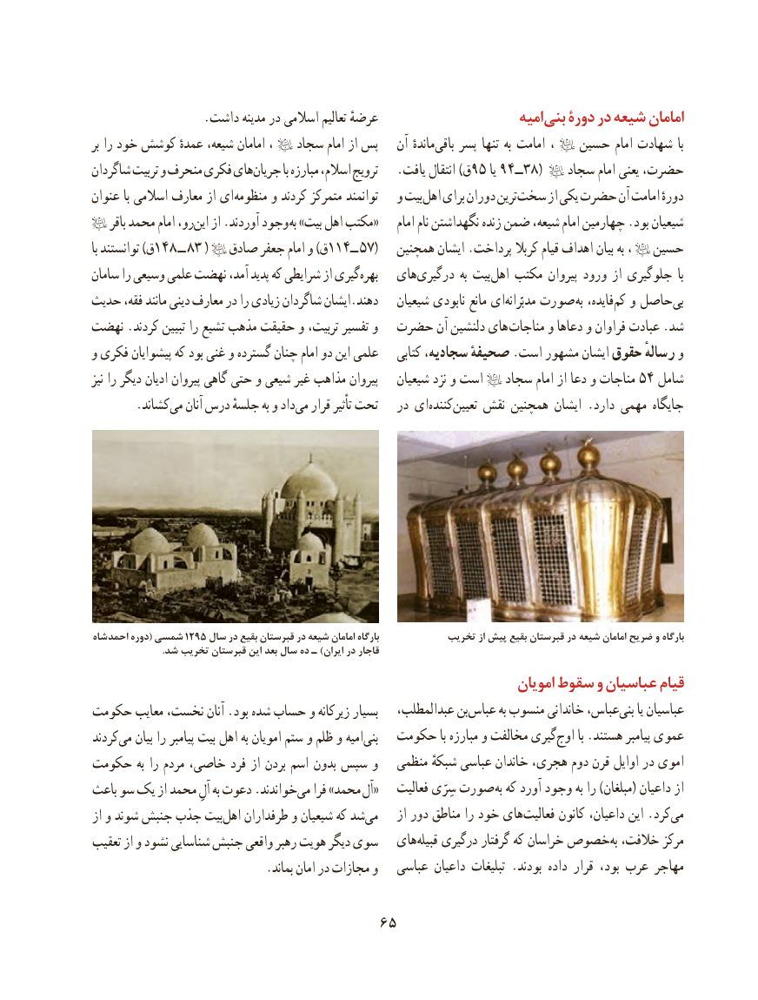

# PDF page 75

.داشت مدینه در اسالمی تعالیم عرضهٔ                       امیه بنی دورۀ در شیعه امامان
بر را خود کوشش عمدهٔ شیعه، امامان ،   سجاد امام از پس   آن ماندهٔ ‌باقی پسر تنها به امامت ،   حسین امام شهادت  با
شاگردان تربیت و منحرف فکری هایجریان‌        با مبارزه اسالم، ترویج   .یافت انتقال )ق95 یا 94ــ38(    سجاد امام یعنی حضرت،
عنوان با اسالمی معارف از ای منظومه و کردند متمرکز توانمند   و بیت‌اهل برای دوران ترین‌سخت از یكی حضرت آن امامت دورهٔ
    باقر محمد امام رو،این‌   از .آوردند وجود «به »بیت اهل مکتب     امام نام نگهداشتن زنده ضمن شیعه، امام چهارمین .بود شیعیان
با توانستند )ق148 ــ 83 (   صادق جعفر امام و )ق114ــ 57(   همچنین ایشان .پرداخت كربال قیام اهداف بیان به ،   حسین
سامان را وسیعی علمی نهضت آمد، پدید که شرایطی از گیریبهره‌     های‌درگیری به بیت ‌اهل مكتب پیروان ورود از جلوگیری  با
حدیث فقه، مانند دینی معارف در را زیادی شاگردان ایشان.دهند   شیعیان نابودی مانع ای ‌مدبّرانه صورت به فایده،‌كم و حاصل‌بی
نهضت .کردند تبیین را تشیع مذهب حقیقت و تربیت، تفسیر و  حضرت آن دلنشین های  مناجات و دعاها و فراوان عبادت .شد
و فکری پیشوایان که بود غنی و گسترده چنان امام دو این علمی    کتابی سجادیه، صحیفهٔ .است مشهور ایشان حقوق رسالهٔ و
نیز را دیگر ادیان پیروان گاهی حتی و شیعی غیر مذاهب پیروان   شیعیان نزد و است   سجاد امام از دعا و مناجات 54 شامل
  .‌کشاندمی آنان درس جلسهٔ به و دادمی‌   قرار تأثیر تحت   در ای ‌كننده‌تعیین نقش همچنین ایشان .دارد مهمی جایگاه

شاه احمد دوره( شمسی 1295 سال در بقیع قبرستان در شیعه امامان بارگاه            تخريب از پيش بقيع قبرستان در شیعه امامان ضریح و بارگاه
                              .شد تخریب قبرستان این بعد سال ده ـ )ایران در قاجار
                                                                    امویان سقوط و عباسیان قیام
حكومت معایب نخست، آنان .بود شده حساب و زیركانه بسیار   عبدالمطلب، بنعباس‌       به منسوب خاندانی عباس،بنی‌    یا عباسیان
كردندمی‌   بیان را پیامبر بیت اهل به امویان ستم و ظلم و امیه‌بنی  حكومت با مبارزه و ‌مخالفت گیری‌اوج با .هستند پیامبر عموی
حكومت به را مردم خاصی، فرد از بردن اسم بدون سپس و   منظمی شبكهٔ عباسی خاندان هجری، دوم قرن اوایل در اموی
باعث سو یک از محمد آلِ به دعوت .خواندندمی‌   فرا »محمد «آل    فعالیت سِرّی صورت به كه آورد وجود به را )مبلغان( داعیان از
از و شوند جنبش جذب بیتاهل‌   طرفداران و شیعیان كه شدمی‌      از دور مناطق را خود هایفعالیت‌      كانون داعیان، این .كردمی‌
تعقیب از و نشود شناسایی جنبش واقعی رهبر هویت دیگر سوی   های‌قبیله درگیری‌        گرفتار كه خراسان خصوص به خالفت، مركز
                             .بماند امان در مجازات و   عباسی داعیان تبلیغات .بودند داده قرار بود، عرب مهاجر

                                  65

