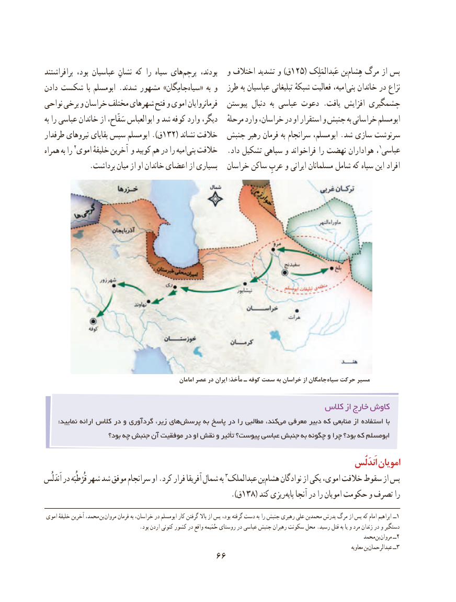

# PDF page 76

برافراشتند بود، عباسیان نشانِ كه را سیاه هایپرچم‌      بودند، و۱۲۵اختالف تشدید و )ق     ( عَبدالمَلِک بنهِشام‌   مرگ از پس
دادن شكست  با ابومسلم .شدند مشهور »جامِگانسیاه‌   « به و   طرز به عباسیان تبلیغاتی شبکهٔ فعالیت امیه،بنی‌   خاندان در نزاع
نواحی برخی و خراسان مختلف شهرهای فتح و اموی فرمانروایان   پیوستن دنبال  به عباسی دعوت .یافت افزایش چشمگیری
به را عباسی خاندان از سَفّاح، ابوالعباس و شد كوفه وارد دیگر،   مرحلهٔ وارد خراسان، در او استقرار و جنبش به خراسانی ابومسلم
طرفدار نیروهای بقایای سپس ابومسلم ).ق 132( نشاند خالفت  جنبش رهبر فرمان به سرانجام ابومسلم، .شد سازی سرنوشت
همراه به را اموی٢ خلیفهٔ آخرین و كوبید هم در را امیهبنی‌  خالفت   .داد تشکیل سپاهی و فراخواند را نهضت هواداران ،1عباسی
            .برداشت میان از او خاندان اعضای از بسیاری   خراسان ساكن عربِ و ایرانی مسلمانان شامل كه سپاه این افراد

                                                        امامان عصر در ایران :مأخذ ـ کوفه سمت به خراسان از جامگان سیاه حرکت مسیر

                                                            كالس از خارج كاوش
      :نمایید ارائه كالس در و گردآوری زیر، هایپرسش‌       به پاسخ در را مطالبی كند،می‌  معرفی دبیر كه منابعی از استفاده با
                     بود؟ چه جنبش آن موفقیت در او نقش و تأثیر پیوست؟ عباسی جنبش به چگونه و چرا بود؟ كه ابومسلم

                                                                                                             اَندَلُس امویان
اَندَلُس در قُرْطُبَه شهر شد موفق سرانجام او .كرد فرار آفریقا شمال به عبدالملک٣ بنهشام‌     نوادگان از یكی اموی، خالفت سقوط از پس
                                          ).138(ق     كند ریزیپایه‌   آنجا در را امویان حكومت و تصرف را

 اموی خلیفهٔ آخرین محمد،  بن مروان فرمان به خراسان، در ابومسلم كار گرفتن باال از پس بود، گرفته دست به را جنبش رهبری علی محمدبن پدرش مرگ از پس كه امام ابراهیم ــ1
                                     .بود اردن كنونی كشور در واقع حُمَیمه روستای در عباسی جنبش رهبران سكونت محل .رسید قتل به یا و مرد زندان در و دستگیر
                                                                                                              محمد بن مروان ٢ــ
                                                                                                                                                             معاویه بنعبدالرحمان‌          ٣ــ
                                   66

