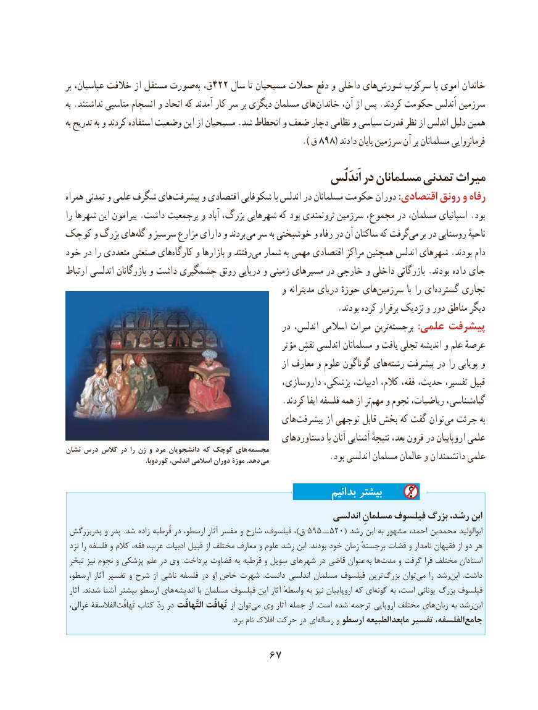

# PDF page 77

بر عباسیان، خالفت از مستقل صورت به ق،422 سال تا مسیحیان حمالت دفع و داخلی هایشورش‌     سركوب با اموی خاندان
به .نداشتند مناسبی انسجام و اتحاد که آمدند کار سر بر دیگری مسلمان های خاندان آن، از پس .كردند حكومت اَندلس سرزمین
به تدریج به و کردند استفاده وضعیت این از مسیحیان .شد انحطاط و ضعف دچار نظامی و سیاسی قدرت نظر از اندلس دلیل همین
                                        ).898(ق       دادند پایان سرزمین آن بر مسلمانان فرمانروایی
                                                                     اَندَلُس در مسلمانان تمدنی میراث
همراه تمدنی و علمی شگرف هایپیشرفت‌      و اقتصادی شكوفایی با اندلس در مسلمانان حكومت دوران :اقتصادی رونق و رفاه
را شهرها این پیرامون .داشت پرجمعیت و آباد بزرگ، شهرهایی كه بود ثروتمندی سرزمین مجموع، در مسلمان، اسپانیای .بود
كوچک و بزرگ های‌گله و سرسبز مزارع دارای و بردند می سر به خوشبختی و رفاه در آن ساكنان كه گرفتمی‌   بر در روستایی ناحیهٔ
خود در را متعددی صنعتی های‌كارگاه و بازارها و رفتند ‌می شمار به مهمی اقتصادی مراكز همچنین اندلس شهرهای .بودند دام
ارتباط اندلسی بازرگانان و داشت چشمگیری رونق دریایی و زمینی مسیرهای در خارجی و داخلی بازرگانی .بودند داده جای
                                                  و مدیترانه دریای حوزهٔ های‌سرزمین با را ایگسترده‌     تجاری
        .‌بودند كرده برقرار نزدیک و دور مناطق دیگر
                                                   در اندلس، اسالمی میراث ترین ‌برجسته :علمی پیشرفت
                                                            مؤثر نقشِ اندلسی مسلمانان و یافت تجلی اندیشه و علم عرصهٔ
                                                              از معارف و علوم گوناگون های‌رشته پیشرفت در را پویایی و
                                                  داروسازی، پزشكی، ادبیات، كالم، فقه، حدیث، تفسیر، قبیل
                                                  .كردند ایفا فلسفه همه از تر ‌مهم و نجوم ریاضیات، شناسی،‌گیاه
                                              های‌پیشرفت از توجهی قابل بخش كه گفت توان‌می جرئت به
                                                   دستاوردهای با آنان آشنایی نتیجهٔ بعد، قرون در اروپاییان علمی
نشان درس کالس در را زن و مرد دانشجویان که کوچک های مجسمه . کوردوبا اندلس، اسالمی دوران موزۀ .دهد می              .بود اندلسی مسلمان عالمان و دانشمندان علمی

                                                                بدانیم بیشتر
                                                          اندلسی مسلمانِ فیلسوف بزرگ رشد، ابن
 پدربزرگش و پدر  .شد زاده قُرطبه در ارسطو، آثار مفسر و شارح فیلسوف، ،)ق 595 ــ 520( رشد ابن به مشهور احمد، محمدبن ابوالولید
 نزد را فلسفه و كالم فقه، عرب، ادبیات قبیل از مختلف معارف و علوم رشد ابن  .بودند خود زمان برجستهٔ قضات و نامدار فقیهان از دو هر
 تبحّر نیز نجوم و پزشكی علم در وی  .پرداخت قضاوت به قرطبه و سِویل شهرهای در قاضی عنوان  به ها‌مدت و گرفت فرا مختلف استادان
 ارسطو، آثار تفسیر و شرح از ناشی فلسفه در او خاص شهرت  .دانست اندلسی مسلمان فیلسوف ترین ‌بزرگ توان‌می را رشد‌ابن  .داشت
 آثار  .شدند آشنا بیشتر ارسطو های‌اندیشه با مسلمان فیلسوف این آثار واسطهٔ به نیز اروپاییان كه ای ‌گونه به است، یونانی بزرگ فیلسوف
 غزالی، الفالسفة‌تَهافُت كتاب ردّ در التَّهافُت‌ تَهافُت از توان‌می وی آثار جمله از  .است شده ترجمه اروپایی مختلف های ‌زبان به رشد‌ابن
    .‌برد نام افالک حركت در ای رساله و ارسطو مابعدالطبیعه تفسیر الفلسفه،‌جامع

                                  67

