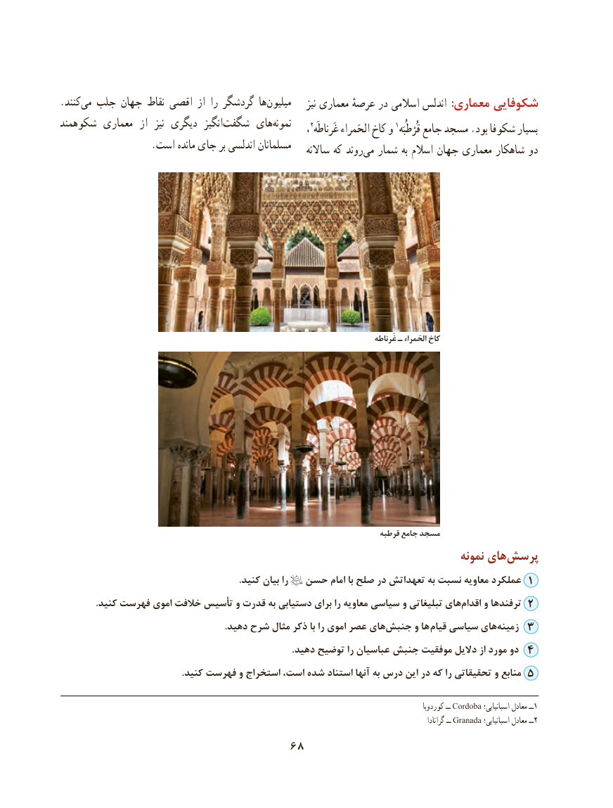

# PDF page 78

.كنندمی‌  جلب جهان نقاط اقصی از را گردشگر هامیلیون‌            نیز معماری عرصهٔ در اسالمی اندلس :معماری شکوفایی
شكوهمند معماری  از  نیز دیگری  انگیز‌شگفت های‌نمونه     2                       1                                                                 ، غَرناطَه الحَمراء كاخ و  قُرْطُبَه جامع مسجد .بود شكوفا بسیار
                   .است مانده جای بر اندلسی مسلمانان                                                                ساالنه كه روند‌می شمار به اسالم جهان معماری شاهكار دو

                                                                                                    غَرناطه ـ الحَمراء كاخ

                                                                                 قرطبه جامع مسجد
                                                                                   نمونه های‌پرسش
                                                                             .كنید بیان را  حسن امام با صلح در تعهداتش به نسبت معاویه عملكرد 1
               .كنید فهرست اموی خالفت تأسیس و قدرت به دستیابی برای را معاویه سیاسی و تبلیغاتی هایاقدام‌     و ترفندها 2
                                                                       .دهید شرح مثال ذكر با را اموی عصر های ‌جنبش و ها  قیام سیاسی های‌زمینه 3
                                                                                                   .دهید توضیح را عباسیان جنبش موفقیت دالیل از مورد دو 4
                                                    .كنید فهرست و استخراج است، شده استناد آنها به درس این در كه را تحقیقاتی و منابع 5

                                                                                                                       کوردوبا ــ Cordoba اسپانیایی؛ معادل ــ1
                                                                                                                                                 گرانادا ــ Granada اسپانیایی؛ معادل ٢ــ
                                 68

