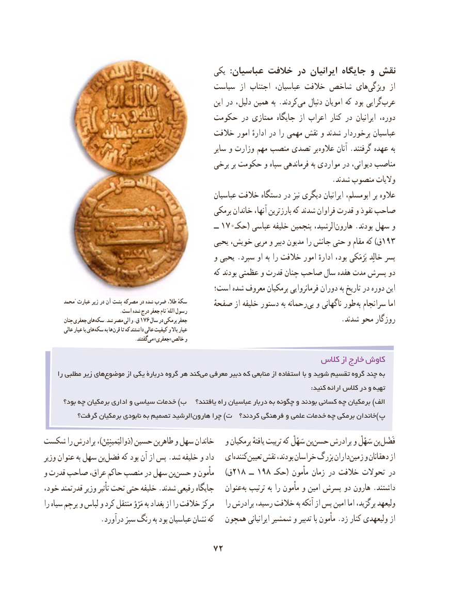

# PDF page 82

یکی  :عباسیان خالفت در ایرانیان جایگاه و نقش
                                        سیاست  از اجتناب عباسیان، خالفت شاخص های‌ویژگی  از
                                                         این در دلیل، همین به .کردند‌می دنبال امویان که بود گرایی‌عرب
                                    حکومت در ممتازی جایگاه از اعراب کنار در ایرانیان دوره،
                                          خالفت امور ادارهٔ در را مهمی نقش و شدند برخوردار عباسیان
                                                        سایر و وزارت مهم منصب تصدی بر عالوه آنان .گرفتند عهده به
                                             برخی بر حکومت و سپاه فرماندهی به مواردی در دیوانی، مناصب
                                                                                .شدند منصوب والیات
                                                     عباسیان خالفت دستگاه در نیز دیگری ایرانیان ابومسلم، بر عالوه
                                                 برمکی خاندان آنها، بارزترین که شدند فراوان قدرت و نفوذ صاحب
                                                                       ــ 170حکـ( عباسی خلیفه پنجمین الرشید،هارون‌     .بودند سهل و
                                               یحیی خویش، مربی و دبیر مدیون را جانش حتی و مقام که )ق193
                                               و یحیی .سپرد او به را خالفت امور ادارهٔ بود، بَرْمَکی خالِد پسر
                                                     که بودند عظمتی و قدرت چنان صاحب سال هفده مدت پسرش دو
                                         است؛ شده معروف برمکیان فرمانروایی دوران به تاریخ در دوره این
       محمد" عبارت زیر در آن پشت مصرکه در شده ضرب طال، سکهٴ       صفحهٔ از خلیفه دستور به رحمانه‌بی و ناگهانی طور به سرانجام اما                                 .است شده درج جعفر نام "الله رسول
         چنان جعفری های سکه .شد مصر والی .ق 176 سال در برمکی جعفر                                           .شدند محو روزگار
         عالی عیار با های سکه به ها قرن تا که داشتند عالی کیفیت و باال عیار
             . گفتند می »جعفری« خالص و

                                                            كالس از خارج كاوش
     را مطلبی زیر هایموضوع‌       از یکی دربارۀ گروه هر کندمی‌  معرفی دبیر که منابعی از استفاده با و شوید تقسیم گروه چند به
                                                                                                                             :کنید ارائه کالس در و تهیه
      بود؟ چه برمکیان اداری و سیاسی خدمات )ب   یافتند؟ راه عباسیان دربار به چگونه و بودند کسانی چه برمکیان )الف
         گرفت؟ برمکیان نابودی به تصمیم الرشید ‌هارون چرا )ت  کردند؟ فرهنگی و علمی خدمات چه برمکی خاندان) پ

شکست را برادرش ،)ذوالیَمینِیْنْ( حسین طاهربن و سهل خاندان   و برمکیان یافتهٔ تربیت که سَهْلْ بنحسن‌    برادرش و سَهْلْ بنفَضْل‌
وزیر عنوان به سهل بنفضل‌     که بود آن از پس .شد خلیفه و داد   ایکننده‌    تعیین‌   نقش بودند، خراسان بزرگ دارانزمین‌    و دهقانان از
و قدرت صاحب عراق، حاکم منصب در سهل بنحسن‌    و مأمون    )ق 218 ــ 198 حکـ( مأمون زمان در خالفت تحوالت در
خود، قدرتمند وزیر تأثیر تحت حتی خلیفه .شدند رفیعی جایگاه   عنوان به ترتیب به را مأمون و امین پسرش دو هارون .داشتند
را سیاه پرچم‌    و لباس و کرد منتقل مَرْوْ به بغداد از را خالفت مرکز    را برادرش رسید، خالفت به آنکه از پس امین اما برگزید، ولیعهد
                .درآورد سبز رنگ به بود عباسیان نشان که   همچون ایرانیانی شمشیر و تدبیر با مأمون .زد کنار ولیعهدی از

                                  72

