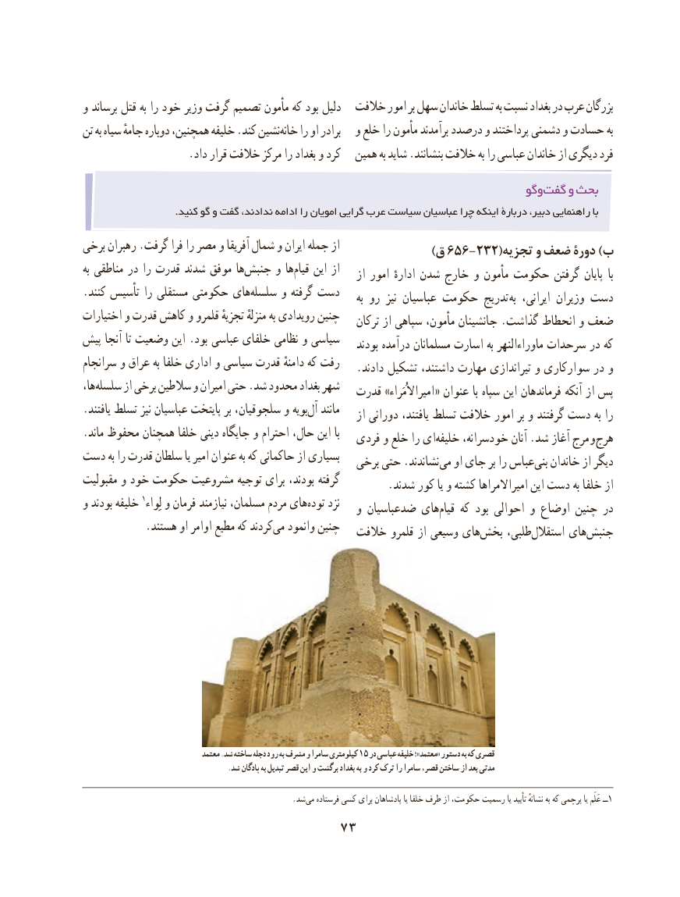

# PDF page 83

و برساند قتل به را خود وزیر گرفت تصمیم مأمون که بود دلیل  خالفت امور بر سهل خاندان تسلط به نسبت بغداد در عرب بزرگان
تن به سیاه جامهٔ دوباره همچنین، خلیفه .کند نشینخانه‌    را او برادر   و خلع را مأمون برآمدند درصدد و پرداختند دشمنی و حسادت به
                   .داد قرار خالفت مرکز را بغداد و کرد   همین به شاید .بنشانند خالفت به را عباسی خاندان از دیگری فرد

                                                                           وگوگفت‌    و بحث
                             .کنید گو و گفت ندادند، ادامه را امویان گرایی عرب سیاست عباسیان چرا اینکه دربارۀ دبیر، راهنمایی با
برخی رهبران .گرفت فرا را مصر و آفریقا شمال و ایران جمله از                                            )656-232(ق         تجزیه و ضعف دورۀ )ب
به مناطقی در را قدرت شدند موفق هاجنبش‌     و هاقیام‌    این از                                                              از امور ادارهٔ شدن خارج و مأمون حکومت گرفتن پایان  با
.کنند تأسیس را مستقلی حکومتی هایسلسله‌     و گرفته دست                                                                                 به رو  نیز عباسیان حکومت تدریج به ایرانی، وزیران دست
اختیارات و قدرت کاهش و قلمرو تجزیهٔ منزلهٔ به رویدادی چنین                                                            ترکان از سپاهی مأمون، جانشینان .گذاشت انحطاط و ضعف
پیش آنجا تا وضعیت این .بود عباسی خلفای نظامی و سیاسی                                                               بودند درآمده مسلمانان اسارت به ماوراءالنهر سرحدات در که
سرانجام و عراق به خلفا اداری و سیاسی قدرت دامنهٔ که رفت                                                  .دادند تشکیل داشتند، مهارت تیراندازی و سوارکاری در و
ها،‌سلسله از برخی سالطین و امیران حتی .شد محدود بغداد شهر                                            قدرت »امیراالُمَراء « عنوان با سپاه این فرماندهان آنکه از پس
.یافتند تسلط نیز عباسیان پایتخت بر سلجوقیان، و بویهآل‌   مانند                                                              از دورانی یافتند، تسلط خالفت امور بر و گرفتند دست به را
.ماند محفوظ همچنان خلفا دینی جایگاه و احترام حال، این با                                              فردی و خلع را ای ‌خلیفه خودسرانه، آنان .شد آغاز مرج و هرج
دست به را قدرت سلطان یا امیر عنوان به که حاکمانی از بسیاری                                                برخی حتی .نشاندند‌می او جای بر را عباسبنی‌   خاندان از دیگر
مقبولیت و خود حکومت مشروعیت توجیه برای بودند، گرفته                                                        .شدند کور یا و کشته امیراالمراها این دست به خلفا از
و بودند خلیفه 1لِواء و فرمان نیازمند مسلمان، مردم هایتوده‌    نزد                                                    و ضدعباسیان هایقیام‌    که بود احوالی و اوضاع چنین در
 .‌هستند او اوامر مطیع که کردندمی وانمود چنین                                                                                                  ‌خالفت قلمرو از وسیعی هایبخش‌     طلبی،‌استقالل هایجنبش‌

                                  معتمد .شد ساخته دجله رود به مشرف و سامرا کیلومتری 15 در عباسی خلیفه ؛»معتمد« دستور به که قصری
                                         .شد پادگان به تبدیل قصر این و برگشت بغداد به و کرد ترک را سامرا قصر، ساختن از بعد مدتی

                           .‌شدمی فرستاده کسی برای پادشاهان یا خلفا طرف از حکومت، رسمیت یا تأیید نشانهٔ به که پرچمی یا عَلَم ــ1
                               73

