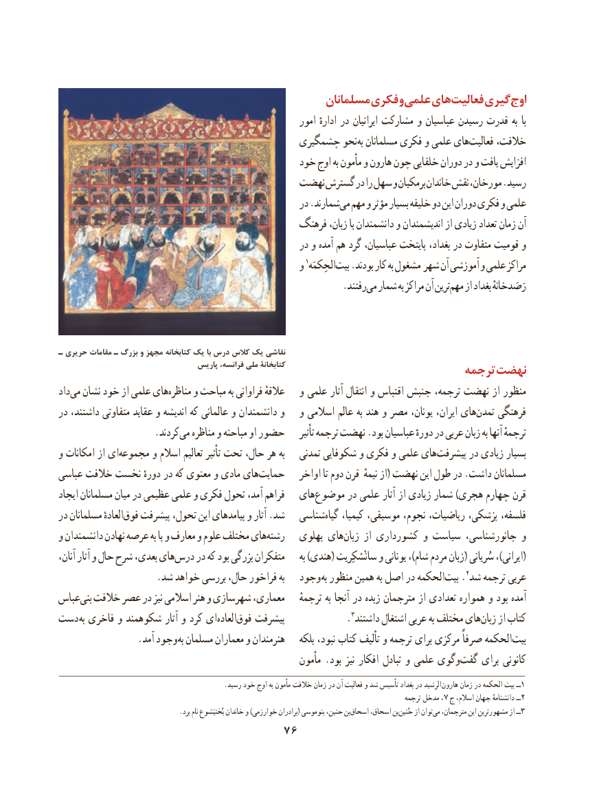

# PDF page 86

مسلمانان فکری و علمی هایفعالیت‌     گیریاوج‌
                                                           امور ادارهٔ در ایرانیان مشارکت و عباسیان رسیدن قدرت به با
                                         چشمگیری نحو به مسلمانان فکری و علمی هایفعالیت‌     خالفت،
                                           خود اوج به مأمون و هارون چون خلفایی دوران در و یافت افزایش
                                      نهضت گسترش در را سهل و برمکیان خاندان نقش مورخان، .رسید
                                                     در .شمارندمی‌  مهم و مؤثر بسیار خلیفه دو این دوران فکری و علمی
                                            فرهنگ زبان، با دانشمندان و اندیشمندان از زیادی تعداد زمان آن
                                                     در و آمده هم‌  گرد عباسیان، پایتخت بغداد، در متفاوت قومیت و
                                                  و 1الحِکمَهبیت‌   .بودند کار به مشغول شهر آن آموزشی و علمی مراکز
                                                           .رفتندمی‌  شمار به مراکز آن ترینمهم‌   از بغداد رَصَدخانهٔ

ـ حریری مقامات ـ بزرگ و مجهز کتابخانه یک با درس کالس یک نقاشی
                                  پاریس فرانسه، ملی کتابخانۀ                             ترجمه نهضت
دادمی‌  نشان خود از علمی هایمناظره‌     و مباحث به فراوانی عالقهٔ   و علمی آثار انتقال و اقتباس جنبش ترجمه، نهضت از منظور
در داشتند، متفاوتی عقاید و اندیشه که عالمانی و دانشمندان و   و اسالمی عالم به هند و مصر یونان، ایران، هایتمدن‌    فرهنگی
       .‌کردندمی مناظره و مباحثه او حضور     تأثیر ترجمه نهضت .بود عباسیان دورهٔ در عربی زبان به آنها ترجمهٔ
و امکانات از ایمجموعه‌      و اسالم تعالیم تأثیر تحت حال، هر به   تمدنی شکوفایی و فکری و علمی هایپیشرفت‌      در زیادی بسیار
عباسی خالفت نخست دورهٔ در که معنوی و مادی هایحمایت‌         اواخر تا دوم قرن  نیمهٔ از( نهضت این طول در .داشت مسلمانان
ایجاد مسلمانان میان در عظیمی علمی و فکری تحول آمد، فراهم   هایموضوع‌      در علمی  آثار از زیادی شمار )هجری چهارم قرن
در مسلمانان العادهٔفوق‌   پیشرفت تحول، این پیامدهای و آثار .شد   شناسیگیاه‌    کیمیا، موسیقی، نجوم، ریاضیات، پزشکی، فلسفه،
و دانشمندان نهادن عرصه به پا و معارف و علوم مختلف هایرشته‌      پهلوی هایزبان‌     از کشورداری و سیاست جانورشناسی، و
آنان، آثار و حال شرح بعدی، هایدرس‌    در که بود بزرگی متفکران     به )هندی( سانْسْکِریت و یونانی ،)شام مردم زبان( سُریانی ،)ایرانی(
                    .شد خواهد بررسی حال، فراخور به   وجود به منظور همین به اصل در الحکمهبیت‌.2شد ترجمه عربی
عباسبنی‌  خالفت عصر در نیز اسالمی هنر و شهرسازی معماری،    ترجمهٔ به آنجا در زبده مترجمان از تعدادی همواره و بود آمده
دست به فاخری و شکوهمند آثار و کرد ایالعاده‌   فوق‌   پیشرفت‌                  .داشتند٣ اشتغال عربی به مختلف هایزبان‌    از کتاب
    . آمد وجود به مسلمان معماران و هنرمندان    بلکه نبود، کتاب تألیف و ترجمه برای مرکزی صرفاً الحکمهبیت‌
                                                        مأمون .بود نیز افکار تبادل و علمی وگویگفت‌    برای کانونی
  . 1رسید خود اوج به مأمون خالفت زمان در آن فعالیت و شد تأسیس بغداد در الرشید هارون زمان در الحکمه بیت ــ
                                                                                                           ترجمه مدخل ،7 ج اسالم، جهان دانشنامهٔ ــ2
                                   .برد نام بُختیَشوع خاندان و )خوارزمی برادران( موسیبنو‌  حنین، بناسحاق‌     اسحاق، بنحُنین‌     از توانمی‌  مترجمان، این مشهورترین از ٣ــ
                                 76

