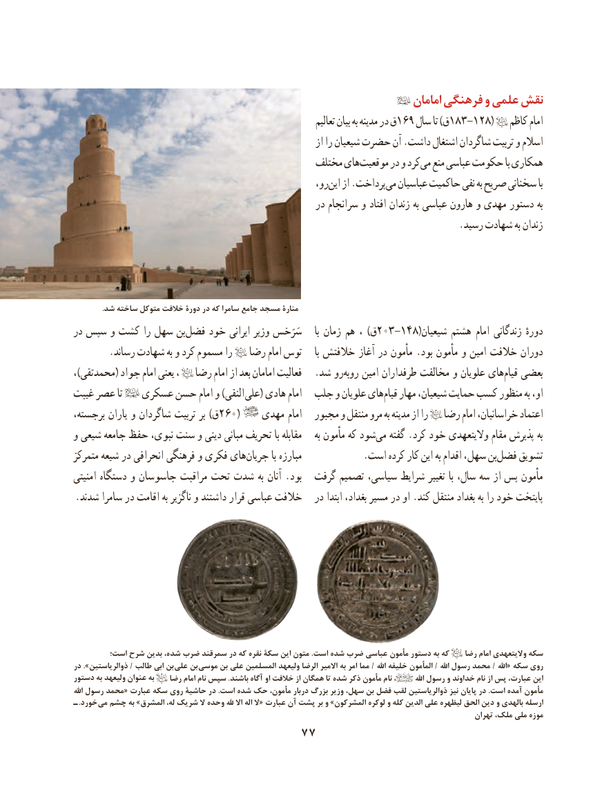

# PDF page 87

امامان فرهنگی و علمی نقش
                                                                          تعالیم بیان به مدینه در ق169 سال تا )ق183-128(   کاظم امام
                                                               از را شیعیان حضرت آن .داشت اشتغال شاگردان تربیت و اسالم
                                             مختلف هایموقعیت‌      در و کردمی‌  منع عباسی حکومت با همکاری
                                                       رو،این‌   از .پرداختمی‌  عباسیان حاکمیت نفی به صریح سخنانی با
                                                    در سرانجام و افتاد زندان به عباسی هارون و مهدی دستور به
                                                                                .رسید شهادت به زندان

               .شد ساخته متوکل خالفت دورۀ در که سامرا جامع مسجد منارۀ
در سپس و کشت را سهل بنفضل‌    خود ایرانی وزیر سَرَخس     با زمان هم ، )ق203-148(شیعیان هشتم امام زندگانی دورهٔ
       .رساند شهادت به و کرد مسموم را   رضا امام توس     با خالفتش آغاز در مأمون .بود مأمون و امین خالفت دوران
،)محمدتقی( جواد امام یعنی ،   رضا امام از بعد امامان فعالیت   .شد روروبه‌    امین طرفداران مخالفت و علویان هایقیام‌   بعضی
غیبت عصر تا   عسکری حسن امام و )النقی علی( هادی امام  جلب و علویان هایقیام‌   مهار شیعیان، حمایت کسب منظور به او،
برجسته، یاران و شاگردان تربیت بر )ق260(    مهدی امام   مجبور و منتقل مرو به مدینه از را   رضا امام خراسانیان، اعتماد
و شیعی جامعه حفظ نبوی، سنت و دینی مبانی تحریف با مقابله    به مأمون که شودمی‌   گفته .کرد خود والیتعهدی مقام پذیرش به
متمرکز شیعه در انحرافی فرهنگی و فکری هایجریان‌         با مبارزه .‌است کرده کار این به اقدام سهل، بنفضل تشویق
امنیتی دستگاه و جاسوسان مراقبت تحت شدت به آنان .بود  گرفت تصمیم سیاسی، شرایط تغییر با سال، سه از پس مأمون
.شدند سامرا در اقامت به ناگزیر و داشتند قرار عباسی خالفت   در ابتدا بغداد، مسیر در او .کند منتقل بغداد به را خود پایتخت

        است؛ شرح بدین شده، ضرب سمرقند در که نقره سکۀ این متون .است شده ضرب عباسی مأمون دستور به که    رضا امام والیتعهدی سکه
در ».ذوالریاستین / طالب ابی بن علی بن موسی بن علی المسلمین ولیعهد الرضا االمیر به امر مما / اهلل خلیفه المأمون / اهلل رسول محمد / اهلل« سکه روی
دستور به ولیعهد عنوان به    رضا امام نام سپس .باشند آگاه او خالفت از همگان تا شده ذکر مأمون نام ،        اهلل رسول و خداوند نام از پس عبارت، این
اهلل رسول محمد« عبارت سکه روی حاشیۀ در .است شده حک مأمون، دربار بزرگ وزیر سهل، بن فضل لقب ذوالریاستین نیز پایان در .است آمده مأمون
ـ .خورد  می چشم به »المشرق له، شریک ال وحده هلل اال اله ال« عبارت آن پشت بر و »المشرکون لوکره و کله الدین علی لیظهره الحق دین و بالهدی ارسله
                                                                                                             تهران ملک، ملی موزه
                                77

