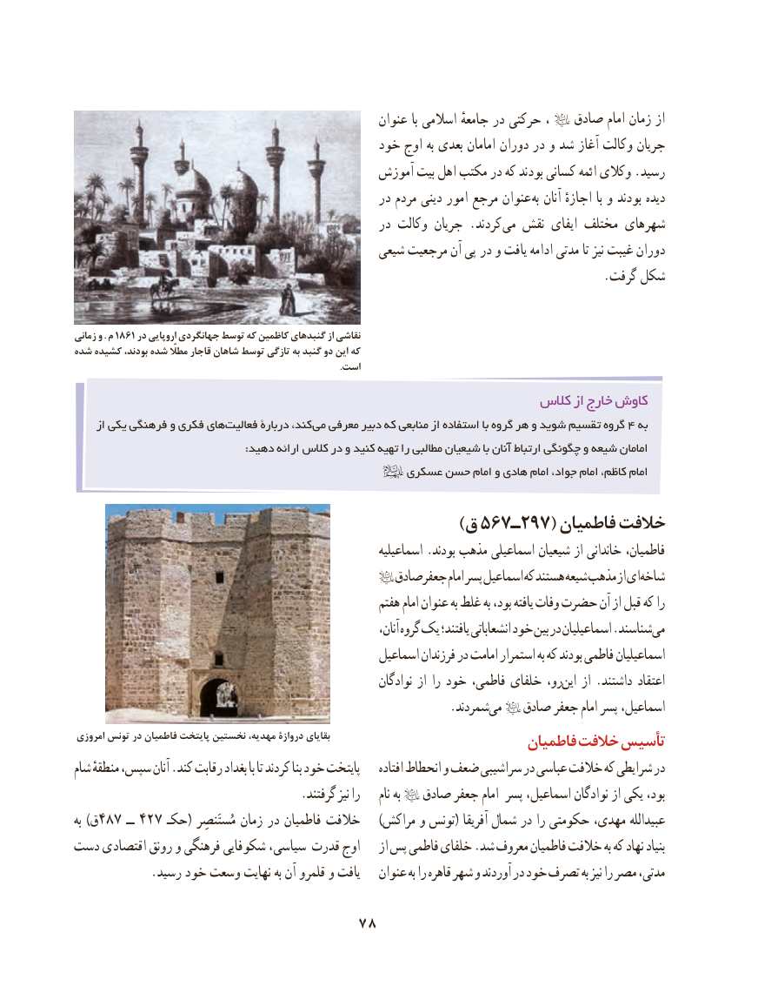

# PDF page 88

عنوان با اسالمی جامعهٔ در حرکتی ،   صادق امام زمان از
                                           خود اوج به بعدی امامان دوران در و شد آغاز وکالت جریان
                                            آموزش بیت اهل مکتب در که بودند کسانی ائمه وکالی .رسید
                                                   در مردم دینی امور مرجع عنوان  به آنان اجازهٔ با و بودند دیده
                                                   در وکالت جریان .کردند می نقش ایفای مختلف شهرهای
                                               شیعی مرجعیت آن پی   در و یافت ادامه مدتی تا نیز غیبت دوران
                                                                                       .گرفت شکل

زمانی و . م 1861 در اروپایی جهانگردی توسط که کاظمین گنبدهای از نقاشی
شده کشیده بودند، شده مطااّلّ قاجار شاهان توسط تازگی به گنبد دو این که
                                                                                                                 .است

                                                            كالس از خارج كاوش
     از یکی فرهنگی و فکری هایفعالیت‌       دربارۀ کند، می معرفی دبیر که منابعی از استفاده با گروه هر و شوید تقسیم گروه 4 به
                                                :دهید ارائه کالس در و کنید تهیه را مطالبی شیعیان با آنان ارتباط چگونگی و شیعه امامان
                                              عسکری حسن امام و هادی امام جواد، امام کاظم، امام

                                                        )ق 567ـ297( فاطمیان خالفت
                                                              اسماعیلیه .بودند مذهب اسماعیلی شیعیان از خاندانی فاطمیان،
                                                                                                      صادق جعفر امام پسر اسماعیل که هستند شیعه مذهب از ایشاخه‌
                                                         هفتم امام عنوان به غلط به بود، یافته وفات حضرت آن از قبل که را
                                                                           آنان، گروه یک یافتند؛ انشعاباتی خود بین در اسماعیلیان .شناسندمی‌
                                                     اسماعیل فرزندان در امامت استمرار به که بودند فاطمی اسماعیلیان
                                                                نوادگان از را خود فاطمی، خلفای رو،این‌   از .داشتند اعتقاد
                  .‌شمردندمی   صادق جعفر امام پسر اسماعیل،
امروزی تونس در فاطمیان پایتخت نخستین مهدیه، دروازۀ بقایای                            فاطمیان خالفت تأسیس
شام منطقهٔ سپس، آنان .کند رقابت بغداد با تا کردند بنا خود پایتخت    افتاده انحطاط و ضعف سراشیبی در عباسی خالفت که شرایطی در
                                     .گرفتند نیز را     نام به        صادق جعفر امام پسر اسماعیل، نوادگان از یکی بود،
به )ق487 ــ 427 حکـ( مُستَنصِر زمان در فاطمیان خالفت    )مراکش و تونس( آفریقا شمال در را حکومتی مهدی، عبیدالله
دست اقتصادی رونق و فرهنگی شکوفایی سیاسی، قدرت اوج    از پس فاطمی خلفای .شد معروف فاطمیان خالفت به که نهاد بنیاد
             .رسید خود وسعت نهایت به آن قلمرو و یافت   عنوان به را قاهره شهر و آوردند در خود تصرف به نیز را مصر مدتی،

                               78

