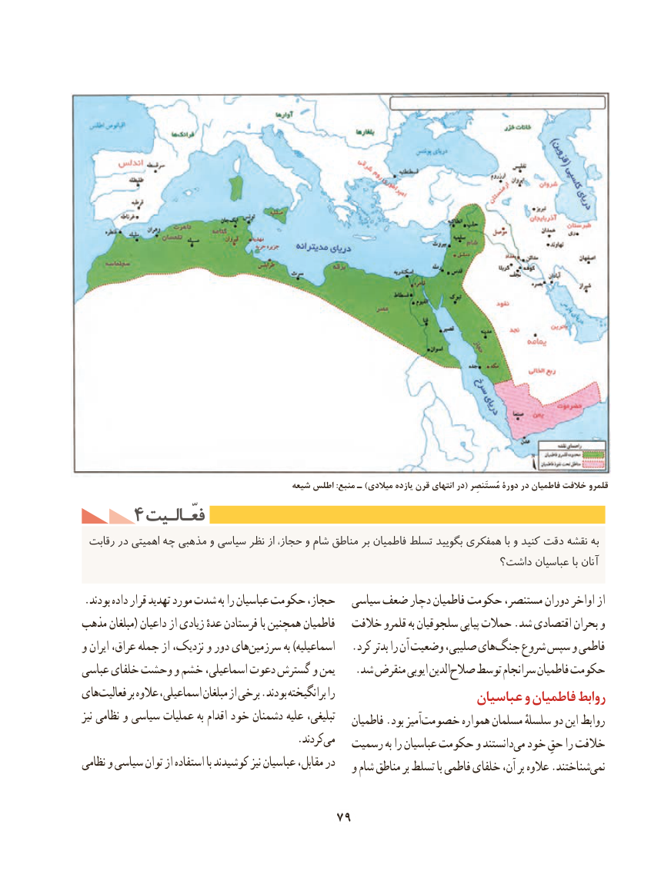

# PDF page 89

شیعه اطلس :منبع ـ )میالدی یازده قرن انتهای در( مُستَنصِر دورۀ در فاطمیان خالفت قلمرو
     4 فعّـالـیتفعّـالـیت
 رقابت در اهمیتی چه مذهبی و سیاسی نظر از حجاز، و شام مناطق بر فاطمیان تسلط بگویید همفکری با و کنید دقت نقشه به
                                                                داشت؟ عباسیان با آنان
.بودند داده قرار تهدید مورد شدت به را عباسیان حکومت حجاز،   سیاسی ضعف دچار فاطمیان حکومت مستنصر، دوران اواخر از
مذهب مبلغان( داعیان از زیادی عدهٔ فرستادن با همچنین فاطمیان   خالفت قلمرو به سلجوقیان پیاپی حمالت .شد اقتصادی بحران و
و ایران عراق، جمله از نزدیک، و دور هایسرزمین‌         به )اسماعیلیه   .کرد بدتر را آن وضعیت صلیبی، هایجنگ‌    شروع سپس و فاطمی
عباسی خلفای وحشت و خشم اسماعیلی، دعوت گسترش و یمن .‌شد منقرض ایوبی الدینصالح توسط سرانجام فاطمیان حکومت
هایفعالیت‌       بر عالوه اسماعیلی، مبلغان از برخی .بودند برانگیخته را                     عباسیان و فاطمیان روابط
نیز نظامی و سیاسی عملیات به اقدام خود دشمنان علیه تبلیغی،                                                           فاطمیان .بود آمیزخصومت‌        همواره مسلمان سلسلهٔ دو این روابط
               .‌کردندمی                                           رسمیت به را عباسیان حکومت و دانستندمی‌  خود حقِ را خالفت
نظامی و سیاسی توان از استفاده با کوشیدند‌نیز عباسیان مقابل، در                                                  و شام مناطق بر تسلط با فاطمی خلفای آن، بر عالوه .شناختندنمی‌

                                  79

