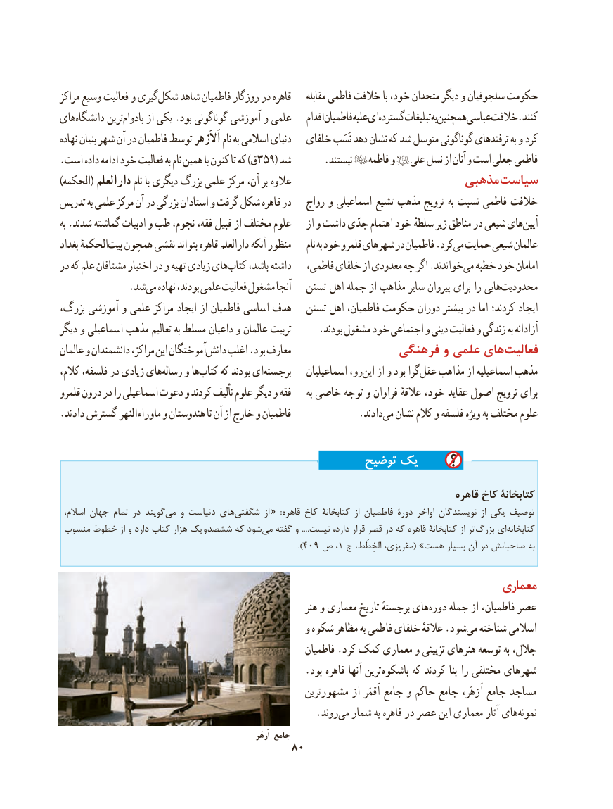

# PDF page 90

مراکز وسیع فعالیت و گیریشکل‌    شاهد فاطمیان روزگار در قاهره     مقابله فاطمی خالفت با خود، متحدان دیگر و سلجوقیان حکومت
هایدانشگاه‌       ترینبادوام‌     از یکی .بود گوناگونی آموزشی و علمی    اقدامفاطمیانعلیهایگسترده‌      تبلیغاتبههمچنینعباسیخالفت.کنند
نهاده بنیان شهر آن در فاطمیان توسط اَالَزهر نام به اسالمی دنیای   خلفای نَسَب دهد نشان که شد متوسل گوناگونی ترفندهای به و کرد
.است داده ادامه خود فعالیت به نام همین با کنون تا که )ق359( شد       .نیستند    فاطمه و   علی نسل از آنان و است جعلی فاطمی
)الحکمه( دارالعلم نام با دیگری بزرگ علمی مرکز آن، بر  عالوه                         مذهبی سیاست
تدریس به علمی مرکز آن در بزرگی استادان و گرفت شکل قاهره در   رواج و اسماعیلی تشیع مذهب ترویج به نسبت فاطمی خالفت
به .شدند گماشته ادبیات و طب نجوم، فقه، قبیل از مختلف علوم    از و داشت جدّی اهتمام خود سلطهٔ زیر مناطق در شیعی هایآیین‌
بغداد الحکمهٔبیت‌  همچون نقشی بتواند قاهره دارالعلم آنکه منظور     نام به خود قلمرو شهرهای در فاطمیان .کردمی‌  حمایت شیعی عالمان
در که علم مشتاقان اختیار در و تهیه زیادی هایکتاب‌    باشد، داشته   فاطمی، خلفای از معدودی چه اگر .خواندندمی‌  خطبه خود امامان
       . شد می نهاده بودند، علمی فعالیت مشغول آنجا   تسنن اهل جمله از مذاهب سایر پیروان برای را هاییمحدودیت‌
بزرگ، آموزشی و علمی مراکز ایجاد از فاطمیان اساسی هدف   تسنن اهل فاطمیان، حکومت دوران بیشتر در اما کردند؛ ایجاد
دیگر و اسماعیلی مذهب تعالیم به مسلط داعیان و عالمان تربیت      .بودند مشغول خود اجتماعی و دینی فعالیت و زندگی به آزادانه
عالمان و دانشمندان مراکز، این آموختگاندانش‌    اغلب .بود معارف                فرهنگی  و  علمی هایفعالیت‌
کالم، فلسفه، در زیادی هایرساله‌    و هاکتاب‌    که بودند ایبرجسته‌          اسماعیلیان رو،این‌   از و بود گراعقل‌   مذاهب از اسماعیلیه مذهب
قلمرو درون در را اسماعیلی دعوت و کردند تألیف علوم دیگر و فقه     به خاصی توجه و فراوان عالقهٔ خود، عقاید اصول ترویج برای
.دادند گسترش ماوراءالنهر و هندوستان تا آن از خارج و فاطمیان     .‌دادندمی نشان کالم و فلسفه ویژه به مختلف علوم

                                                توضیح یک
                                                                                    قاهره کاخ کتابخانۀ
 اسالم، جهان تمام در گویندمی‌   و دنیاست های‌شگفتی  از «  :قاهره کاخ کتابخانۀ  از فاطمیان دورۀ اواخر نویسندگان  از یکی توصیف
 منسوب خطوط از و دارد کتاب هزار یک  و ششصد که شود‌می گفته و ....نیست دارد، قرار قصر در که قاهره کتابخانۀ از تر بزرگ ای‌کتابخانه
                                                       ).409 ص ،1 ج الخِطَط، مقریزی،( »هست بسیار آن در صاحبانش به

                                                                            معماری
                                                            هنر و معماری تاریخ برجستهٔ های‌دوره جمله از فاطمیان، عصر
                                                  و شکوه مظاهر به فاطمی خلفای عالقهٔ .شود‌می شناخته اسالمی
                                                          فاطمیان .کرد کمک معماری و تزیینی هنرهای توسعه به جالل،
                                                  .بود قاهره آنها ترین  باشکوه که کردند بنا را مختلفی شهرهای
                                                   مشهورترین از اَقمَر جامع و حاکم جامع اَزهَر، جامع مساجد
                                                    .روند ‌می شمار به قاهره در عصر این معماری آثار هاینمونه‌
                                                                                     اَزهَر جامع
                                     80

