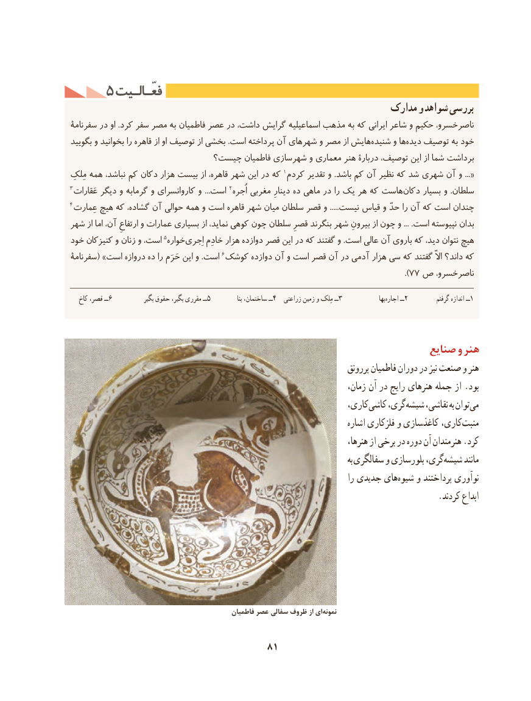

# PDF page 91

5 فعّـالـیتفعّـالـیت
                                                            مدارک و شواهد بررسی
سفرنامۀ در او .کرد سفر مصر به فاطمیان عصر در داشت، گرایش اسماعیلیه مذهب به که ایرانی شاعر و حکیم ناصرخسرو،
بگویید و بخوانید را قاهره از او توصیف از بخشی .است پرداخته آن شهرهای و مصر از هایششنیده‌     و هادیده‌   توصیف به خود
                         چیست؟ فاطمیان شهرسازی و معماری هنر دربارۀ توصیف، این از شما برداشت
مِلکِ همه نباشد، کم دکان هزار بیست از قاهره، شهر این در که 1«...کردم تقدیر و .باشد کم آن نظیر که شد شهری آن و
3عَقارات دیگر و گرمابه و کاروانسرای و ...است 2اُجره مغربی دینارِ ده ماهی در را یک هر که هاستدکان‌     بسیار و .سلطان
4عِمارت هیچ که گشاده، آن حوالی همه و است قاهره شهر میان سلطان قصر و .....نیست قیاس و حدّ را آن که است چندان
شهر از اما آن، ارتفاعِ و عمارات بسیاری از نماید، کوهی چون سلطان قصرِ بنگرند شهر بیرونِ از چون و ... .است نپیوسته بدان
خود کنیزکان و زنان و است، 5خوارهاِجری‌     خادِم هزار دوازده قصر این در که گفتند و .است عالی آن باروی که دید، نتوان هیچ
سفرنامۀ( »است دروازه ده را حَرَم این و .است 6کوشک دوازده آن و است قصر آن در آدمی هزار سی که گفتند االّ داند؟ که
                                                                                       ).77 ص ناصرخسرو،

   کاخ قصر، ــ6             بگیر حقوق بگیر، مقرری ــ5               بنا ساختمان، ــ4  زراعتی زمین و مِلک ــ3                 بها‌اجاره ــ2           گرفتم اندازه ــ1

                                                                   صنایع و هنر
                                                                            پررونق فاطمیان دوران در نیز صنعت و هنر
                                                                           زمان، آن در رایج هنرهای جمله از .بود
                                                                  کاری،کاشی‌    گری،شیشه‌    نقاشی، به توانمی‌
                                                                              اشاره فلزکاری و کاغذسازی کاری،منبت‌
                                                                                 هنرها، از برخی در دوره آن هنرمندان .کرد
                                                                                                         به سفالگری و بلورسازی گری،شیشه‌      مانند
                                                                                  را جدیدی هایشیوه‌    و پرداختند نوآوری
                                                                                      .کردند ابداع

                                                 فاطمیان عصر سفالی ظروف از ای ‌نمونه

                                     81

