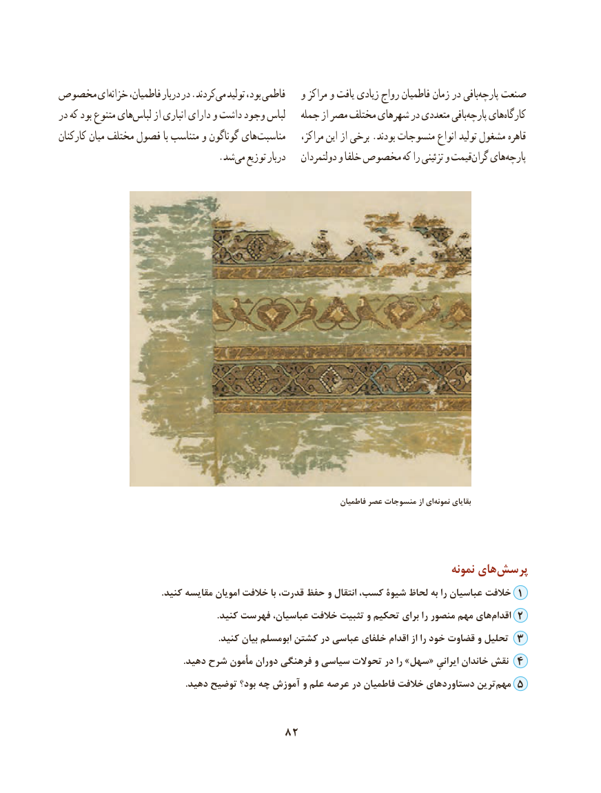

# PDF page 92

مخصوص ایخزانه‌    فاطمیان، دربار در .کردندمی‌  تولید بود، فاطمی   و مراکز و یافت زیادی رواج فاطمیان زمان در بافیپارچه‌   صنعت
در که بود متنوع هایلباس‌     از انباری دارای و داشت وجود لباس   جمله از مصر مختلف شهرهای در متعددی بافیپارچه‌    هایکارگاه‌
کارکنان میان مختلف فصول با متناسب و گوناگون های‌ مناسبت    مراکز، این از برخی .بودند منسوجات انواع تولید مشغول قاهره
                 .‌شدمی توزیع دربار    دولتمردان و خلفا مخصوص که را تزئینی و قیمتگران‌   هایپارچه‌

                                                                            فاطمیان عصر منسوجات از ای‌نمونه بقایای

                                                                                   نمونه های‌پرسش
 .1کنید مقایسه امویان خالفت با قدرت، حفظ و انتقال کسب، شیوۀ لحاظ به را عباسیان خالفت
                                                                     .کنید فهرست عباسیان، خالفت تثبیت و تحکیم برای را منصور مهم هایاقدام‌    2
                                                                      .کنید بیان ابومسلم کشتن در عباسی خلفای اقدام از را خود قضاوت و تحلیل 3
                                                      .دهید شرح مأمون دوران فرهنگی و سیاسی تحوالت در را »سهل« ایرانیِ خاندان نقش 4
                                                       .دهید توضیح بود؟ چه آموزش و علم عرصه در فاطمیان خالفت دستاوردهای ترینمهم‌   5

                                 82

