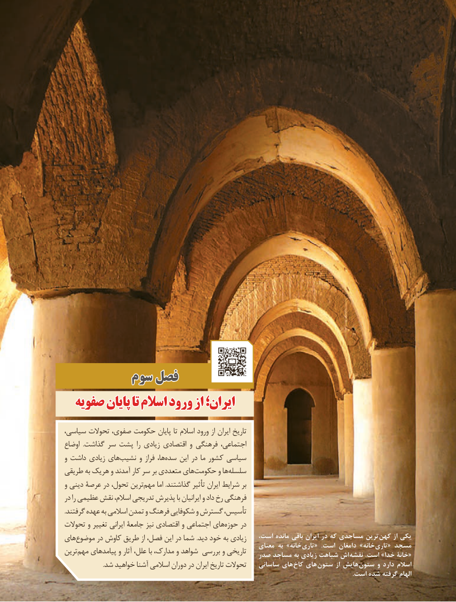

# PDF page 93

سومسوم فصلفصل
  صفویهصفویه پایانپایان تاتا اسالماسالم ورودورود ازاز ایران؛ایران؛

،تاریخسیاسی تحوالت صفوی، حکومت پایان تا اسالم ورود از ایران
اوضاع  .گذاشت سر پشت را زیادی اقتصادی و فرهنگی اجتماعی،
و داشت زیادی هاینشیب‌      و فراز ها،سده‌    این در ما کشور سیاسی
طریقی به یک هر و آمدند کار سر بر متعددی هایحکومت‌       و هاسلسله‌
و دینی عرصۀ در تحول، ترینمهم‌     اما .گذاشتند تأثیر ایران شرایط بر
در را عظیمی نقش اسالم، تدریجی پذیرش با ایرانیان و داد رخ فرهنگی
.گرفتند عهده به اسالمی تمدن و فرهنگ شکوفایی و گسترش تأسیس،
تحوالت و تغییر ایرانی جامعۀ نیز اقتصادی و اجتماعی هایه‌ حوز‌   در
                                                     است، مانده باقی ایران در که مساجدی ترین  کهن از یکیهایموضوع‌      در کاوش طریق از فصل، این در شما .دید خود به زیادی                                                             معنای به »خانه تاری«  .است دامغان »خانه تاری« مسجدترینمهم‌   پیامدهای و آثار علل، با مدارک، و شواهد بررسی و تاریخی                                                صدر مساجد به زیادی شباهت اش  «نقشه .است »خدا خانۀ
                         .شد خواهید آشنا اسالمی دوران در ایران تاریخ تحوالت   ساسانی های  کاخ های ستون از هایش  ستون و دارد اسالم
                                                                                                                                                                                       .است شده گرفته الهام

