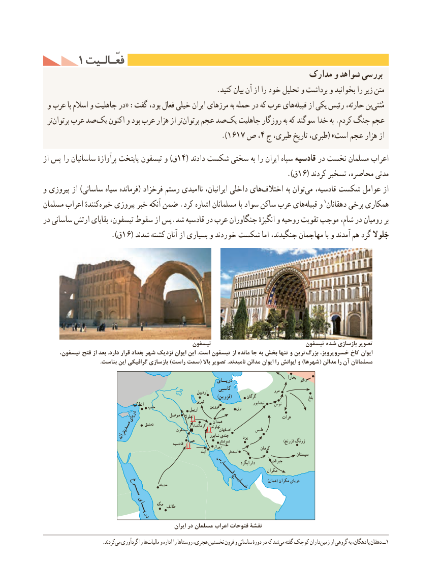

# PDF page 96

1 فعّـالـیتفعّـالـیت
                                                          مدارک و شواهد بررسی
                                                 .کنید بیان آن از را خود تحلیل و برداشت و بخوانید را زیر متن‌
 و عرب با اسالم و جاهلیت در« :گفت بود، فعال خیلی ایران مرزهای به حمله در که عرب هایقبیله‌    از یکی رئیس حارثه، بنمُثنی‌
  ترپرتوان‌    عرب صد یک اکنون و بود عرب هزار از ترپرتوان‌    عجم صد یک جاهلیت روزگار به که سوگند خدا به .کردم جنگ عجم
                                             ).1617 ص ،4 ج طبری، تاریخ طبری،( »است عجم هزار از
از پس را ساسانیان پرآوازهٔ پایتخت تیسفون و )ق14( دادند شکست سختی به را ایران سپاه قادسیه در نخست مسلمان اعراب
                                                                                 ).ق16( کردند تسخیر محاصره، مدتی
و پیروزی از )ساسانی سپاه فرمانده( فرخزاد رستم ناامیدی ایرانیان، داخلی های‌اختالف به توان‌می قادسیه، شکست عوامل از
مسلمان اعراب کنندهٔ‌خیره پیروزی خبر آنکه ضمن .کرد اشاره مسلمانان با سواد ساکن عرب های ‌قبیله و 1دهقانان برخی همکاری
در ساسانی ارتش بقایای تیسفون، سقوط از پس.شد قادسیه در عرب جنگاوران انگیزهٔ و روحیه تقویت موجب شام، در رومیان بر
               ).16(ق    شدند کشته آنان از بسیاری و خوردند شکست اما جنگیدند، مهاجمان با و آمدند هم گرد جَلوال

                                               تیسفون                              تیسفون شده بازسازی تصویر
      تیسفون، فتح از بعد .دارد قرار بغداد شهر نزدیک ایوان این .است تیسفون از مانده جا به بخش تنها و ترین  بزرگ پرویز،  خسرو کاخ ایوان
                                         .بناست این گرافیکی بازسازی )راست سمت( باال تصویر .نامیدند مدائن ایوان را ایوانش و )شهرها( مدائن را آن مسلمانان
                                                                                دریــای                                بخارا سمرقند
                                                                        کاسپی                     مرو                                                                                        اردبیل
                                                                                                                     )قزوین(        گرگان                                 بلخ
                                                                                                  تبریز                            نیشابور    توس                                                      انطاکیه                                              حلب                                                                                       قزوین       ری                                                                                   اربیل
                                                                                      جلوال                                         هرات                            دریای            موصل                                                                                         همدان                                              دمشق                        کرمانشاه   نهاوند                                                                   تیسفون               اصفهان         طبس                                      مــدیترانه                                        شاپور جندی         یزد                                                                                  حیره           شوشتر                                           )زرنج( زرنگ                                                                          قادسیه                                                                                                  اهواز                     کرمان                                                                                                                  ابله          استخر                                                                                                                            سیستان
                                                                                                               دارابگرد        جیرفت                                                                          فــــــارس              مکران
                                                                                                                                                                                     )عمان( مکران دریای                                                                      مدینه                            خـــلیــج                                      ســــرخ

                                                     مکه                                                       طائف                                                دریــــای
                                                        ایران در مسلمان اعراب فتوحات نقشۀ
                       .کردندمی‌  گردآوری را هامالیات‌    و اداره را روستاها هجری، نخستین قرون و ساسانی دورهٔ در که شدمی‌  گفته کوچک داران زمین از گروهی به دهگان، یا دهقان ــ1

