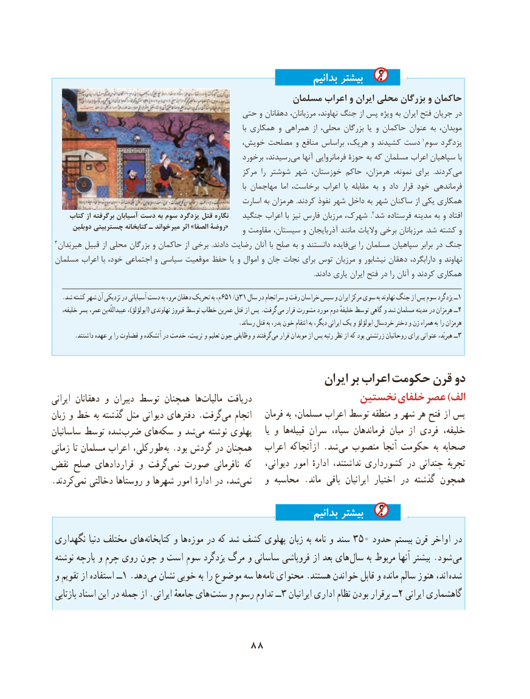

# PDF page 98

بدانیم بیشتر
                                                 مسلمان اعراب و ایران محلی بزرگان و حاکمان
                                        حتی و دهقانان مرزبانان، نهاوند، جنگ از پس ویژه به ایران فتح جریان در
                                                                                                با همکاری و همراهی  از محلی، بزرگان  یا و حاکمان عنوان به موبدان،
                                          خویش، مصلحت و منافع براساس هریک، و کشیدند دست 1سوم یزدگرد
                                                      برخورد رسیدند، ‌می آنها فرمانروایی حوزۀ به که مسلمان اعراب سپاهیان با
                                                    مرکز  را شوشتر شهر خوزستان، حاکم هرمزان، نمونه، برای   .کردندمی‌
                                                                                                با مهاجمان  اما برخاست، اعراب  با مقابله به و داد قرار خود فرماندهی
                                                  اسارت به هرمزان .کردند نفوذ شهر داخل به شهر ساکنان از یکی همکاری
     کتاب از برگرفته آسیابان دست به سوم یزدگرد قتل نگاره   جنگید اعراب با نیز فارس مرزبان شهرک،  . 2شد فرستاده مدینه به و افتاد
      دوبلین چستربیتی کتابخانه ـ میرخواند اثر »الصفاروضه«                                                           و مقاومت سیستان، و آذربایجان مانند والیات برخی مرزبانان  .شد کشته و
 3هیربَدان قبیل از محلی بزرگان و حاکمان از برخی  .دادند رضایت آنان با صلح به و دانستند فایده‌بی را مسلمان سپاهیان برابر در جنگ
 مسلمان اعراب با خود، اجتماعی و سیاسی موقعیت حفظ یا و اموال و جان نجات برای توس مرزبان و نیشابور دهقان دارابگرد، و نهاوند
                                                                                                                                                                .دادند یاری ایران فتح در را آنان و کردند همکاری

   .شد کشته شهر آن نزدیکی در آسیابانی دست به مرو، دهقان تحریک به م،651 /ق31 سال در سرانجام و رفت خراسان سپس و ایران مرکز سوی به نهاوند جنگ از پس سوم یزدگرد ــ1
 ،بنخلیفه پسر عمر،     عبیداللّه ،)ابولؤلؤ( نهاوندی فیروز توسط خطاب عمربن قتل از پس .گرفت 2می قرار مشورت مورد دوم خلیفهٔ توسط گاهی و شد مسلمان مدینه در هرمزان ــ
                                                              .رساند قتل به پدر، خون انتقام به دیگر، ایرانی یک و ابولؤلؤ خردسال دختر و زن همراه به را هرمزان
.‌داشتند عهده بر را قضاوت و آتشکده در خدمت تربیت، و تعلیم چون وظایفی و گرفتندمی قرار موبدان از پس رتبه نظر از که بود زرتشتی روحانیان برای عنوانی هیربَد، ــ3

                                                         ایران بر اعراب حکومت قرن دو
ایرانی دهقانان و  دبیران توسط همچنان  هامالیات‌      دریافت                  نخستین خلفای عصر )الف
زبان و خط به گذشته مثل دیوانی دفترهای .فت ‌گر ‌می انجام    فرمان به مسلمان، اعراب توسط منطقه و شهر هر فتح از پس
ساسانیان توسط شده ضرب های ‌سکه و شدمی‌   نوشته پهلوی      یا و هاقبیله‌    سران سپاه، فرماندهان میان از فردی خلیفه،
زمانی تا مسلمان اعراب کلی،  طور  به .بود گردش در همچنان   اعراب که آنجا از .شد می منصوب آنجا حکومت  به صحابه
نقض صلح قراردادهای و گرفت ‌نمی صورت  نافرمانی که    دیوانی، امور ادارهٔ نداشتند، کشورداری در چندانی تجربهٔ
.‌کردند نمی دخالتی روستاها و شهرها امور ادارهٔ در شد،‌نمی   و محاسبه .ماند  باقی  ایرانیان  اختیار در گذشته همچون

                                                                بدانیم بیشتر
 نگهداری دنیا مختلف های  کتابخانه و ها موزه در که شد کشف پهلوی زبان به نامه و سند 350 حدود بیستم قرن اواخر در
 نوشته پارچه و چرم روی چون و است سوم یزدگرد مرگ و ساسانی فروپاشی از بعد های  سال به مربوط آنها بیشتر .شود می
 و تقویم از استفاده ــ1 .دهد  می نشان خوبی به را موضوع سه ها نامه محتوای .هستند خواندن قابل و مانده سالم هنوز اند،  شده
 بازتابی اسناد این در جمله از .ایرانی جامعهٔ های  سنت و رسوم تداوم ــ3 ایرانیان اداری نظام بودن برقرار ــ2 ایرانی گاهشماری

                               88

