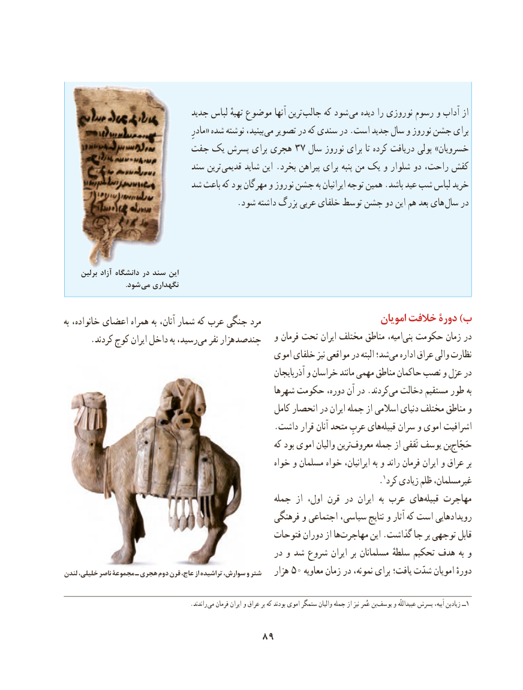

# PDF page 99

جدید لباس تهیهٔ موضوع آنها ترین  جالب که شود می دیده را نوروزی رسوم و آداب از
                                             مادرِ« شده نوشته بینید، می تصویر در که سندی در .است جدید سال و نوروز جشن برای
                      جفت یک پسرش برای هجری ۳۷ سال نوروز برای تا کرده دریافت پولی »خسرویان
                             سند ترین  قدیمی شاید این .بخرد پیراهن برای پنبه من یک و شلوار دو راحت، کفش
                         شد باعث که بود مهرگان و نوروز جشن به ایرانیان توجه همین .باشد عید شب لباس خرید
  . شود داشته بزرگ عربی خلفای توسط جشن دو این هم بعد های سال در

     برلین آزاد دانشگاه در سند این
       . شود می نگهداری

                                                                         امویان خالفت دورۀ )ببه خانواده، اعضای همراه به آنان، شمار که عرب جنگی مرد
                                                  و فرمان تحت ایران مختلف مناطق امیه،بنی‌  حکومت زمان در.‌کردند کوچ ایران داخل به رسید،می نفر هزار چندصد
                                                اموی خلفای نیز مواقعی در البته شد؛می‌   اداره عراق والی نظارت
                                                              آذربایجان و خراسان مانند مهمی مناطق حاکمان نصب و عزل در
                                                   شهرها حکومت دوره، آن در .کردندمی‌  دخالت مستقیم طور به
                                                     کامل انحصار در ایران جمله از اسالمی دنیای مختلف مناطق و
                                                  .داشت قرار آنان متحد عربِ هایقبیله‌      ‌ سران و اموی اشرافیت
                                                         که بود اموی والیان ترینمعروف‌     جمله از ثَقفی یوسف بنحَجّاج‌
                                                     خواه و مسلمان خواه ایرانیان، به و راند‌ فرمان ایران و عراق بر
                                                                                       .1کرد زیادی ظلم غیرمسلمان،
                                                  جمله از اول، قرن در  ایران  به عرب هایقبیله‌    مهاجرت
                                                 فرهنگی و اجتماعی سیاسی، نتایج و آثار که است رویدادهایی
                                               فتوحات دوران از هامهاجرت‌        این .گذاشت جا بر توجهی قابل
                                                  در و شد شروع ایران بر مسلمانان سلطهٔ تحکیم هدف به و
لندن خلیلی، ناصر مجموعۀ ـ هجری دوم قرن عاج، از تراشیده سوارش، و شتر   هزار 50 معاویه زمان در نمونه، برای یافت؛ شدّت امویان دورهٔ

                                          .راندند می فرمان ایران و عراق بر که بودند اموی ستمگر والیان جمله از نیز عُمر بن ‌یوسف و ‌عبیداللّه١پسرش اَبیه، زیادبن ــ

                                 89

