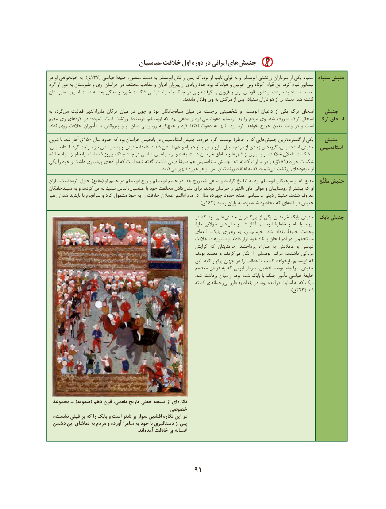

# PDF page 101

عباسیان خالفت اول دوره در ایرانی هایجنبش‌
در او خونخواهی به ،)ق137( عباسی خلیفۀ منصور، دست به ابومسلم قتل از پس که بود، او نایب قولی به و ابومسلم زرتشتی سرداران از یکی سنباد  سنباد جنبش
گرد او دور به طبرستان و ری خراسان، در مختلف مذاهب و ادیان پیروان از زیادی عدۀ  .بود هولناک و خونین ولی کوتاه قیام، این  .کرد قیام نیشابور
طبرستان اسپهبد دست به بعد اندکی و خورد شکست عباسی سپاه با جنگ در ولی گرفت؛ را قزوین و ری قومس، نیشابور، سرعت به سنباد  .آمدند
   .‌ماندند وفادار وی به مرگش از پس سنباد، هواداران از ایدسته .شد کشته
به کرد،‌می فعالیت  ماوراءالنهر ترکان میان در چون و بود جامگان‌سیاه میان در برجسته شخصیتی و ابومسلم داعیان  از یکی ترک اسحاق   جنبش
مقیم ری های ‌کوه در نمرده؛ است، زرتشت فرستادۀ ابومسلم، که بود مدعی و کردمی‌  دعوت ابومسلم به  را مردم وی  .شد معروف ترک اسحاق  تُرک اسحاق
.‌نداد روی خالفت مأموران  با پیروانش و  او  ‌میان  ‌رویارویی  ‌گونه ‌هیچ و کرد اکتفا  ‌دعوت  ‌به تنها وی  .کرد خواهد خروج معین وقت در و است
شروع با .شد آغاز ق150 سال حدود که بود خراسان بادغیس در استادسیس جنبش خورده، گره ابومسلم خاطرۀ با که هاییجنبش‌      ترین‌گسترده از یکی   جنبش
استادسیس، .کرد سرایت نیز سیستان به او جنبش دامنۀ .شدند داستان  هم و همراه او با تبر و پارو بیل، با مردم از زیادی های‌گروه استادسیس، جنبش  استادسیس
خلیفه سپاه از سرانجام اما شد، پیروز جنگ چند در عباسی سپاهیان بر و یافت دست خراسان مناطق و شهرها از بسیاری بر خالفت، عامالن شکست با
یکی را خود و داشت پیغمبری ادعای او که است شده گفته .داشت دینی صبغۀ هم استادسیس جنبش .شد کشته اسارت در و )ق151( خورد شکست
                    .‌کنندمی ظهور هزاره هر از پس زرتشتیان اعتقاد به که شمردمی‌  زرتشت موعودهای از
یاران .است کرده حلول )مقنع( او جسم در ابومسلم روح و ابومسلم جسم در خدا روح شد مدعی و گرایید تناسخ به بود ابومسلم سرهنگان از که مقنع    مُقَنَّع جنبش
سپیدجامگان به و کردند تن به سفید لباس عباسیان، با خود مخالفت دادن نشان برای بودند، خراسان و ماوراءالنهر موالی و روستاییان از بیشتر که او
رهبر شدن ناپدید با سرانجام و کرد مشغول خود به را خالفت عامالن ماوراءالنهر در سال چهارده حدود مقنع سیاسی ـ دینی جنبش  .شدند معروف
                                                         ).163(ق     رسید پایان به بود، شده محاصره که ای ‌قلعه در جنبش
                                                                      در که بود هایی ‌جنبش ترین ‌بزرگ از یکی خرمدین بابک جنبش  بابک جنبش
                                                                                  مایۀ طوالنی های ‌سال و شد آغاز ابومسلم خاطرۀ و نام  با پیوند
                                                              ای‌قلعه  ،وحشتبابک رهبری  به خرمدینان،   .شد  بغداد خلیفۀ
                                                           خالفت نیروهای با و دادند قرار خود پایگاه آذربایجان در را مستحکم
                                                           گرایش که خرمدینان   .پرداختند  مبارزه  به عامالنش و عباسی
                                                                               بودند معتقد و کردندمی‌    انکار  را ابومسلم مرگ داشتند، مزدکی
                                                                          این  .کند برقرار جهان در را عدالت تا گشت بازخواهد ابومسلم که
                                                           معتصم فرمان به که ایرانی سردار افشین، توسط سرانجام جنبش
                                                                                                                                                      .شد برداشته میان از بود، شده بابک با جنگ مأمور عباسی خلیفۀ
                                                          کشته ای ‌رحمانه ‌بی طرز به بغداد در بود، درآمده اسارت به که بابک
                                                                                                                                                                                      ).ق223( شد

 مجموعة ـ )صفویه( دهم قرن بلعمی، تاریخ خطی نسخه از ای نگاره
                                  خصوصی
 نشسته، فیلی بر که را بابک و است شتر بر سوار افشین نگاره این در
 دشمن این تماشای به مردم و آورده سامرا به خود با دستگیری از پس
                      . اند آمده خالفت ای افسانه

                                         91

