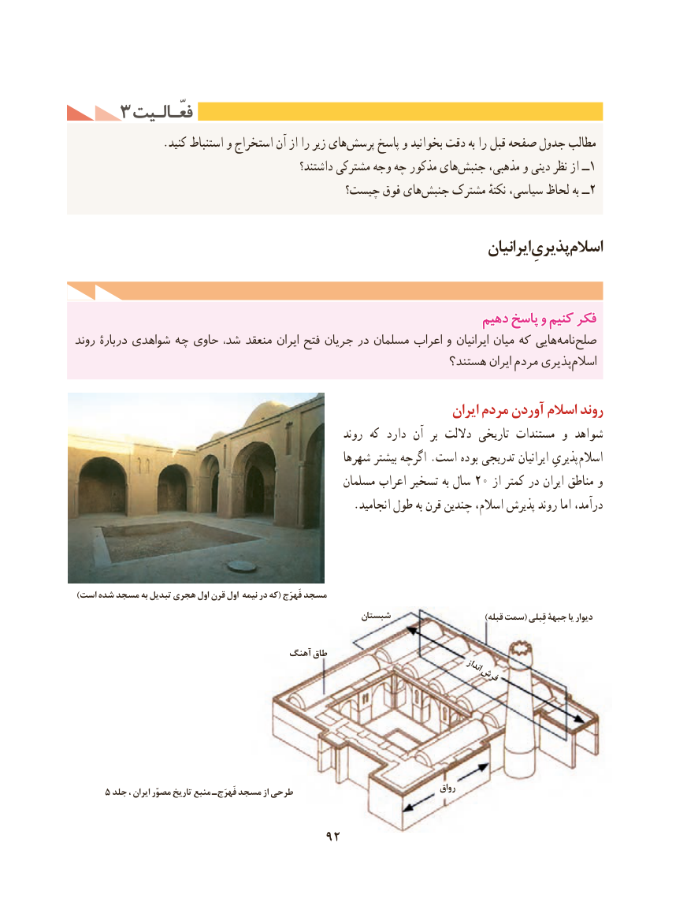

# PDF page 102

3 فعّـالـیتفعّـالـیت
                .کنید استنباط و استخراج آن از را زیر هایپرسش‌     پاسخ و بخوانید دقت به را قبل صفحه جدول مطالب
                                               داشتند؟ مشترکی وجه چه مذکور هایجنبش‌     مذهبی، و دینی نظر از ــ1
                                       چیست؟ فوق های ‌جنبش مشترک نکتهٔ سیاسی، لحاظ به ــ2

                                                                           ایرانیانپذیریِاسالم

                                                             دهیمدهیم پاسخپاسخ وو کنیمکنیم فکرفکر
روند بارۀ در شواهدی چه حاوی شد، منعقد ایران فتح جریان در مسلمان اعراب و ایرانیان میان که هایینامه‌  صلح‌
                                                            هستند؟ ایران مردم پذیریاسالم‌

                                                                      ایران مردم آوردن اسالم روند
                                                        روند که دارد آن  بر داللت تاریخی مستندات و شواهد
                                                  شهرها بیشتر اگرچه .است بوده تدریجی ایرانیان پذیریِ اسالم
                                                   مسلمان اعراب تسخیر به سال 20 از کمتر در ایران مناطق و
                                                   .انجامید طول به قرن چندین اسالم، پذیرش روند اما درآمد،

 )است شده مسجد به تبدیل هجری اول قرن اول نیمه در که( فَهرَج مسجد
                                                          شبستان                           )قبله سمت( قِبلی جبهۀ یا دیوار

                                       آهنگ طاق
                                                                                      انداز                                                 فرش

                                                                                           رواق     5 جلد ، ایران مصوّر تاریخ منبع ـ فَهرَج مسجد از طرحی

                                   92

