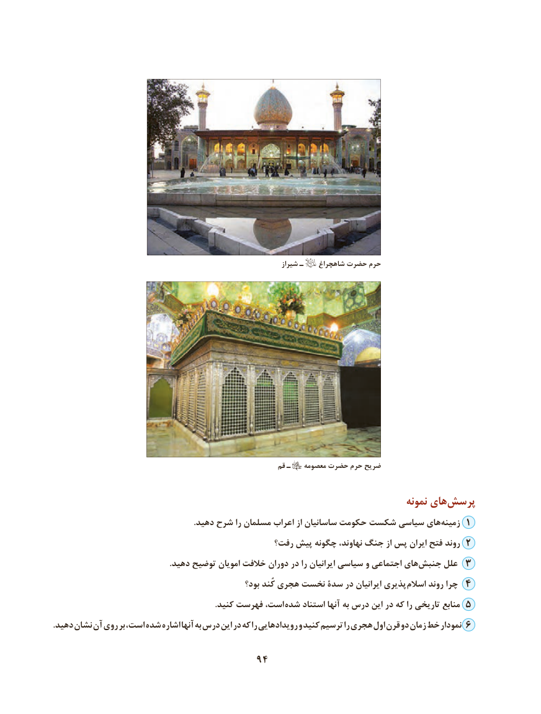

# PDF page 104

شیراز ـ    شاهچراغ حضرت حرم

                                                             قم ـ    معصومه حضرت حرم ضریح

                                                                                   نمونه های‌پرسش
 .‌دهید شرح را مسلمان اعراب از ساسانیان حکومت شکست سیاسی های زمینه 1
                                              رفت؟ پیش چگونه نهاوند، جنگ از پس ایران فتح روند 2
                                                         .دهید توضیح امویان خالفت دوران در را ایرانیان سیاسی و اجتماعی های ‌جنبش علل 3
                                                    بود؟ کُند هجری نخست سدۀ در ایرانیان پذیری اسالم روند چرا 4
                                                                               .کنید فهرست است، شده استناد آنها به درس این در که را تاریخی منابع 5
.دهید نشان آن روی بر است، شده اشاره آنها به درس این در که را رویدادهایی و کنید ترسیم را هجری اول قرن دو زمان خط نمودار 6

                                   94

