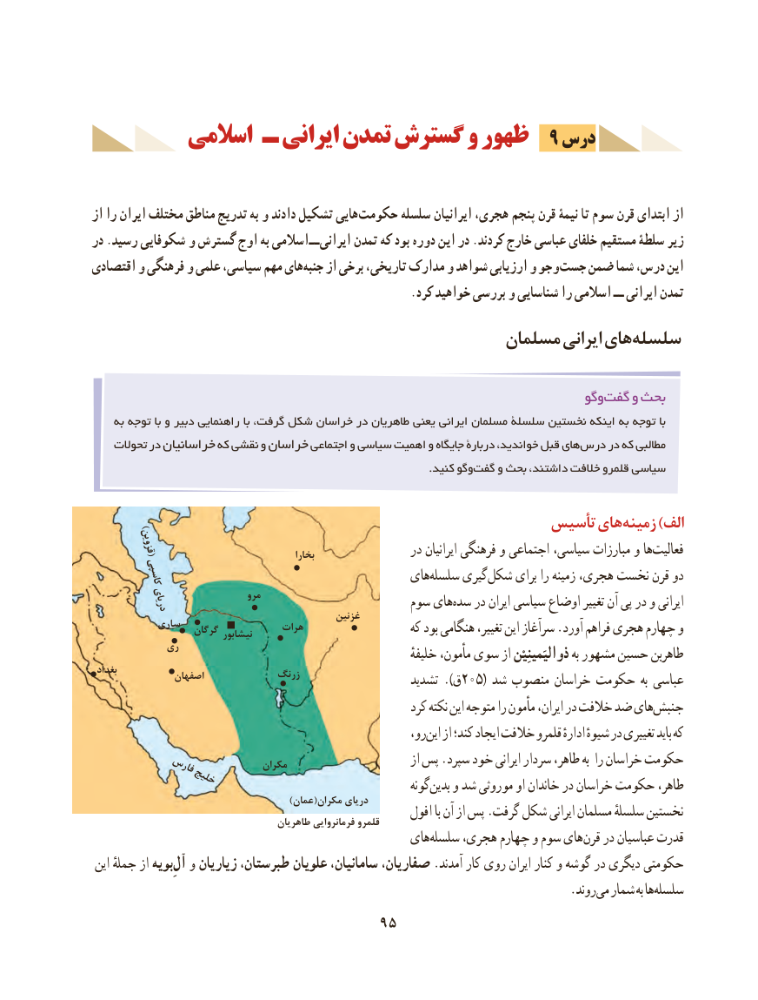

# PDF page 105

اسالمی ـ ایرانی تمدن گسترش و ظهور  9 درس

از را ایران مختلف مناطق تدریج به و دادند تشکیل هایی حکومت  سلسله ایرانیان هجری، پنجم قرن نیمۀ تا سوم قرن ابتدای از
در .رسید شکوفایی و گسترش اوج به اسالمی ــ ایرانی تمدن که بود دوره این در .کردند خارج عباسی خلفای مستقیم سلطۀ زیر
اقتصادی و فرهنگی و علمی سیاسی، مهم هایجنبه‌   از برخی تاریخی، مدارک و شواهد ارزیابی و وجو جست ضمن شما درس، این
                                                         .کرد خواهید بررسی و شناسایی را اسالمی ــ ایرانی تمدن
                                             مسلمان ایرانی هایسلسله‌

                                                                           وگوگفت‌    و بحث
    به توجه با و دبیر راهنمایی با گرفت، شکل خراسان در طاهریان یعنی ایرانی مسلمان سلسلۀ نخستین اینکه به توجه با
    تحوالت در خراسانیان که نقشی و خراسان اجتماعی و سیاسی اهمیت و جایگاه دربارۀ خواندید، قبل هایدرس‌    در که مطالبی
              .‌کنید وگوگفت و بحث داشتند، خالفت قلمرو سیاسی

  )                                                  تأسیس های زمینه )الف
         قزوین(                                                     بخارا                 در ایرانیان فرهنگی و اجتماعی سیاسی، مبارزات و هافعالیت‌
          کاسپی                                     هایسلسله‌     گیریشکل‌     برای را زمینه هجری، نخست قرن دو
            دریای                مرو                      سوم هایسده‌   در ایران سیاسی اوضاع تغییر آن پی در و ایرانی                                                 غزنین            ساری                     گرگان                                   هرات                    که بود هنگامی تغییر، این سرآغاز .آورد فراهم هجری چهارم و                               نیشابور
            ری                                                    خلیفهٔ مأمون، سوی از ذوالیَمینِیْن به مشهور حسین طاهربن
 بغداد                 اصفهان             زرنگ                    تشدید ).ق205( شد منصوب خراسان حکومت به عباسی
                                                         کرد نکته این متوجه را مأمون ایران، در خالفت ضد هایجنبش‌
                                                           رو،این‌   از کند؛ ایجاد خالفت قلمرو ادارهٔ شیوهٔ در تغییری باید که
                                                                   از پس .سپرد خود ایرانی سردار طاهر، به را خراسان حکومت           فارس             مکران              خلیج                                                                گونهبدین‌   و شد موروثی او خاندان در خراسان حکومت طاهر،
                                                   )عمان(مکران دریای
                                                          افول با آن از پس .گرفت شکل ایرانی مسلمان سلسلهٔ نخستین                                       طاهریان فرمانروایی قلمرو
                                                هایسلسله‌    هجری، چهارم و سوم های قرن در عباسیان قدرت
 این جملهٔ از ِبویهآل‌  و زیاریان طبرستان، علویان سامانیان، صفاریان، .آمدند کار روی ایران کنار و گوشه در دیگری حکومتی
                                                                               .روندمی‌  شمار به هاسلسله‌
                                  95

