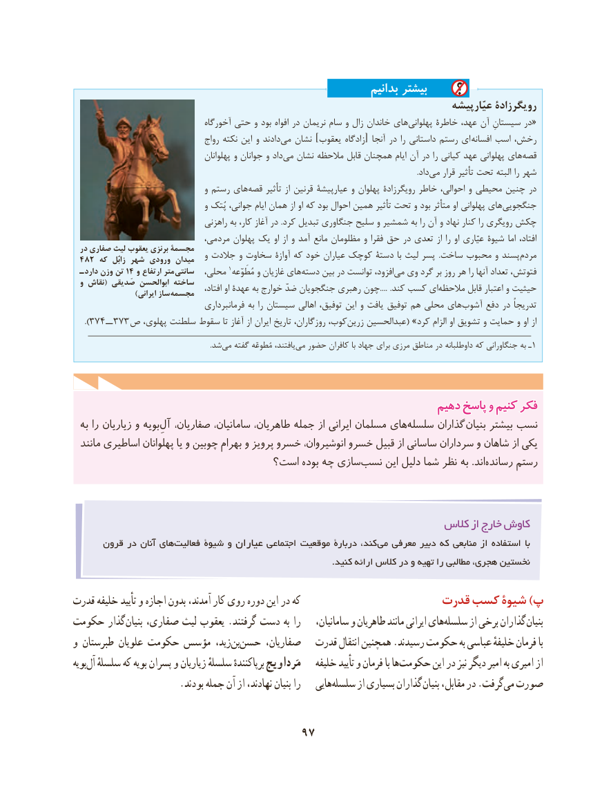

# PDF page 107

بدانیم بیشتر
                                                                                    عیّارپیشه رویگرزادۀ
                                  آخورگاه حتی و بود افواه در نریمان سام و زال خاندان های ‌«پهلوانی خاطرۀ عهد، آن سیستانِ در
                                   رواج نکته این و دادند‌می نشان ]یعقوب زادگاه[ آنجا در را داستانی رستم ای  ‌افسانه اسب رخش،
                                        پهلوانان و جوانان و داد می‌   نشان مالحظه قابل همچنان ایام آن در را کیانی عهد پهلوانی های ‌قصه
                                              .‌دادمی قرار تأثیر تحت البته را شهر
                                    و رستم های‌قصه تأثیر از قرنین عیارپیشۀ و پهلوان رویگرزادۀ خاطر احوالی، و محیطی چنین در
                                    و پُتک جوانی، ایام همان از او که بود احوال همین تأثیر تحت و بود متأثر او پهلوانی های‌جنگجویی
                                  راهزنی به کار، آغاز در .کرد تبدیل جنگاوری سلیح و شمشیر به را آن و نهاد کنار را رویگری چکش
                               مردمی، پهلوان یک او از و آمد مانع مظلومان و فقرا حق در تعدی از را او عیّاری شیوۀ اما افتاد،
  در صفاری لیث یعقوب برنزی مجسمۀ                                    و جالدت و سخاوت آوازۀ که خود عیاران کوچک دستۀ با لیث پسر  .ساخت محبوب و پسندمردم‌ 482 که  زابُل شهر ورودی میدان
  ـ دارد وزن تن 14 و ارتفاع متر سانتی  محلی، 1مُطَوّعه و غازیان های‌دسته بین در توانست افزود، ‌می وی گرد بر روز هر را آنها تعداد فتوتش،
  و نقاش( صَدیقی ابوالحسن ساخته                                             افتاد، او عهدۀ به خوارج ضدّ جنگجویان رهبری چون.... .کند کسب ای‌مالحظه قابل اعتبار و حیثیت   ) ایرانی ساز مجسمه
                                    فرمانبرداری به را سیستان اهالی توفیق، این و یافت توفیق هم محلی های‌آشوب دفع در تدریجاً
   ).374 ــ  373 ص پهلوی، سلطنت سقوط تا آغاز از ایران تاریخ روزگاران، کوب،‌زرین عبدالحسین( »کرد الزام او تشویق و حمایت و او از

                   .‌شد می گفته مُطوعّه یافتند، ‌می حضور کافران با جهاد برای مرزی مناطق در داوطلبانه که جنگاورانی به ـ1

                                                              دهیمدهیم پاسخپاسخ وو کنیمکنیم فکرفکر
  به را زیاریان و بویهآل‌ِهایصفاریان، سامانیان، طاهریان، جمله از ایرانی مسلمان    سلسله‌      گذاران بنیان بیشتر نسب
  مانند اساطیری پهلوانان یا و چوبین بهرام و پرویز خسرو انوشیروان، خسرو قبیل از ساسانی سرداران و شاهان از یکی
                               است؟ بوده چه سازینسب‌     این دلیل شما نظر به .اندرسانده‌     رستم

                                                            کالس از خارج کاوش
      قرون در آنان های ‌فعالیت شیوۀ و عیاران اجتماعی موقعیت دربارۀ کند،  می معرفی دبیر که منابعی از استفاده با
                                                                                           .کنید ارائه کالس در و تهیه را مطالبی هجری، نخستین

قدرت خلیفه تأیید و اجازه بدون آمدند، کار روی دوره این در که                    قدرت کسب شیوۀ )پ
حکومت گذار بنیان صفاری، لیث یعقوب .گرفتند دست به را    سامانیان، و طاهریان مانند ایرانی هایسلسله‌      از برخی گذاران بنیان
و طبرستان علویان حکومت مؤسس زید،بن‌ حسن‌     صفاریان،   قدرت انتقال همچنین .رسیدند حکومت به عباسی خلیفهٔ فرمان با
بویهآل‌  سلسلهٔ که بویه پسران و زیاریان سلسلهٔ برپاکنندهٔ مَرداویج   خلیفه تأیید و فرمان با هاحکومت‌        این در نیز دیگر امیر به امیری از
       .‌بودند جمله آن از نهادند، بنیان را    هاییسلسله‌      از بسیاری گذاران بنیان مقابل، در .گرفتمی‌ صورت

                                  97

