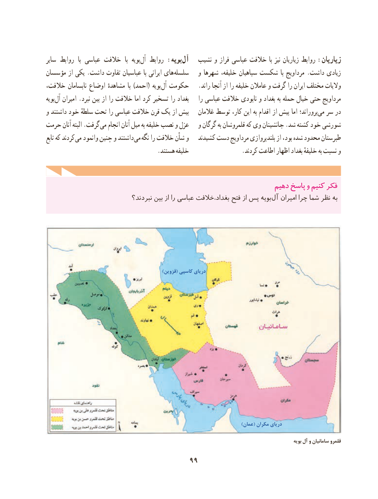

# PDF page 109

سایر روابط  با عباسی خالفت  با  بویه آل روابط :بویه آل   نشیب و فراز عباسی خالفت  با نیز زیاریان روابط :زیاریان
مؤسسان از یکی .داشت تفاوت عباسیان با ایرانی های سلسله   و شهرها خلیفه، سپاهیان شکست  با مرداویج .داشت زیادی
خالفت، نابسامان اوضاع مشاهدهٔ  با )احمد( بویه آل حکومت   .راند آنجا از را خلیفه عامالن و گرفت را ایران مختلف والیات
بویه آل امیران .نبرد بین از را خالفت اما کرد تسخیر را بغداد    را عباسی خالفت نابودی و بغداد به حمله خیال حتی مرداویج
و داشتند خود سلطهٔ تحت را عباسی خالفت قرن یک از بیش   غالمان توسط کار، این به اقدام از پیش اما پروراند؛می‌  سر در
حرمت آنان البته .گرفت می انجام آنان میل به خلیفه نصب و عزل   و گرگان به قلمروشان که وی جانشینان .شد کشته خود شورشی
تابع که کردند می وانمود چنین و داشتند می نگه را خالفت شأن و   کشیدند دست مرداویج بلندپروازی از بود، شده محدود طبرستان
                                     .هستند خلیفه                 .کردند اطاعت اظهار بغداد خلیفهٔ به نسبت و

                                                              دهیمدهیم پاسخپاسخ وو کنیمکنیم فکرفکر
                             نبردند؟ بین از را عباسی خالفت ،بغداد فتح از پس بویه آل امیران چرا شما نظر به

                                                            )قزوین( کاسپی دریای

                                                                                                      )عمان( مکران دریای

                                                                                                                            بویه آل و سامانیان قلمرو

                                    99

