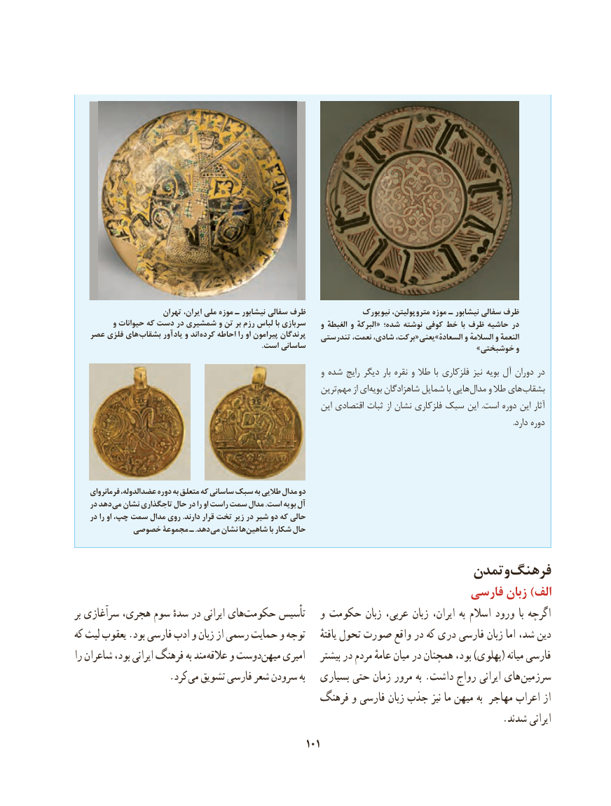

# PDF page 111

تهران ایران، ملی موزه ـ نیشابور سفالی ظرف              نیویورک متروپولیتن، موزه ـ نیشابور سفالی ظرف
          و حیوانات که دست در شمشیری و تن بر رزم لباس با سربازی  والغبطه والبرکه « شده؛ نوشته کوفی خط با ظرف حاشیه در
   عصر فلزی های بشقاب یادآور و اند کرده احاطه را او پیرامون پرندگان   تندرستی نعمت، شادی، برکت، «یعنیț»السعاده والسالمه والنعمه                                                                                                  .است ساسانی                                           »خوشبختی و
                                                                  و شده رایج دیگر بار نقره و طال با فلزکاری نیز بویه آل دوران در
                                                            ترین مهم از ای بویه شاهزادگان شمایل با هایی مدال و طال های بشقاب
                                                                  این اقتصادی ثبات از نشان فلزکاری سبک این  .است دوره این آثار
                                                                                                                                                                                                                                        .دارد دوره

    فرمانروای عضدالدوله، دوره به متعلق که ساسانی سبک به طالیی مدال دو
    در دهد می نشان تاجگذاری حال در را او راست سمت مدال .است بویه آل
    در را او چپ، سمت مدال روی .دارند قرار تخت زیر در شیر دو که حالی
          خصوصی مجموعة ـ .دهد می نشان ها شاهین با شکار حال

                                                    تمدنوفرهنگ
                                                            فارسی زبان )الف
بر سرآغازی هجری، سوم سدهٔ در ایرانی هایحکومت‌      تأسیس   و حکومت زبان عربی، زبان ایران، به اسالم ورود  با اگرچه
که لیث یعقوب .بود فارسی ادب و زبان از رسمی حمایت و توجه     یافتهٔ تحول صورت واقع در که دری فارسی زبان اما شد، دین
را شاعران بود، ایرانی فرهنگ به مند عالقه و دوستمیهن‌    امیری    بیشتر در مردم عامهٔ میان در همچنان بود، )پهلوی( میانه فارسی
         . کرد می تشویق فارسی شعر سرودن به   بسیاری حتی زمان مرور به .داشت رواج ایرانی های  سرزمین
                                           فرهنگ و فارسی زبان جذب نیز ما میهن به مهاجر اعراب از
                                                                                       .شدند ایرانی
                                                101

