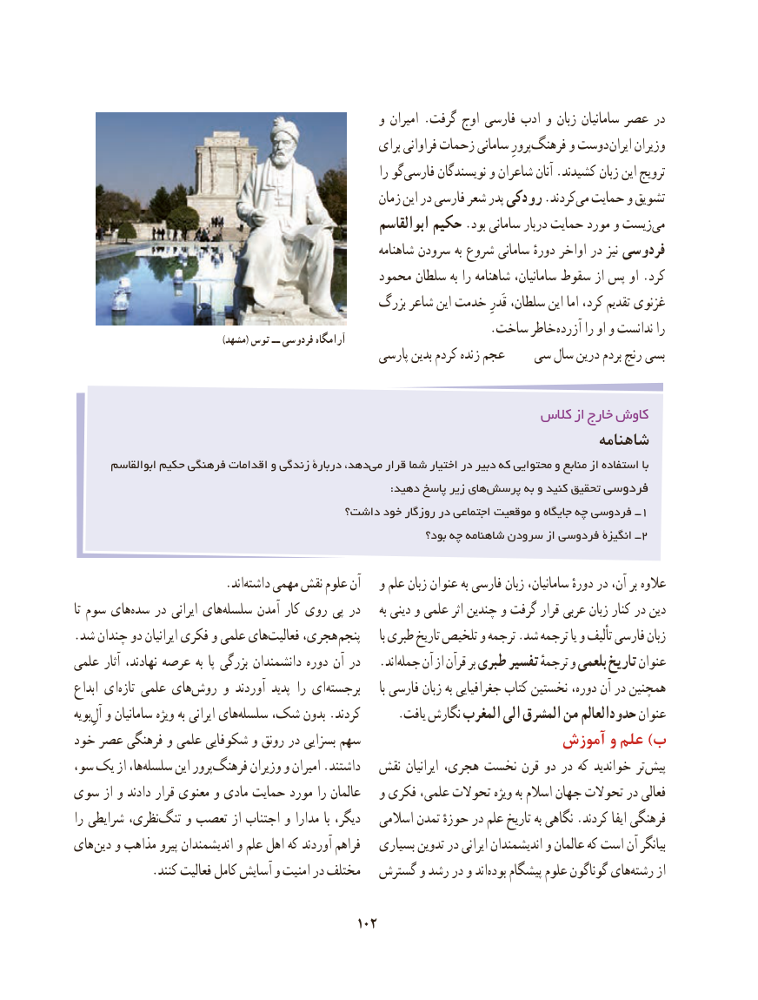

# PDF page 112

و امیران .گرفت اوج فارسی ادب و زبان سامانیان عصر در
                                                        برای فراوانی زحمات سامانی پرورِفرهنگ‌      و دوست ایران وزیران
                                                               را گوفارسی‌      نویسندگان و شاعران آنان .کشیدند زبان این ترویج
                                                        زمان این در فارسی شعر پدر رودکی .کردندمی‌  حمایت و تشویق
                                                       ابوالقاسم حکیم .بود سامانی دربار حمایت مورد و زیستمی‌
                                                             شاهنامه سرودن به شروع سامانی دورهٔ اواخر در نیز فردوسی
                                              محمود سلطان به را شاهنامه سامانیان، سقوط از پس او .کرد
                                             بزرگ شاعر این خدمت قَدرِ سلطان، این اما کرد، تقدیم غزنوی
            . ساخت خاطر آزرده را او و ندانست را                                                  )مشهد( توس ــ فردوسی آرامگاه
                                                   پارسی بدین کردم زنده عجم   سی سال درین بردم رنج بسی

                                                            کالس از خارج کاوش
                                                                        شاهنامه
       ابوالقاسم حکیم فرهنگی اقدامات و زندگی دربارۀ دهد،می‌   قرار شما اختیار در دبیر که محتوایی و منابع از استفاده با
      :‌دهید پاسخ زیر های پرسش به و کنید تحقیق فردوسی
                                      داشت؟ خود روزگار در اجتماعی موقعیت و جایگاه چه فردوسی ــ 1
                                                                   بود؟ چه شاهنامه سرودن از فردوسی انگیزۀ ــ 2

              .‌اندداشته مهمی نقش علوم آن   و علم زبان عنوان به فارسی زبان سامانیان، دورهٔ در آن، بر عالوه
تا سوم هایسده‌   در ایرانی هایسلسله‌      آمدن کار روی پی در     به دینی و علمی اثر چندین و گرفت قرار عربی زبان کنار در دین
.شد چندان دو ایرانیان فکری و علمی هایفعالیت‌    هجری، پنجم      با طبری تاریخ تلخیص و ترجمه .شد ترجمه یا و تألیف فارسی زبان
علمی آثار نهادند، عرصه به پا بزرگی دانشمندان دوره آن در   .اندجمله‌    آن از قرآن بر طبری تفسیر ترجمهٔ و بلعمی تاریخ عنوان
ابداع ایتازه‌   علمی هایروش‌     و آوردند پدید را ایبرجسته‌                با فارسی زبان به جغرافیایی کتاب نخستین دوره، آن در همچنین
بویهآل‌ِهایو سامانیان ویژه به ایرانی    سلسله‌   شک، بدون .کردند      .یافت نگارش المغرب الی المشرق من حدودالعالم عنوان
خود عصر فرهنگی و علمی شکوفایی و رونق در بسزایی سهم                       آموزش و علم )ب
سو، یک از ها،سلسله‌      این پرورفرهنگ‌       وزیران و امیران .داشتند   نقش ایرانیان هجری، نخست قرن دو در که خواندید تر پیش
سوی از و دادند قرار معنوی و مادی حمایت مورد را عالمان   و فکری علمی، تحوالت ویژه به اسالم جهان تحوالت در فعالی
را شرایطی نظری،تنگ‌    و تعصب از اجتناب و مدارا با دیگر،   اسالمی تمدن حوزهٔ در علم تاریخ به نگاهی .کردند ایفا فرهنگی
های دین و مذاهب پیرو اندیشمندان و علم اهل که آوردند فراهم   بسیاری تدوین در ایرانی اندیشمندان و عالمان که است آن بیانگر
             .کنند فعالیت کامل آسایش و امنیت در مختلف  گسترش و رشد در و اندبوده‌   پیشگام علوم گوناگون هایرشته‌     از

                                          102

