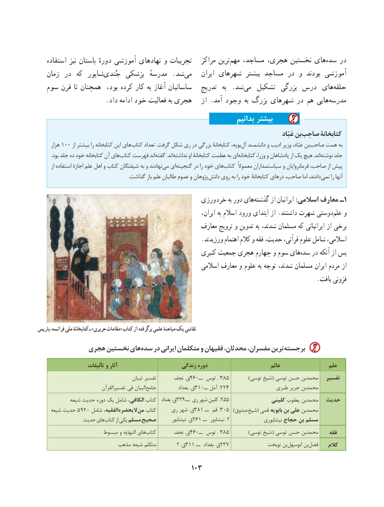

# PDF page 113

استفاده نیز باستان دورهٔ آموزشی نهادهای و تجربیات   مراکز ترینمهم‌   مساجد، هجری، نخستین هایسده‌    در
   زمان  در  که  شاپورجُندی‌     پزشکی  مدرسهٔ .شد‌می    ایران شهرهای  بیشتر مساجد در و  بودند آموزشی
  سوم قرن تا همچنان  بود، کرده کار به آغاز ساسانیان   تدریج  به  .شدمی‌   تشکیل  بزرگی درس هایحلقه‌
                    .داد ادامه خود فعالیت به هجری   از .آمد وجود به بزرگ شهرهای در هم هاییمدرسه‌
                                                                   بدانیم بیشتر
                                                                                                                            عَبّاد بنصاحِب‌      کتابخانۀ
      هزار 100 از بیشتر را کتابخانه این هایکتاب‌     تعداد .گرفت شکل ری در بزرگی کتابخانۀ بویه،آل‌ِبندانشمند و ادیب وزیر عَبّاد،  صاحب‌    همت به
           .بود جلد ده خود کتابخانه آن هایکتاب‌   فهرست اندگفته‌        .اندنداشته‌        او کتابخانۀ عظمت به ایکتابخانه‌         وزرا، و پادشاهان از یک‌هیچ .اندنوشته‌    جلد
        از استفاده اجازۀ علم اهل و کتاب شیفتگان به و نهادندمی‌  ایگنجینه‌      در را خود هایکتاب‌      معموالً سیاستمداران و فرمانروایان صاحب، از پیش
  .‌گذاشت باز علم طالبان عموم و پژوهاندانش روی به را خود کتابخانۀ درهای صاحب، اما دادند،نمی‌     را آنها

                                             ورزی خرد به دور هایگذشته‌      از ایرانیان :اسالمی معارف ـ1
       ،دوستیایران به اسالم ورود ابتدای از .داشتند شهرت       علم‌   و
                                                    معارف ترویج و تدوین به شدند، مسلمان که ایرانیانی از برخی
                                                     .ورزیدند اهتمام کالم و فقه حدیث، قرآنی، علوم شامل اسالمی،
                                                       کثیری جمعیت هجری چهارم و سوم های‌سده در آنکه از پس
                                                        اسالمی معارف و علوم به توجه شدند، مسلمان ایران مردم از
                                                                                           .یافت فزونی

پاریس ،نقاشیفرانسه ملی کتابخانۀ ـ »حریری مقامات« کتاب از برگرفته علمی مباحثۀ یک
            هجری نخستین هایسده‌    در ایرانی متکلمان و فقیهان محدثان، مفسران، ترینبرجسته‌
                     تألیفات و آثار                      زندگی دوره                          عالم                 علم
                                            تبیان تفسیر      نجف .ق460ــ توس . 385          )توسی شیخ( توسی حسن محمدبن   تفسیر
                             تفسیرالقرآن فی البیان‌جامع           بغداد .ق310.ــ آمل 224                طبری جریر محمدبن
            شیعه حدیث دوره یک شامل الکافی، کتاب   بغداد .ق329 ــ ری شهر کلین . 255               کلینی یعقوب محمدبن  حدیث
     شیعه حدیث 5920 شامل الفقیه،‌الیحضرهمن‌   کتاب     ری شهر .ق 381 ــ قم . 305 ) صدوق شیخ( قمی بابویه بن علی محمدبن
              حدیث های کتاب از یکی مسلم صحیح        نیشابور .ق261 ــ  نیشابور .؟               نیشابوری حجاج بن مسلم
                      مبسوط و النهایه های‌کتاب      نجف .ق460ــ توس . 385          )توسی شیخ( توسی حسن محمدبن    فقه
                         مذهب شیعه متکلم         ؟ .ق311 ــ  بغداد .ق237               نوبخت بنابوسهل‌      بن‌فضل    کالم

                                           103

