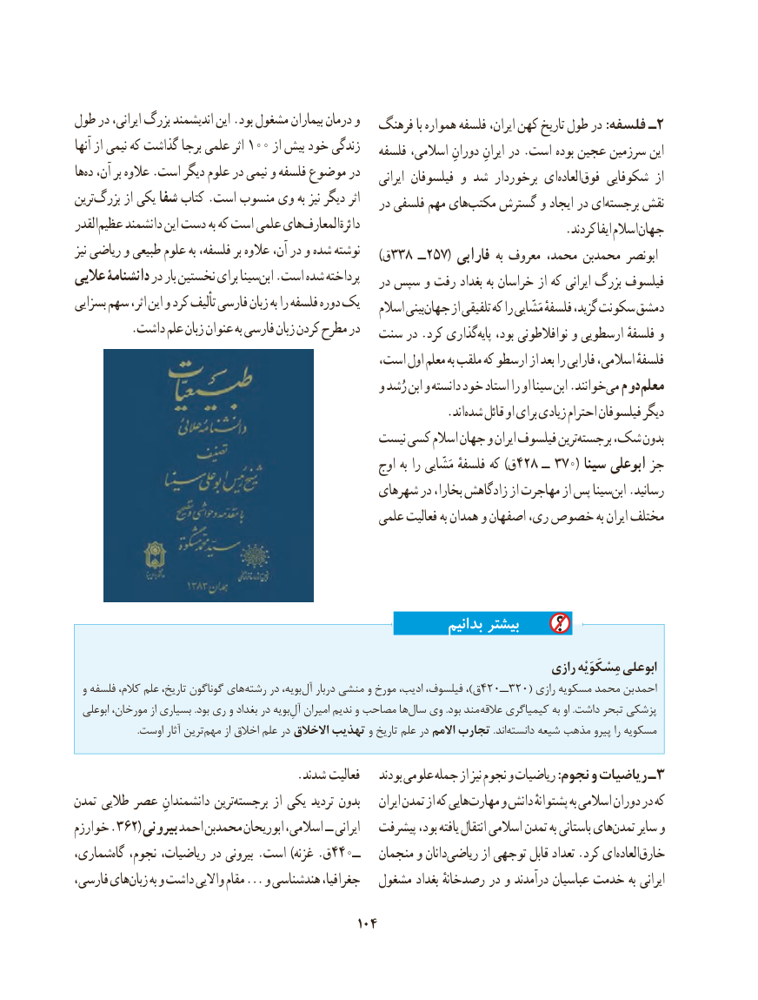

# PDF page 114

طول در ایرانی، بزرگ اندیشمند این .بود مشغول بیماران درمان و                                            فرهنگ با همواره فلسفه ایران، کهن تاریخ طول در :فلسفه ـ2
آنها از نیمی که گذاشت برجا علمی اثر 100 از بیش خود زندگی                                                       فلسفه اسالمی، دورانِ ایرانِ در .است بوده عجین سرزمین این
هاده‌  آن، بر عالوه .است دیگر علوم در نیمی و فلسفه موضوع در                                                                        ایرانی فیلسوفان و شد برخوردار ایالعاده‌   فوق‌    شکوفایی از
ترینبزرگ‌      از یکی شفا کتاب .است منسوب وی به نیز دیگر اثر                                                     در فلسفی مهم هایمکتب‌    گسترش و ایجاد در ایبرجسته‌     نقش
القدر عظیم دانشمند این دست به که است علمی هایالمعارف‌        دائرة‌             . کردند ایفا اسالمجهان
نیز ریاضی و طبیعی علوم به فلسفه، بر عالوه آن، در و شده نوشته                                                                         )ق 338 ــ257( فارابی به معروف محمد، محمدبن ابونصر
عالیی دانشنامۀ در بار نخستین برای سیناابن‌  .است شده پرداخته                                                     در سپس و رفت بغداد به خراسان از که ایرانی بزرگ فیلسوف
بسزایی سهم اثر، این و کرد تألیف فارسی زبان به را فلسفه دوره یک                                                           اسالم بینیجهان‌     از تلفیقی که را مَشّایی فلسفهٔ گزید، سکونت دمشق
         .داشت علم زبان عنوان به فارسی زبان کردن مطرح در                                       سنت در .کرد گذاریپایه‌   بود، نوافالطونی و ارسطویی فلسفهٔ و
                                             است، اول معلم به ملقب که ارسطو از بعد را فارابی اسالمی، فلسفهٔ
                                                  و رُشد ابن و دانسته خود استاد را او سینا ابن .خوانندمی‌  دوم معلم
                                   .‌اندشده قائل او برای زیادی احترام فیلسوفان دیگر
                                             نیست کسی اسالم جهان و ایران فیلسوف ترینبرجسته‌   شک، بدون
                                                      اوج به را مَشّایی فلسفهٔ که )ق428 ــ 370( سینا ابوعلی جز
                                              شهرهای در بخارا، زادگاهش از مهاجرت از پس سیناابن‌  .رسانید
                                                 علمی فعالیت به همدان و اصفهان ری، خصوص به ایران مختلف

                                                                بدانیم بیشتر
                                                                              رازی مِسْکَوَیْه ابوعلی
  و فلسفه کالم، علم تاریخ، گوناگون هایرشته‌    در بویه،آل۴۲۰ــ۳۲۰‌   دربار منشی و مورخ ادیب، فیلسوف، ،)ق            ( رازی مسکویه محمد بن احمد
  ابوعلی مورخان، از بسیاری .بود ری و بغداد در بویهآل‌ِهاامیران ندیم و مصاحب  سال‌   وی .بود مند عالقه کیمیاگری به او .داشت تبحر پزشکی
  .‌اوست آثار ترینمهم از اخالق علم در االخالق تهذیب و تاریخ علم در االمم تجارب .انددانسته‌     شیعه مذهب پیرو را مسکویه

                                     .شدند  فعالیت    بودند علومی جمله از نیز نجوم و ریاضیات :نجوم و ریاضیات ـ3
تمدن طالیی عصر دانشمندانِ ترینبرجسته‌        از یکی تردید بدون    ایران تمدن از که هاییمهارت‌     و دانش‌     پشتوانهٔ به اسالمی دوران در که
خوارزم .362( بیرونی احمد محمدبن ابوریحان اسالمی،  ــ  ایرانی   پیشرفت بود، یافته انتقال اسالمی تمدن به باستانی هایتمدن‌    سایر و
شماری،گاه‌  نجوم، ریاضیات، در بیرونی .است )غزنه .ق440ــ   منجمان و دانانریاضی‌       از توجهی قابل تعداد .کرد ایالعاده‌   خارق‌
فارسی، هایزبان‌    به و داشت واالیی مقام ... و هندشناسی جغرافیا،   مشغول بغداد رصدخانهٔ در و درآمدند عباسیان خدمت به ایرانی

                                          104

