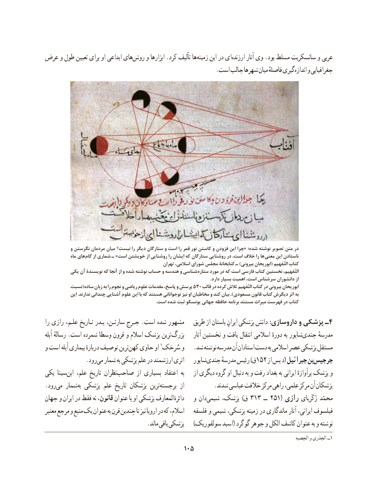

# PDF page 115

عرض و طول تعیین برای او ابداعی هایروش‌    و ابزارها .کرد تألیف ها زمینه این در ایارزنده‌       آثار وی .بود مسلط سانسکریت و عربی
    .‌است جالب شهرها میان فاصلهٔ گیریاندازه و جغرافیایی

            و نگرستن مردمان میان نیست؟ را دیگر ستارگان و است را قمر نور کاستن و فزودن این چرا« شده؛ نوشته تصویر متن در
             ماه های گام از شماری ـ »است خویشتن از روشنایی را ایشان که ستارگان روشنایی در است، خالف را ها معنی این ناستادن
                                                     تهران اسالمی، شورای مجلس کتابخانۀ ـ )بیرونی ابوریحان( التّفهیم کتاب
         یکی آن نویسندۀ که آنجا از و شده نوشته حساب و هندسه و شناسی ستاره مورد در که است فارسی کتاب نخستین التّفهیم،
                                                                                                                                                .دارد بسیار اهمیت است، سرشناس دانشوران از
         نسبت( ساده۵۳۰زبان به را نجوم و ریاضی علوم مقدمات پاسخ، و پرسش    قالب در کرده تالش التّفهیم کتاب در بیرونی ابوریحان
            این .ندارند چندانی آشنایی علوم این با که هستند نوجوانانی نیز او مخاطبان و کند بیان ،)مسعودی قانون کتاب دیگرش اثر به
                                                                                                 .است شده ثبت یونسکو جهانی حافظه برنامه مستند میراث فهرست در کتاب

را رازی علـم، تـاریخ پـدر سارتـن، جـرج .است شده مشهور   طریق از باستان ایرانِ پزشکی دانش :داروسازی و پزشکی ـ4
آبله رسالهٔ .است شمرده وسطا قرون و اسالم پزشک ترین بزرگ     آثار نخستین و یافت انتقال اسالمی دورهٔ به شاپورجندی‌      مدرسهٔ
و است آبله بیماری دربارهٔ توصیف ترینکهن١و‌   حاوی او سُرخک    .شد نوشته مدرسه آن استادان دست به اسالمی عصر پزشکی مستقل
      .‌رودمی شمار به پزشکی علم در ارزشمند اثری   شاپورجندی‌     مدرسهٔ رئیس )ق152 از پس د( جبرائیل بنجرجیس‌
یکی سیناابن‌   علم، تاریخ نظرانصاحب‌        از بسیاری اعتقاد  به    از دیگری گروه او دنبال به و رفت بغداد به ایرانی پرآوازهٔ پزشک و
.رودمی‌   شمار به پزشکی علم تاریخ پزشکان ترین برجسته از          .شدند عباسی خالفت مرکز راهی علمی، مرکز آن پزشکان
جهان و ایران در فقط نه قانون، عنوان با او پزشکی المعارفدائرة‌      و دانشیمی۳۱۳‌    پزشک، )ق     ــ۲۵۱( رازی زَکَریای محمّد
معتبر مرجع و منبع یک عنوان به قرن چندین تا نیز اروپا در که اسالم،   فلسفه و شیمی پزشکی، زمینه در ماندگاری آثار ایرانی، فیلسوف
                                  .ماند باقی پزشکی    )سولفوریک اسید( گوگرد جوهر و الکل کاشف عنوان به و نوشته
                                                      الحِصبه١و الجدَری ــ
                                         105

