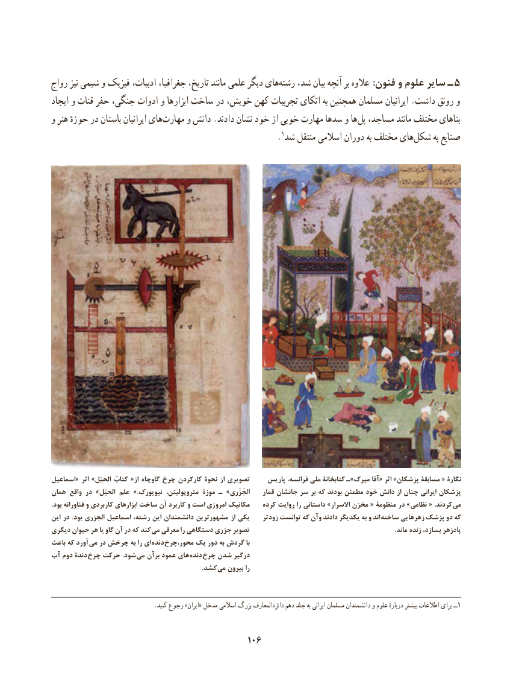

# PDF page 116

رواج نیز شیمی و فیزیک ادبیات، جغرافیا، تاریخ، مانند علمی دیگر هایرشته‌    شد، بیان آنچه بر عالوه :فنون و علوم سایر ـ 5
ایجاد و قنات حفر جنگی، ادوات و ابزارها ساخت در خویش، کهن تجربیات اتکای به همچنین مسلمان ایرانیان .داشت رونق و
و هنر حوزهٔ در باستان ایرانیان های ‌مهارت و دانش .دادند نشان خود از خوبی مهارت سدها و هاپل‌  مساجد، مانند مختلف بناهای
                                                              .1شد منتقل اسالمی دوران به مختلف هایشکل‌       به صنایع

اسماعیل« اثر »الحیَل کتابُ «از گاوچاه چرخ کارکردن نحوة از تصویری     پاریس فرانسه، ملی کتابخانة ـ»میرک آقا« اثر »پزشکان مسابقة « نگارة
همان واقع در »الحیَل علم  .«نیویورک متروپولیتن، موزة ـ »الجَزَری    قمار جانشان سر بر که بودند مطمئن خود دانش از چنان ایرانی پزشکان
.بود فناورانه و کاربردی ابزارهای ساخت آن کاربرد و است امروزی مکانیک    کرده روایت را داستانی »االسرار مخزن « منظومة در »نظامی « .کردند  می
این در .بود الجزری اسماعیل رشته، این دانشمندان مشهورترین از یکی    زودتر توانست که وآن دادند یکدیگر به و اند  ساخته زهرهایی پزشک دو که
دیگری حیوان هر یا گاو آن در که کند می معرفی را دستگاهی جزری تصویر                                                                                         .ماند زنده بسازد، پادزهر
باعث که آورد  می در چرخش به را ای  دنده محور،چرخ یک دور به گردش با
آب دوم دندة چرخ حرکت .شود می برآن عمود های  دنده چرخ شدن درگیر
                  . کشد می بیرون را

  . کنید رجوع »ایران« مدخل اسالمی بزرگ المعارف دائرة دهم جلد به ایرانی مسلمان دانشمندان و علوم دربارهٔ بیشتر اطالعات برای ــ1

                                          106

