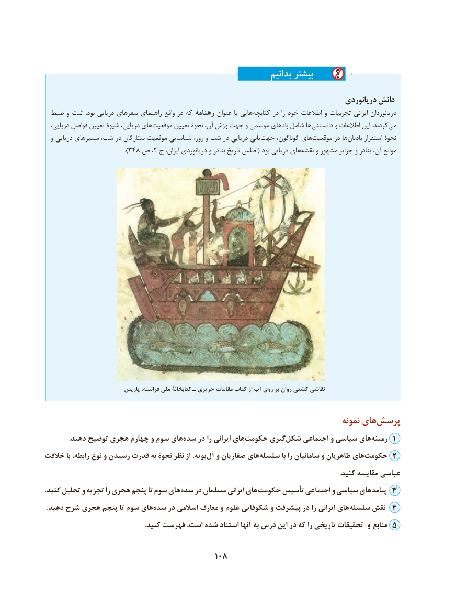

# PDF page 118

بدانیم بیشتر
                                                                                     دریانوردی دانش
 ضبط و ثبت بود، دریایی سفرهای راهنمای واقع در که رهنامه عنوان با هایی کتابچه در را خود اطالعات و تجربیات ایرانی دریانوردان
  دریایی، فواصل تعیین شیوۀ دریایی، هایموقعیت‌      تعیین نحوۀ آن، وزش جهت و موسمی بادهای شامل ها دانستنی و اطالعات این .کردندمی‌
  و دریایی مسیرهای شب، در ستارگان موقعیت شناسایی روز، و شب در دریایی یابیجهت‌     گوناگون، هایموقعیت‌       در هابادبان‌      استقرار نحوۀ
                         ).348 ص ، 2 ج ایران، دریانوردی و بنادر تاریخ اطلس( بود دریایی هاینقشه‌    و مشهور جزایر و بنادر آن، موانع

                          پاریس فرانسه، ملی کتابخانة ـ حریری مقامات کتاب از آب روی بر روان کشتی نقاشی

                                                                                   نمونه های‌پرسش
.‌دهید توضیح هجری چهارم و سوم هایسده در را ایرانی های‌حکومت گیری‌شکل اجتماعی و سیاسی هایزمینه‌    1
خالفت با رابطه، نوع و رسیدن قدرت به نحوۀ نظر از بویه، آل و صفاریان های‌سلسله با را سامانیان و طاهریان های‌حکومت 2
                                                                                                                                                                          .کنید مقایسه عباسی
. کنید تحلیل و تجزیه را هجری پنجم تا سوم های سده در مسلمان ایرانی های حکومت تأسیس اجتماعی و سیاسی پیامدهای 3
 .دهید شرح هجری پنجم تا سوم های‌سده در اسالمی معارف و علوم شکوفایی و پیشرفت در را ایرانی های  سلسله نقش 4
                                                         .کنید فهرست است، شده استناد آنها به درس این در که را تاریخی تحقیقات و منابع 5

                                        108

