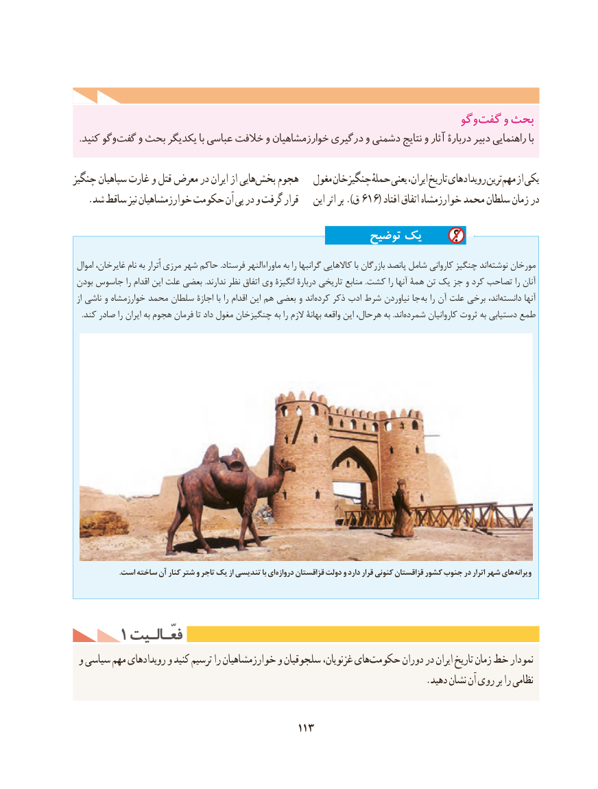

# PDF page 123

وگووگو  گفتگفت وو بحثبحث
  .کنید وگو گفت و بحث یکدیگر با عباسی خالفت و خوارزمشاهیان درگیری و دشمنی نتایج و آثار دربارۀ دبیر راهنمایی با

چنگیز سپاهیان غارت و قتل معرض در ایران از هاییبخش‌    هجوم   مغول چنگیزخان حملهٔ یعنی ایران، تاریخ رویدادهای ترین مهم از یکی
   .شد ساقط نیز خوارزمشاهیان حکومت آن پی در و گرفت قرار    این اثر بر ).ق 616( افتاد اتفاق خوارزمشاه محمد سلطان زمان در

                                               توضیح یک

 اموال غایرخان، نام به اُترار مرزی شهر حاکم .فرستاد ماوراءالنهر به را گرانبها کاالهایی با بازرگان پانصد شامل کاروانی چنگیز اندنوشته‌    مورخان
 بودن جاسوس را اقدام این علت بعضی .ندارند نظر اتفاق وی انگیزۀ دربارۀ تاریخی منابع .کشت را آنها همۀ تن یک جز و کرد تصاحب را آنان
 از ناشی و خوارزمشاه محمد سلطان اجازۀ با را اقدام این هم بعضی و اندکرده‌    ذکر ادب شرط نیاوردن جا به را آن علت برخی اند،دانسته‌        آنها
.‌کند صادر را ایران به هجوم فرمان تا داد مغول چنگیزخان به را الزم بهانۀ واقعه این هرحال، به .اندشمرده کاروانیان ثروت به دستیابی طمع

                         .است ساخته آن کنار شتر و تاجر یک از تندیسی با ای دروازه قزاقستان دولت و دارد قرار کنونی قزاقستان کشور جنوب در اترار شهر های ویرانه

     1 فعّـالـیتفعّـالـیت
 و سیاسی مهم رویدادهای و کنید ترسیم را خوارزمشاهیان و سلجوقیان غزنویان، هایحکومت‌       دوران در ایران تاریخ زمان خط نمودار
                                                                          .دهید نشان آن روی بر را نظامی

                                        113

