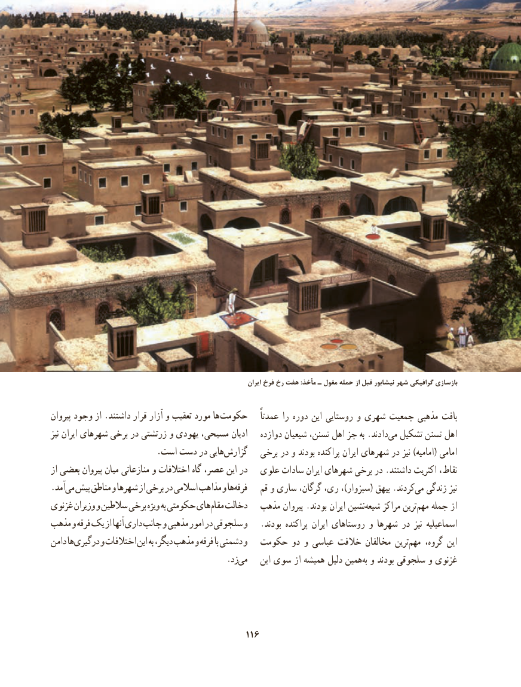

# PDF page 126

ایران فرخ رخ هفت :مأخذ ـ مغول حمله از قبل نیشابور شهر گرافیکی بازسازی

پیروان وجود از .داشتند قرار آزار و تعقیب مورد ها حکومت    عمدتاً را دوره این روستایی و شهری جمعیت مذهبی بافت
نیز ایران شهرهای برخی در زرتشتی و یهودی مسیحی، ادیان    دوازده شیعیان تسنن، اهل جز به .دادندمی‌  تشکیل تسنن اهل
   .‌است دست در هاییگزارش   برخی در و بودند پراکنده ایران شهرهای در نیز )امامیه( امامی
از بعضی پیروان میان منازعاتی و اختالفات گاه عصر، این در   علوی سادات ایران شهرهای برخی در .داشتند اکثریت نقاط،
.آمدمی‌  پیش مناطق و شهرها از برخی در اسالمی مذاهب و هافرقه‌      قم و ساری گرگان، ری، ،)سبزوار( بیهق .کردندمی‌  زندگی نیز
غزنوی وزیران و سالطین برخی ویژه به حکومتی های مقام دخالت‌       مذهب پیروان .بودند ایران نشینشیعه‌     مراکز ترینمهم‌   جمله از
مذهب و فرقه یک از آنها داری جانب و مذهبی امور در سلجوقی و   .بودند پراکنده ایران روستاهای و شهرها در نیز اسماعیلیه
دامن هادرگیری‌      و اختالفات این به دیگر، مذهب و فرقه با دشمنی‌     و  حکومت دو و عباسی خالفت مخالفان ترینمهم‌    گروه، این
                                        .زدمی‌      این سوی از همیشه دلیل همینبه‌ و بودند سلجوقی و غزنوی

                                          116

