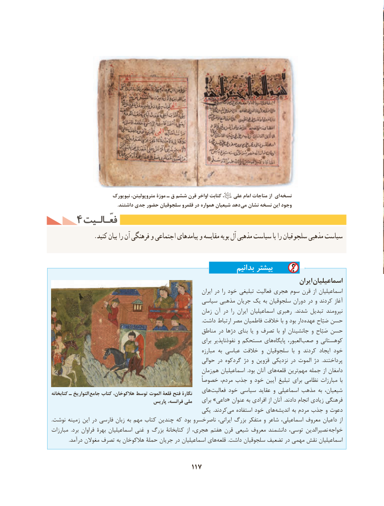

# PDF page 127

نیویورک متروپولیتن، موزة ـ ق ششم قرن اواخر کتابت ،   علی امام مناجات از ای نسخه
 . داشتند جدی حضور سلجوقیان قلمرو در همواره شیعیان دهد می نشان نسخه این وجود
    4 فعّـالـیتفعّـالـیت
              .کنید بیان را آن فرهنگی و اجتماعی پیامدهای و مقایسه بویه آل مذهبی سیاست با را سلجوقیان مذهبی سیاست

                                                               بدانیم بیشتر
                                                                                               ایران اسماعیلیان
                                                                        ایران در را خود تبلیغی فعالیت هجری سوم قرن از اسماعیلیان
                                               سیاسی مذهبی جریان یک به سلجوقیان دوران در و کردند آغاز
                                                          زمان آن در  را ایران اسماعیلیان رهبری  .شدند تبدیل نیرومند
                                                                                                                               .داشت ارتباط مصر فاطمیان خالفت با و بود دار عهده صَبّاح حسن
                                                    مناطق در دژها بنای یا و تصرف  با او جانشینان و صَبّاح حسن
                                                              برای نفوذناپذیر و مستحکم های ‌پایگاه العبور، ‌صعب و کوهستانی
                                                                     مبارزه به عباسی خالفت و سلجوقیان  با و کردند ایجاد خود
                                                         حوالی در گردکوه دژ و قزوین نزدیکی در الموت دژ  .پرداختند
                                                          زمان  هم اسماعیلیان  .بود آنان های ‌قلعه ترین ‌مهم جمله از دامغان
                                                       خصوصاً مردم، جذب و خود آیین تبلیغ برای نظامی مبارزات  با
                                                 های‌فعالیت خود سیاسی عقاید و اسماعیلی مذهب به شیعیان،کتابخانه ـ التواریخ  جامع کتاب هالکوخان، توسط الموت قلعۀ فتح نگارۀ
                                       پاریس فرانسه، ملی    برای »داعی« عنوان به افرادی از آنان  .دادند انجام زیادی فرهنگی
                                                 یکی  .کردندمی‌   استفاده خود های ‌اندیشه به مردم جذب و دعوت
.نوشت زمینه این در فارسی زبان به مهم کتاب چندین که بود ناصرخسرو ایرانی، بزرگ متفکر و شاعر اسماعیلی، معروف داعیان از
مبارزات  .برد فراوان بهرۀ اسماعیلیان غنی و بزرگ کتابخانۀ  از هجری، هفتم قرن شیعی معروف دانشمند توسی، نصیرالدین خواجه
.‌درآمد مغوالن تصرف به هالکوخان حملۀ جریان در اسماعیلیان های قلعه .داشت سلجوقیان تضعیف در مهمی نقش اسماعیلیان

                                        117

