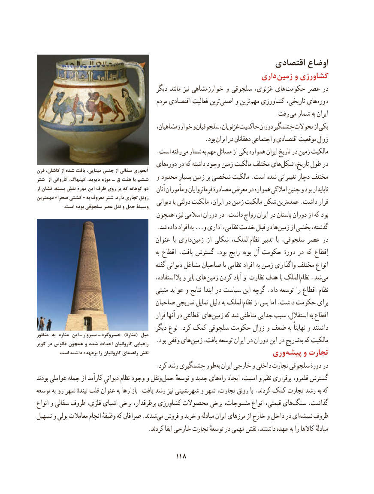

# PDF page 128

اقتصادی اوضاع
                                                           داری  زمین و کشاورزی
                                            دیگر مانند نیز خوارزمشاهی و سلجوقی غزنوی، های  حکومت عصر در
                                             مردم اقتصادی فعالیت ترین اصلی و ترین مهم کشاورزی تاریخی، های دوره
                               . رفت می شمار به ایران
                                           خوارزمشاهیان، و سلجوقیان غزنویان، حاکمیت دوران چشمگیر تحوالت از یکی
                                                        .بود ایران در دهقانان اجتماعی و اقتصادی موقعیت زوال
                                        .است رفتهمی‌  شمار به مهم مسائل از یکی همواره ایران تاریخ در زمین مالکیت
                                     هایدوره‌    در که داشته وجود زمین مالکیت مختلف هایشکل‌     تاریخ، طول درقرن کاشان، از شده یافت مینایی، جنس از سفالی آبخوری
شتر  از کاروانی .کپنهاگ دیوید، موزه ـ ق هفت یا ششم   و محدود بسیار زمین بر شخصی مالکیت .است شده تغییراتی دچار مختلف
از نشان بسته، نقش دوره این ظرف روی بر که کوهانه دو    آنان مأموران و فرمانروایان مصادرهٔ معرض در همواره امالکی چنین و بود ناپایدار
مهمترین »صحرا کشتی « به معروف شتر .دارد تجاری رونق   دیوانی یا دولتی مالکیت ایران، در زمین مالکیت شکل ترینعمده‌    .داشت قرار                       .است بوده سلجوقی عصر نقل و حمل وسیلة
                                  همچون نیز، اسالمی دوران در .داشت رواج ایران در باستان دوران از که بود
                                        .شد داده افراد به ...و اداری نظامی، خدمت قبال در هازمین‌     از بخشی گذشته،
                                          عنوان  با داری زمین از شکلی الملک،‌نظام تدبیر  با سلجوقی، عصر در
                                                                به اقطاع .یافت گسترش بود، رایج بویه آل حکومت دورهٔ در که اِقطاع
                                                 گفته دیوانی مشاغل صاحبان یا نظامی افراد به زمین واگذاری مختلف انواع
                                                    بالاستفاده، و بایر های زمین کردن آباد و نظارت هدف با الملک‌نظام .شدمی‌
                                                مثبتی عواید و نتایج ابتدا در سیاست این گرچه .داد توسعه را اقطاع نظام
                                     صاحبان تدریجی تمایل دلیل ‌به الملک‌نظام از پس اما داشت، حکومت برای
                                                 قرار آنها در اقطاعی های ‌زمین که شد مناطقی جدایی سبب استقالل، به اقطاع
                                            دیگر نوع .کرد کمک سلجوقی حکومت زوال و ضعف به نهایتاً و داشتندمنظور  به  مناره این   ـ سبزوار   ـ خسروگرد  )منارۀ( میل
کویر در فانوس همچون و شده احداث کاروانیان راهیابی .‌بود وقفی های زمین یافت، توسعه ایران در دوران این در تدریج به‌ که مالکیت
                   .است داشته برعهده را کاروانیان راهنمای نقش                                                        وری پیشه و تجارت
                                        .کرد رشد چشمگیری طور به ایران خارجی و داخلی تجارت سلجوقی دورهٔ در
بودند عواملی جمله از کارآمد دیوانیِ نظام وجود و ونقل حمل توسعهٔ و جدید های راه ایجاد امنیت، و نظم برقراری  ،گسترشقلمرو
توسعه ‌ به رو شهر تپندهٔ قلب عنوان به بازارها .یافت رشد نیز شهرنشینی و شهر تجارت، رونق با .کردند کمک تجارت رشد به که
انواع و سفالی ظروف فلزی، اشیای برخی پرطرفدار، کشاورزی محصوالت برخی منسوجات، انواع قیمتی، هایسنگ‌     .گذاشت
تسهیل و پولی معامالت انجام وظیفهٔ که صرافان .شدندمی‌  فروش و خرید و مبادله ایران مرزهای از خارج و داخل در ایشیشه‌   ظروف
                                     .کردند ایفا خارجی تجارت توسعهٔ در مهمی نقش داشتند، عهده به را کاالها مبادلهٔ

                                        118

