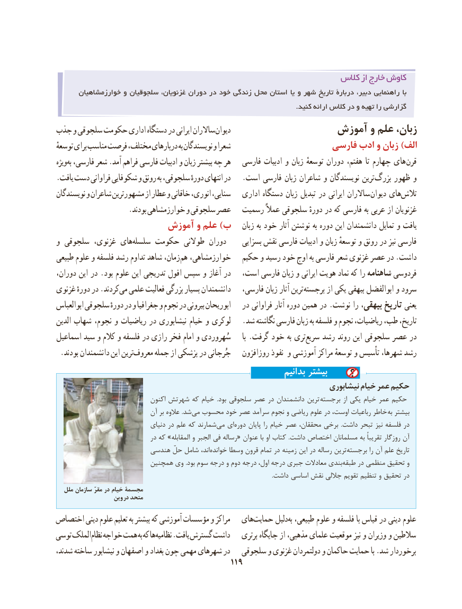

# PDF page 129

کالس از خارج کاوش
       خوارزمشاهیان و سلجوقیان غزنویان، دوران در خود زندگی محل استان یا و شهر تاریخ دربارۀ دبیر، راهنمایی با
                                                                                                              .کنید ارائه کالس در و تهیه را گزارشی
جذب و سلجوقی حکومت اداری دستگاه در ایرانی ساالران دیوان                 آموزش و علم زبان،
توسعهٔ برای مناسب فرصت مختلف، دربارهای به نویسندگان و شعرا                    فارسی ادب و زبان )الف
ویژهبه‌ فارسی، شعر .آمد فراهم فارسی ادبیات و زبان بیشتر چه هر   فارسی ادبیات و زبان توسعهٔ دوران هفتم، تا چهارم های قرن
.یافت دست فراوانی شکوفایی و رونق به سلجوقی، دورهٔ انتهای در   .است فارسی زبان شاعران و نویسندگان ترین بزرگ ظهور و
نویسندگان و شاعران مشهورترین از عطار و خاقانی انوری، سنایی،   اداری دستگاه زبان تبدیل در ایرانی ساالران دیوان هایتالش‌
                    .بودند خوارزمشاهی و سلجوقی عصر   رسمیت عمالً سلجوقی دورهٔ در که فارسی به عربی از غزنویان
                     آموزش و علم )ب    زبان به خود آثار نوشتن به دوره این دانشمندان تمایل و یافت
و سلجوقی غزنوی، هایسلسله‌    حکومت طوالنی دوران     بسزایی نقش فارسی ادبیات و زبان توسعهٔ و رونق در نیز فارسی
طبیعی علوم و فلسفه رشد تداوم شاهد زمان، هم خوارزمشاهی،   حکیم و رسید خود اوج به فارسی شعر غزنوی عصر در .داشت
دوران، این در .بود علوم این تدریجی افول سپس و آغاز در   است، فارسی زبان و ایرانی هویت نماد که را شاهنامه فردوسی
غزنوی دورهٔ در .کردندمی‌  علمی فعالیت بزرگی بسیار دانشمندان   فارسی، زبان آثار ترین برجسته از یکی بیهقی ابوالفضل و سرود
ابوالعباس سلجوقی دورهٔ در و جغرافیا و نجوم در بیرونی ابوریحان   در فراوانی آثار دوره همین در .نوشت را بیهقی، تاریخ یعنی
الدین شهاب نجوم، و ریاضیات در نیشابوری خیام و لوکری   .شد نگاشته فارسی زبان به فلسفه و نجوم ریاضیات، طب، تاریخ،
اسماعیل سید و کالم و فلسفه در رازی فخر امام و سُهروردی      با .گرفت خود به تریسریع‌   رشد روند این سلجوقی عصر در
.‌بودند دانشمندان این ترینمعروف جمله از پزشکی در جُرجانی   روزافزون نفوذ و آموزشی مراکز توسعهٔ و تأسیس شهرها، رشد
                                                                بدانیم بیشتر
                                                                         نیشابوری خیام عمر حکیم
                               اکنون شهرتش که خیام  .بود سلجوقی عصر در دانشمندان ترین برجسته از یکی خیام عمر حکیم
                           آن بر عالوه .شد ‌می محسوب خود عصر سرآمد نجوم و ریاضی علوم در اوست، رباعیات خاطر به بیشتر
                               دنیای در علم که شمارند‌می ای‌دوره پایان را خیام عصر محققان، برخی  .داشت تبحر نیز فلسفه در
                               در که »المقابله و الجبر فی رساله« عنوان با او کتاب  .داشت اختصاص مسلمانان به تقریباً روزگار آن
                       هندسی حلّ شامل اند، ‌خوانده وسطا قرون تمام در زمینه این در رساله ترین‌برجسته را آن علم تاریخ
                         همچنین وی .بود سوم درجه و دوم درجه اول، درجه جبری معادالت بندی‌طبقه در منظمی تحقیق و
                                                                                                                                                       .داشت اساسی نقش جاللی تقویم تنظیم و تحقیق در
   ملل سازمان مقرّ در خیام مجسمۀ
                   وین در متحد
اختصاص دینی علوم تعلیم به بیشتر که آموزشی مؤسسات و مراکز   هایحمایت‌      دلیلبه‌ طبیعی، علوم و فلسفه با قیاس در دینی علوم
توسی الملکنظام‌  خواجه همت به که هانظامیه‌    .یافت گسترش داشت    برتری جایگاه از مذهبی، علمای موقعیت نیز و وزیران و سالطین
شدند، ساخته نیشابور و اصفهان و بغداد چون مهمی شهرهای در   سلجوقی و غزنوی دولتمردان و حاکمان حمایت با .شد برخوردار
                                           119

